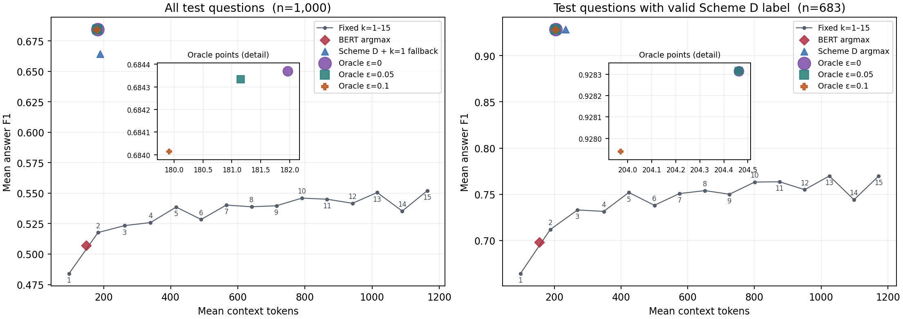
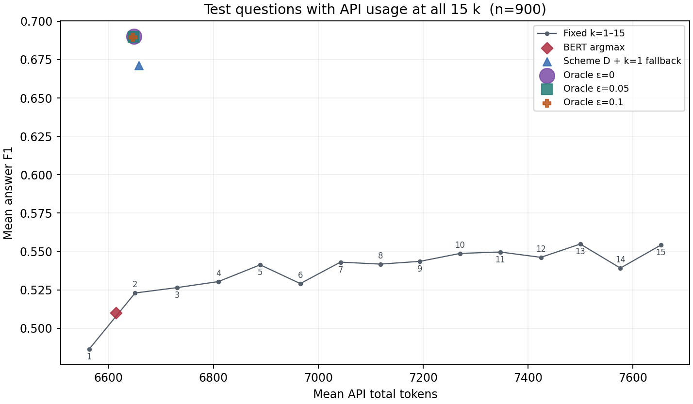
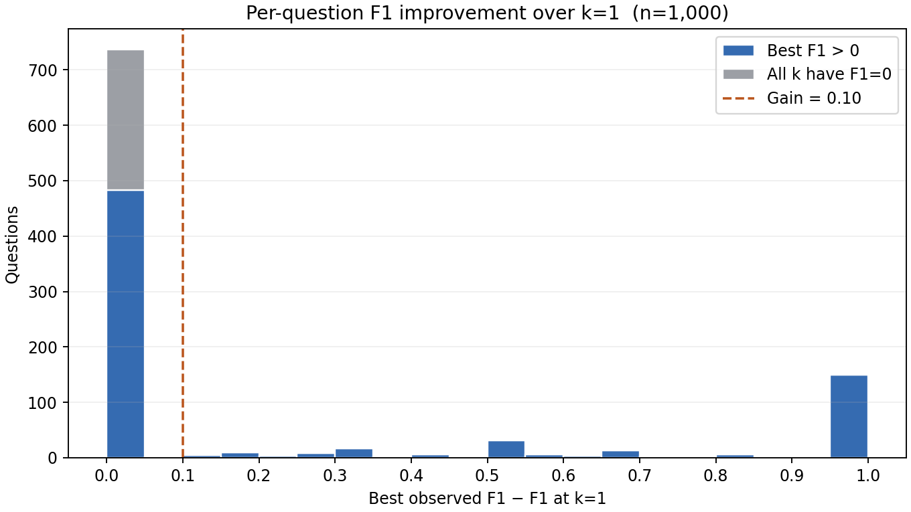
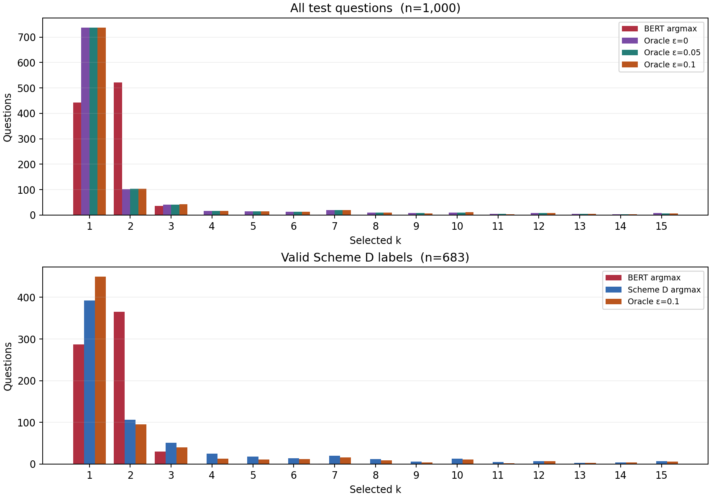
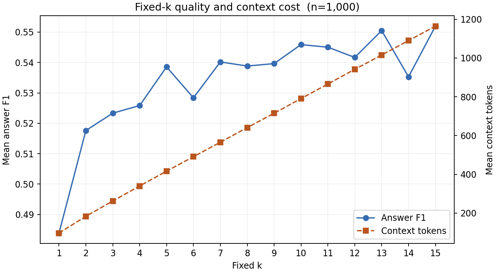
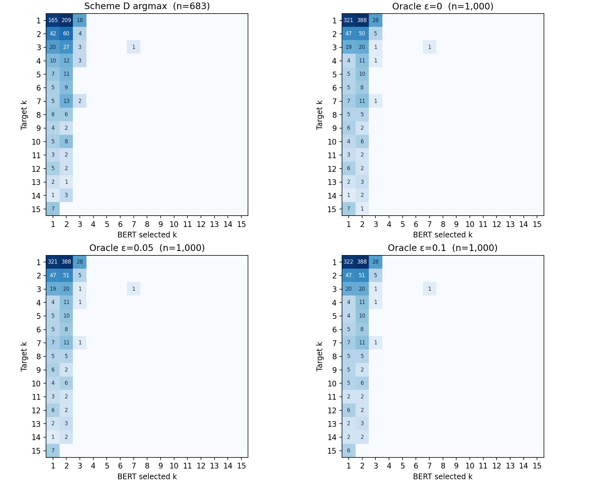

# HotpotQA Dynamic Top-K RAG 离线诊断

测试集共 1,000 题。**262（26.2%） 在允许 F1 损失 0.10 时仍需要提高 k**，**483（48.3%） 在 k=1 已取得正的最佳 F1**，另有 **254（25.4%） 在所有 k 下 F1 为零**。质量约束 Oracle（ε=0.10）达到 **F1 0.68401 / 179.92 Context Token**，BERT 为 **0.50712 / 148.76**。当前最直接的性能差距出现在选 k 策略的逐题分配上，证据门槛和现有 RAG 的全零题构成另外两处可量化的限制。

## 1. 当前实验配置与数据说明

诊断采用已完成的 HotpotQA Train5000 + BERT。原实验从官方 Train 的预处理样本中去除 15 个 Few-shot ID，以种子 42 无放回抽取 5,000 题。单轮 BM25 请求 k=1–15，Reader 使用实际保存的检索段落，Qwen2.5-7B-Instruct 使用固定 15-shot Prompt、temperature=0。过滤和裁剪后实际段数可能小于请求 k。原研究笔记记录的是较早的 Dev 分层实验，本文使用本地正式 Train5000 产物。 [RAG 实验说明](../../experiments/hotpotqa_train_5000/README.md) · [BERT 实验说明](../../experiments/hotpotqa_train_5000_bert/README.md)

数据按 `random.Random(42).shuffle` 对全部 ID 洗牌，按 70/10/20 划分，划分与标签无关。测试是官方 Train 内部的保留集。BERT 输入仅为 Question，使用 `bert-base-uncased` 全参数微调和 15 类分类头（AdamW、学习率 2e-5、batch 16、最长 128 tokens）。训练 5 个 epoch，按验证集 Soft CE 选中第 2 轮。 [配置](../../experiments/hotpotqa_train_5000_bert/config/experiment.json) · [划分 ID](../../experiments/hotpotqa_train_5000_bert/data/splits.json)

| 划分 | 总计 | 有效标签 | 全零 F1 | 证据/质量联合候选为空 |
| --- | --- | --- | --- | --- |
| train | 3500 | 2516 | 764 | 220 |
| validation | 500 | 344 | 119 | 37 |
| test | 1000 | 683 | 254 | 63 |

- 逐题 F1 是保存的生成答案相对于 HotpotQA 金标准的官方 Answer F1，保留 yes/no/noanswer 的特殊规则。 `curves.jsonl` 每题一行，按 k 记录 F1、Context Token、句证据召回和生成答案。 [曲线](../../experiments/hotpotqa_train_5000_bert/data/curves.jsonl) · [评分实现](../../experiments/hotpotqa_train_5000_bert/src/metrics.py)
- Context Token 是 Qwen tokenizer 对实际 `effective_context_text` 的计数。API Prompt、Completion、Total Token 取自原始 `contexts.jsonl` 中保存的 API Usage，包含对应调用范围的开销。 [原始运行](../../experiments/hotpotqa_train_5000/runs/predictions/hotpotqa_train_5000_seed42/)
- 原标签含候选掩码、15 维概率和 Argmax。BERT 文件有 500 个验证集和 1,000 个测试集概率向量及预测 k， 另有测试决策和既有评测。 [标签](../../experiments/hotpotqa_train_5000_bert/data/labels.jsonl) · [BERT 概率](../../experiments/hotpotqa_train_5000_bert/data/bert_predictions.jsonl) · [测试决策](../../experiments/hotpotqa_train_5000_bert/data/test_decisions.jsonl) · [原评测](../../experiments/hotpotqa_train_5000_bert/reports/evaluation.json)

实际标签为 Scheme D。对每题以全部 15 个 k 的最大 Context Token 归一化成本，即 `c_i(k) = C_i(k) / max_j C_i(j)`。候选需同时满足 `F1_i(k) ≥ max_j F1_i(j) − 0.10` 及 `句证据召回下界 ≥ 0.50`。句证据下界使用确认匹配的原标注支持句数除以原标注支持句总数，两处越界索引按 unknown 保留原分母。在候选内取 `U_i(k) = F1_i(k) − 0.10 × c_i(k)`，再用 `softmax(U_i / 0.10)` 分配概率，候选外概率为零。效用平手选较小 k，全零 F1 或候选为空时概率与 Argmax 均为空。仅有效标签参与训练。实现记录 Soft CE，即 `−Σ p log q`；相对于固定标签分布，优化它与优化 `KL(p||q)` 等价，两者相差标签熵。 [标签实现](../../experiments/hotpotqa_train_5000_bert/src/soft_oracle.py) · [训练实现](../../experiments/hotpotqa_train_5000_bert/src/train.py)

以 `question_id` 连接划分、曲线、标签、输入、BERT 概率和决策，原始 RAG 以 `qid` 对应同一值。核验各划分互斥、每个测试 ID 在每个 k 恰好出现一次、问题文本和预测答案一致，校验冻结输入与原始上下文指纹、标签公式及历史评测汇总。所有 Context Token 主对比均在注明的统一集合上完成。 [逐题核验](test_audit.jsonl) · [汇总和指纹](summary.json)

## 2. 固定 k、当前软标签、BERT、质量约束 Oracle 的性能对比

质量 Oracle 对每题在 `F1_i(k) ≥ F1_i^max − ε` 的候选中最小化实际 Context Token，等成本时取最小 k，F1 边界误差容许 1e-12。ε=0 给出保存曲线可达到的最高平均 F1。所有质量 Oracle 和 Scheme D Argmax 都依赖真实答案的事后 F1，仅作离线参照。原有验证集最高平均 F1 选中了固定 k=12。测试上的 15 个固定点用于描述权衡。

### 全测试集

原 Scheme D 只有 683 道题可决策。为给出全测试集对照，表中的混合规则对其余 317 题显式回退到固定 k=1。这项回退只用于诊断。每个方法相对全部 15 个固定 k 的变化和完整选 k 计数都在 CSV 中。 [方法统计](method_metrics.csv)

| 方法 | F1 | Context Token | 平均 k | 对 k=1 ΔF1（百分点） | 对 k=1 ΔToken | 对 k=12 ΔF1（百分点） | 对 k=12 ΔToken |
| --- | --- | --- | --- | --- | --- | --- | --- |
| Fixed k=1 | 0.48387 | 96.78 | 1.000 | +0.00 | +0.00（+0.0%） | -5.78 | -844.80（-89.7%） |
| Fixed k=2 | 0.51763 | 183.34 | 2.000 | +3.38 | +86.56（+89.4%） | -2.40 | -758.24（-80.5%） |
| Fixed k=3 | 0.52333 | 262.17 | 3.000 | +3.95 | +165.39（+170.9%） | -1.83 | -679.42（-72.2%） |
| Fixed k=4 | 0.52584 | 339.70 | 4.000 | +4.20 | +242.92（+251.0%） | -1.58 | -601.88（-63.9%） |
| Fixed k=5 | 0.53856 | 416.18 | 5.000 | +5.47 | +319.40（+330.0%） | -0.31 | -525.40（-55.8%） |
| Fixed k=6 | 0.52837 | 490.71 | 6.000 | +4.45 | +393.93（+407.0%） | -1.33 | -450.87（-47.9%） |
| Fixed k=7 | 0.54019 | 565.46 | 7.000 | +5.63 | +468.68（+484.3%） | -0.15 | -376.12（-39.9%） |
| Fixed k=8 | 0.53884 | 640.67 | 8.000 | +5.50 | +543.89（+562.0%） | -0.28 | -300.91（-32.0%） |
| Fixed k=9 | 0.53964 | 714.97 | 9.000 | +5.58 | +618.19（+638.8%） | -0.20 | -226.61（-24.1%） |
| Fixed k=10 | 0.54589 | 790.52 | 10.000 | +6.20 | +693.74（+716.8%） | +0.42 | -151.06（-16.0%） |
| Fixed k=11 | 0.54503 | 865.65 | 11.000 | +6.12 | +768.87（+794.5%） | +0.34 | -75.93（-8.1%） |
| Fixed k=12 | 0.54167 | 941.58 | 12.000 | +5.78 | +844.80（+872.9%） | +0.00 | +0.00（+0.0%） |
| Fixed k=13 | 0.55050 | 1015.14 | 13.000 | +6.66 | +918.36（+948.9%） | +0.88 | +73.56（+7.8%） |
| Fixed k=14 | 0.53528 | 1089.83 | 14.000 | +5.14 | +993.05（+1026.1%） | -0.64 | +148.25（+15.7%） |
| Fixed k=15 | 0.55197 | 1164.19 | 15.000 | +6.81 | +1067.41（+1102.9%） | +1.03 | +222.61（+23.6%） |
| BERT Argmax | 0.50712 | 148.76 | 1.599 | +2.32 | +51.98（+53.7%） | -3.45 | -792.82（-84.2%） |
| Scheme D Argmax + k=1 回退 | 0.66430 | 189.43 | 2.107 | +18.04 | +92.65（+95.7%） | +12.26 | -752.16（-79.9%） |
| Oracle ε=0 | 0.68437 | 181.97 | 2.044 | +20.05 | +85.19（+88.0%） | +14.27 | -759.62（-80.7%） |
| Oracle ε=0.05 | 0.68433 | 181.15 | 2.031 | +20.05 | +84.37（+87.2%） | +14.27 | -760.43（-80.8%） |
| Oracle ε=0.1 | 0.68401 | 179.92 | 2.019 | +20.01 | +83.14（+85.9%） | +14.23 | -761.67（-80.9%） |

### 有效标签子集

以下所有方法均在相同的 683 道有效标签题上比较。全量固定 k 数据见上面的 CSV。

| 方法 | F1 | Context Token | 平均 k | 对 k=1 ΔF1（百分点） | 对 k=1 ΔToken |
| --- | --- | --- | --- | --- | --- |
| Fixed k=1 | 0.66415 | 98.17 | 1.000 | +0.00 | +0.00（+0.0%） |
| Fixed k=2 | 0.71183 | 187.54 | 2.000 | +4.77 | +89.38（+91.0%） |
| Fixed k=12 | 0.75500 | 950.66 | 12.000 | +9.09 | +852.49（+868.4%） |
| BERT Argmax | 0.69826 | 154.71 | 1.631 | +3.41 | +56.55（+57.6%） |
| 原 Scheme D Argmax | 0.92831 | 233.81 | 2.621 | +26.42 | +135.64（+138.2%） |
| Oracle ε=0 | 0.92831 | 204.46 | 2.293 | +26.42 | +106.30（+108.3%） |
| Oracle ε=0.05 | 0.92831 | 204.46 | 2.293 | +26.42 | +106.30（+108.3%） |
| Oracle ε=0.1 | 0.92794 | 203.97 | 2.284 | +26.38 | +105.81（+107.8%） |



### API Token 单独统计

测试集 15,000 个题目–k 组合中，14,752 个有原始 API Usage，缺失 248 个。以下所有方法只比较 15 个 k 均有 Usage 的同一批 **900 题**，选择规则仍以 Context Token 为成本。保留 API 返回或可绑定到同一调用的历史 Usage，不用 tokenizer 估计补齐。子集可能随旧缓存覆盖产生选择偏差，表中结果适用于该子集。

| 方法 | F1 | Context Token | API Prompt | API Completion | API Total | API Total 对固定 k=1 |
| --- | --- | --- | --- | --- | --- | --- |
| Fixed k=1 | 0.48646 | 96.39 | 6518.55 | 44.53 | 6563.08 | +0.00% |
| Fixed k=2 | 0.52298 | 183.24 | 6605.40 | 45.25 | 6650.65 | +1.33% |
| Fixed k=3 | 0.52651 | 263.37 | 6685.54 | 45.60 | 6731.15 | +2.56% |
| Fixed k=4 | 0.53042 | 341.38 | 6763.56 | 46.00 | 6809.55 | +3.76% |
| Fixed k=5 | 0.54133 | 419.75 | 6841.92 | 47.34 | 6889.26 | +4.97% |
| Fixed k=6 | 0.52912 | 496.62 | 6918.79 | 46.94 | 6965.73 | +6.14% |
| Fixed k=7 | 0.54308 | 572.57 | 6994.75 | 47.66 | 7042.41 | +7.30% |
| Fixed k=8 | 0.54180 | 648.36 | 7070.54 | 47.86 | 7118.40 | +8.46% |
| Fixed k=9 | 0.54359 | 725.09 | 7147.27 | 46.77 | 7194.04 | +9.61% |
| Fixed k=10 | 0.54876 | 801.72 | 7223.89 | 46.83 | 7270.72 | +10.78% |
| Fixed k=11 | 0.54967 | 878.54 | 7300.71 | 46.59 | 7347.30 | +11.95% |
| Fixed k=12 | 0.54620 | 956.17 | 7378.34 | 46.45 | 7424.80 | +13.13% |
| Fixed k=13 | 0.55488 | 1031.28 | 7453.46 | 46.48 | 7499.94 | +14.27% |
| Fixed k=14 | 0.53921 | 1107.99 | 7530.16 | 46.25 | 7576.41 | +15.44% |
| Fixed k=15 | 0.55423 | 1184.06 | 7606.24 | 47.64 | 7653.87 | +16.62% |
| BERT Argmax | 0.51014 | 147.43 | 6569.59 | 44.76 | 6614.35 | +0.78% |
| Oracle ε=0 | 0.68999 | 182.53 | 6604.68 | 44.16 | 6648.84 | +1.31% |
| Oracle ε=0.05 | 0.68995 | 181.63 | 6603.78 | 44.08 | 6647.86 | +1.29% |
| Oracle ε=0.1 | 0.68959 | 180.25 | 6602.41 | 44.05 | 6646.46 | +1.27% |
| Scheme D Argmax + k=1 回退 | 0.67125 | 191.32 | 6613.47 | 43.87 | 6657.34 | +1.44% |

在统一的 900 题上，ε=0.10 Oracle 相对固定 k=12 的 Context Token 节省 81.1%，API Total Token 节省 10.5%。API Total 包含大体稳定的 Few-shot 与其他 Prompt 开销。



## 3. 不同问题对 k 的需求分布

令 ΔF1 为逐题最大 F1 减 k=1 的 F1。以 ΔF1 > 0.10 界定有明显收益，以 `0 < F1_max ≤ 0.20` 标记全程低分的正分题。表内部分诊断指标彼此重叠。

| 现象 | 题数（占 1,000 题） |
| --- | --- |
| k=1 达到正的逐题最佳 F1 | 483（48.3%） |
| k=1 的 F1 就是 1 | 413（41.3%） |
| 任何 k 的 F1 均为 0 | 254（25.4%） |
| 逐题最佳 F1 在 (0, 0.20] 内 | 6（0.6%） |
| 存在 k>1 带来任意正收益 | 263（26.3%） |
| ΔF1 在 (0, 0.05] 内 | 0（0.0%） |
| ΔF1 在 (0.05, 0.10] 内 | 1（0.1%） |
| ΔF1 > 0.10 | 262（26.2%） |
| 至少一个 k>1 的 F1 低于 k=1 | 203（20.3%） |
| k=15 的 F1 低于 k=1 | 92（9.2%） |
| 至少一次相邻 k 增加使 F1 下降 | 337（33.7%） |
| 相邻 k 同时出现过上升和下降 | 306（30.6%） |

按正分最优定义，固定 k=1 已足够的比例是 **483（48.3%）**，在 746 道至少有一个 k 得到正分的题中占 **64.7%**。当 ε=0、0.05、0.10 时，k=1 达到质量门槛且逐题最佳 F1 为正的题数分别为 **483 / 483 / 484**，必须增加 k 才达门槛的分别为 **263 / 263 / 262**。其余 254 道全零题对这批保存输出没有可观察到的质量收益。全测试题平均 ΔF1 是 0.2005；超过 0.10 的子组平均提升 0.7650。

| 问题类型 | 题数 | k=1 正分最优 | ΔF1 > 0.10 | 全零 |
| --- | --- | --- | --- | --- |
| bridge | 797 | 347（43.5%） | 213（26.7%） | 236（29.6%） |
| comparison | 203 | 136（67.0%） | 49（24.1%） | 18（8.9%） |

| k | Oracle ε=0 | Oracle ε=0.05 | Oracle ε=0.10 | BERT（全测试） | BERT（有效标签） | Scheme D（有效标签） |
| --- | --- | --- | --- | --- | --- | --- |
| 1 | 737 | 737 | 738 | 442 | 287 | 392 |
| 2 | 102 | 103 | 103 | 521 | 365 | 106 |
| 3 | 41 | 41 | 42 | 36 | 30 | 51 |
| 4 | 16 | 16 | 16 | 0 | 0 | 25 |
| 5 | 15 | 15 | 14 | 0 | 0 | 18 |
| 6 | 13 | 13 | 13 | 0 | 0 | 14 |
| 7 | 19 | 19 | 19 | 1 | 1 | 20 |
| 8 | 10 | 10 | 10 | 0 | 0 | 12 |
| 9 | 8 | 8 | 7 | 0 | 0 | 6 |
| 10 | 10 | 10 | 11 | 0 | 0 | 13 |
| 11 | 5 | 5 | 4 | 0 | 0 | 5 |
| 12 | 8 | 8 | 8 | 0 | 0 | 7 |
| 13 | 5 | 5 | 5 | 0 | 0 | 3 |
| 14 | 3 | 3 | 4 | 0 | 0 | 4 |
| 15 | 8 | 7 | 6 | 0 | 0 | 7 |

Context Token 曲线逐题检查发现 0 题出现过相邻 k 成本回落。Oracle 始终直接比较 Token，在成本相等时才以较小 k 决胜。原始 Reader 文本序列中，0 题至少一次出现相邻 k 没有保留此前文本作为完整前缀（0 对）。F1 变化同时反映了已检索内容和 Reader 输出对上下文的响应。单题每个 k 只有一个保存答案。







## 4. BERT 的选 k 错误分析

BERT 只选了 k=1、2、3、7，其中 k=2 占 52.1%，k≤2 占 96.3%。ε=0.10 的 Oracle 有 117 题选 k≥4。混淆矩阵行是目标 k、列是 BERT k，原 Scheme D 只用有效标签题。 [混淆矩阵数值](confusion.csv)



| 目标 | n | 相同 k | BERT k 偏小 | BERT k 偏大 | k 不同但 F1 持平 | F1 更低 | F1 更高 |
| --- | --- | --- | --- | --- | --- | --- | --- |
| Oracle ε=0 | 1000 | 372 | 206 | 422 | 389 | 239 | 0 |
| Oracle ε=0.05 | 1000 | 373 | 205 | 422 | 389 | 238 | 0 |
| Oracle ε=0.1 | 1000 | 374 | 204 | 422 | 389 | 237 | 0 |
| 原 Scheme D Argmax | 683 | 228 | 223 | 232 | 246 | 209 | 0 |

以 ε=0.10 的质量 Oracle 为参照，有 **237 题**未达到质量门槛。其中 **204 题 k 偏小**，平均少用 344.8 Context Token，平均少 0.741 F1，约占净 F1 差距的 85.4%。另 **33 题 k 偏大仍失分**，平均多用 76.6 Token。还有 **388 题已达质量门槛、额外花费 Token 且 F1 没有提升**，平均多花 94.5 Token，折合全测试集每题 36.66 Token。主要质量损失发生在 k 偏小的题上，额外成本则广泛出现在质量已经达标的题上。仅看总均值时，欠检索省下的成本掩盖了这部分额外花费，BERT 平均较 Oracle 少用 31.16 个 Context Token，同时 F1 低 17.69 个百分点。

在 262 道 k=1 达不到质量门槛的题里，BERT 仍选 k=1 的有 120 道。

BERT 相对于固定 k=1 共在 558 题上提高 k。其中 60 题 F1 上升，33 题下降，465 题持平。全体平均相对固定 k=1 的 F1 变化为 +2.32 个百分点，相对 k=2 为 -1.05 个百分点。下表的配对 Bootstrap 按测试题有放回抽样 1,000 次。

| 基线 | BERT − 基线 F1（百分点）及 95% 区间 | Context Token 差及 95% 区间 |
| --- | --- | --- |
| Fixed k=1 | +2.32 [+0.81, +3.98] | +51.98 [+48.28, +55.93] |
| Fixed k=2 | -1.05 [-2.50, +0.40] | -34.58 [-38.33, -30.77] |
| Fixed k=12 | -3.45 [-5.71, -1.19] | -792.82 [-806.29, -778.96] |

在等平均 Context Token 的离线对照中，以 60.0% 的概率独立选 k=2，其余选 k=1，期望 F1 为 0.50414。BERT 高 0.30 个百分点，配对 95% 区间 [-0.77, +1.44] 包含零。混合权重来自在测试曲线上对齐 BERT 的平均预算，用于事后比较。

### 预测概率和训练日志

BERT 平均最大类概率为 0.096，平均熵为 2.6864 nats，15 类均匀分布的熵为 2.7081。有效软标签的平均候选数为 11.04，平均最大概率为 0.218，熵为 2.1587 nats。确定性选 k 集中与模型概率接近均匀同时存在。若从保存的 BERT 概率采样，期望 k=7.27，期望 F1=0.53181，期望 Context Token=583.18。这些是同一组曲线的概率加权值。

| 置信度四分位（低到高） | n | 最大概率范围 | 平均熵 | 与质量 Oracle k 一致 | 低于质量门槛 | 到逐题最佳平均 F1 差 |
| --- | --- | --- | --- | --- | --- | --- |
| 1 | 250 | 0.079–0.089 | 2.6951 | 23.2% | 21.6% | 0.177 |
| 2 | 250 | 0.089–0.094 | 2.6908 | 28.0% | 27.6% | 0.202 |
| 3 | 250 | 0.094–0.100 | 2.6857 | 43.6% | 22.8% | 0.164 |
| 4 | 250 | 0.100–0.129 | 2.6739 | 54.8% | 22.8% | 0.166 |

高置信度组与 Oracle 的 k 更常一致，质量违反率和平均 F1 缺口随置信度的变化没有单调趋势。

保留 BERT 的 k 频数并打乱题目对应关系，原评测 200 次置换的平均 F1 为 0.50383，Context Token 为 148.33。真实对应的 F1 高 0.33 个百分点，单侧置换 p=0.289，逐题分配带来的回答收益证据较弱。概率与问题对应时，Soft CE 比打乱概率低 0.00269（p=0.035），说明存在弱的逐题标签信号。与只用训练集拟合的平均软标签相比，BERT 测试 KL 为 0.53524，训练均值策略为 0.53301。BERT−训练均值 Soft CE 的配对 95% 区间为 [-0.00075, +0.00486]。置换结果和区间均来自这一划分及模型种子。

| Epoch | 训练在线 Soft CE | 训练在线 KL（推导） | 验证 Soft CE | 验证 KL |
| --- | --- | --- | --- | --- |
| 1 | 2.70565 | 0.58504 | 2.69152 | 0.58724 |
| 2 | 2.68742 | 0.56681 | 2.69106 | 0.58678 |
| 3 | 2.67232 | 0.55171 | 2.69762 | 0.59334 |
| 4 | 2.64709 | 0.52648 | 2.70316 | 0.59888 |
| 5 | 2.62384 | 0.50323 | 2.70755 | 0.60327 |

日志直接记录训练在线 Soft CE 和验证 KL。训练在线 KL 用每轮 Soft CE 减去有效训练标签平均熵 2.12061 推导，训练值来自参数不断更新的 batch。第 2 轮后训练损失继续下降，验证 KL 开始回升，有轻度过拟合迹象。测试概率熵接近均匀、Soft CE 接近训练均值且 Argmax 集中，说明当前目标下的逐题预测信号较弱。这组日志无法区分 Query 本身信息不足和模型表达、训练样本或监督目标的影响。 [Epoch 日志](../../experiments/hotpotqa_train_5000_bert/logs/epochs.jsonl)

## 5. 典型案例

以下为定向选取的案例，用于查看错误机制。检索标题、句证据召回与答案来自保存记录。每个 k 只有一次输出，关于新增文本干扰或 Reader 表现的解释均为待验证假设。 [案例 JSON](cases.json)

### 1. k=1 严重不足，BERT 仍选 k=1

**Question** · Where is the headquarters of a Midwestern department store that follows the "everyday low price" strategy?

ID `5ae7b15e5542993210983ef8` · bridge · 金标准 **Omaha, Nebraska**。BERT 选 **1**（置信度 0.098）。Scheme D 选 **6**（`valid`）。质量 Oracle 在 ε=0、0.05、0.10 下依次选 **6 / 6 / 6**。

从 k=1 到 k=6，保存的句证据召回由 0.67 变为 1.00，F1 由 0.000 变为 1.000。句证据增加支持检索改善这一解释。

| 对照 k | 实际进入 Reader 的检索标题（原顺序） |
| --- | --- |
| 1 | Everyday low price |
| 6 | Everyday low price、High–low pricing、Manor (department store)、Stewart's Department Store、Limit price、Gordmans |

<details>
<summary>展开 k=1–15 的 F1、Token、软标签和保存答案</summary>

| k | F1 | Context Token | 句证据召回 | 软标签 P(k) | 保存的答案 |
| --- | --- | --- | --- | --- | --- |
| 1 | 0.000 | 144 | 0.667 | 0.0000 | Little Rock, Arkansas |
| 2 | 0.000 | 276 | 0.667 | 0.0000 | Ohio |
| 3 | 0.000 | 389 | 0.667 | 0.0000 | No information available |
| 4 | 0.000 | 435 | 0.667 | 0.0000 | no |
| 5 | 0.000 | 484 | 0.667 | 0.0000 | not provided |
| 6 | 1.000 | 529 | 1.000 | 0.1896 | Omaha, Nebraska |
| 7 | 1.000 | 594 | 1.000 | 0.1805 | Omaha, Nebraska |
| 8 | 1.000 | 663 | 1.000 | 0.1714 | Omaha, Nebraska |
| 9 | 0.000 | 740 | 1.000 | 0.0000 | not enough information |
| 10 | 0.667 | 807 | 1.000 | 0.0000 | Omaha |
| 11 | 0.667 | 919 | 1.000 | 0.0000 | Omaha |
| 12 | 1.000 | 977 | 1.000 | 0.1353 | Omaha, Nebraska |
| 13 | 1.000 | 1227 | 1.000 | 0.1121 | Omaha, Nebraska |
| 14 | 1.000 | 1285 | 1.000 | 0.1073 | Omaha, Nebraska |
| 15 | 1.000 | 1328 | 1.000 | 0.1039 | Omaha, Nebraska |

</details>

### 2. k=1 严重不足，BERT 仍选 k=1

**Question** · What kind of technique does SpongeBob SquarePants and Mermaid Man and Barnacle Boy have in common?

ID `5ab8855955429916710eb07e` · bridge · 金标准 **animated**。BERT 选 **1**（置信度 0.106）。Scheme D 选 **10**（`valid`）。质量 Oracle 在 ε=0、0.05、0.10 下依次选 **10 / 10 / 10**。

从 k=1 到 k=10，保存的句证据召回由 0.50 变为 1.00，F1 由 0.000 变为 1.000。句证据增加支持检索改善这一解释。此外，评分区分 animation 与 animated，F1 的跳升也反映了答案词形变化。

| 对照 k | 实际进入 Reader 的检索标题（原顺序） |
| --- | --- |
| 1 | Mermaid Man and Barnacle Boy |
| 10 | Mermaid Man and Barnacle Boy、List of SpongeBob SquarePants characters、SpongeBob SquarePants: Lights, Camera, Pants!、SpongeBob SquarePants: Operation Krabby Patty、SpongeBob SquarePants 4-D、SpongeBob SquarePants (season 1)、SpongeBob SquarePants: Employee of the Month、SpongeBob SquarePants 4D: The Great Jelly Rescue、SpongeBob SquarePants: Revenge of the Flying Dutchman、SpongeBob SquarePants: The Yellow Avenger |

<details>
<summary>展开 k=1–15 的 F1、Token、软标签和保存答案</summary>

| k | F1 | Context Token | 句证据召回 | 软标签 P(k) | 保存的答案 |
| --- | --- | --- | --- | --- | --- |
| 1 | 0.000 | 117 | 0.500 | 0.0000 | animation |
| 2 | 0.000 | 240 | 0.500 | 0.0000 | animation |
| 3 | 0.667 | 445 | 0.500 | 0.0000 | animated characters |
| 4 | 0.000 | 491 | 0.500 | 0.0000 | voicing |
| 5 | 0.000 | 650 | 0.500 | 0.0000 | animation |
| 6 | 0.000 | 826 | 1.000 | 0.0000 | animation |
| 7 | 0.000 | 906 | 1.000 | 0.0000 | animation and voice acting |
| 8 | 0.000 | 995 | 1.000 | 0.0000 | animation |
| 9 | 0.000 | 1025 | 1.000 | 0.0000 | animation |
| 10 | 1.000 | 1090 | 1.000 | 0.3839 | animated |
| 11 | 0.000 | 1187 | 1.000 | 0.0000 | animation |
| 12 | 1.000 | 1444 | 1.000 | 0.3118 | animated |
| 13 | 1.000 | 1486 | 1.000 | 0.3043 | animated |
| 14 | 0.000 | 1609 | 1.000 | 0.0000 | animation |
| 15 | 0.000 | 1703 | 1.000 | 0.0000 | animation |

</details>

### 3. k=1 已答对，BERT 加检索

**Question** · When was the winner of the ladies' title of The 1988 Prize of Moscow News banned for life by the U.S. Figure Skating Association?

ID `5a8a12bb5542992d82986e93` · bridge · 金标准 **1994**。BERT 选 **2**（置信度 0.095）。Scheme D 选 **3**（`valid`）。质量 Oracle 在 ε=0、0.05、0.10 下依次选 **1 / 1 / 1**。

BERT 多用了 203 个 Context Token，F1 由 1.000 变为 0.000。原 k=1 阅读文本仍是新上下文的前缀。新增内容干扰阅读器是一个待验证的假设。

| 对照 k | 实际进入 Reader 的检索标题（原顺序） |
| --- | --- |
| 1 | Prize of Moscow News |
| 2 | Prize of Moscow News、1988 Prize of Moscow News |
| 3 | Prize of Moscow News、1988 Prize of Moscow News、1974 Prize of Moscow News |

<details>
<summary>展开 k=1–15 的 F1、Token、软标签和保存答案</summary>

| k | F1 | Context Token | 句证据召回 | 软标签 P(k) | 保存的答案 |
| --- | --- | --- | --- | --- | --- |
| 1 | 1.000 | 128 | 0.000 | 0.0000 | 1994 |
| 2 | 0.000 | 331 | 0.500 | 0.0000 | 1991 |
| 3 | 1.000 | 410 | 0.500 | 0.0970 | 1994 |
| 4 | 1.000 | 410 | 0.500 | 0.0970 | 1994 |
| 5 | 1.000 | 410 | 0.500 | 0.0970 | 1994 |
| 6 | 1.000 | 410 | 0.500 | 0.0970 | 1994 |
| 7 | 1.000 | 410 | 0.500 | 0.0970 | 1994 |
| 8 | 1.000 | 410 | 0.500 | 0.0970 | 1994 |
| 9 | 1.000 | 410 | 0.500 | 0.0970 | 1994 |
| 10 | 1.000 | 410 | 0.500 | 0.0970 | 1994 |
| 11 | 1.000 | 410 | 0.500 | 0.0970 | 1994 |
| 12 | 0.000 | 607 | 0.500 | 0.0000 | 1988 |
| 13 | 1.000 | 695 | 0.500 | 0.0744 | 1994 |
| 14 | 0.000 | 866 | 0.500 | 0.0000 | 1991 |
| 15 | 1.000 | 1073 | 0.500 | 0.0523 | 1994 |

</details>

### 4. k=1 已答对，BERT 加检索

**Question** · Did Robert Graves and Edith Wharton both write novels?

ID `5ab5bb225542997d4ad1f1c4` · comparison · 金标准 **yes**。BERT 选 **3**（置信度 0.088）。Scheme D 选 **1**（`valid`）。质量 Oracle 在 ε=0、0.05、0.10 下依次选 **1 / 1 / 1**。

BERT 多用了 198 个 Context Token，F1 由 1.000 变为 0.000。原 k=1 阅读文本仍是新上下文的前缀。新增内容干扰阅读器是一个待验证的假设。

| 对照 k | 实际进入 Reader 的检索标题（原顺序） |
| --- | --- |
| 1 | Edith Wharton |
| 3 | Edith Wharton、The Glimpses of the Moon (novel)、The Reef (novel) |

<details>
<summary>展开 k=1–15 的 F1、Token、软标签和保存答案</summary>

| k | F1 | Context Token | 句证据召回 | 软标签 P(k) | 保存的答案 |
| --- | --- | --- | --- | --- | --- |
| 1 | 1.000 | 149 | 0.500 | 0.1394 | yes |
| 2 | 0.000 | 187 | 0.500 | 0.0000 | no |
| 3 | 0.000 | 347 | 0.500 | 0.0000 | no |
| 4 | 0.000 | 392 | 0.500 | 0.0000 | no |
| 5 | 1.000 | 421 | 0.500 | 0.1089 | yes |
| 6 | 1.000 | 619 | 1.000 | 0.0910 | yes |
| 7 | 1.000 | 678 | 1.000 | 0.0863 | yes |
| 8 | 1.000 | 712 | 1.000 | 0.0837 | yes |
| 9 | 1.000 | 743 | 1.000 | 0.0813 | yes |
| 10 | 1.000 | 777 | 1.000 | 0.0789 | yes |
| 11 | 1.000 | 807 | 1.000 | 0.0767 | yes |
| 12 | 1.000 | 944 | 1.000 | 0.0678 | yes |
| 13 | 1.000 | 973 | 1.000 | 0.0660 | yes |
| 14 | 1.000 | 1054 | 1.000 | 0.0614 | yes |
| 15 | 1.000 | 1103 | 1.000 | 0.0587 | yes |

</details>

### 5. 软标签与质量 Oracle 的成本差

**Question** · Are Sparta and King Charles both from the same country?

ID `5add44e85542992200553a79` · comparison · 金标准 **no**。BERT 选 **2**（置信度 0.101）。Scheme D 选 **14**（`valid`）。质量 Oracle 在 ε=0、0.05、0.10 下依次选 **1 / 1 / 1**。

质量 Oracle 与软标签的 F1 分别为 1.000、1.000，句证据召回分别为 0.00、0.50，Scheme D 多用 1088 个 Context Token。质量 Oracle 的 k 被 0.50 证据门槛排除。

| 对照 k | 实际进入 Reader 的检索标题（原顺序） |
| --- | --- |
| 1 | Eunomus (king of Sparta) |
| 2 | Eunomus (king of Sparta)、Prytanis (king of Sparta) |
| 14 | Eunomus (king of Sparta)、Prytanis (king of Sparta)、List of kings of Sparta、Amyclas of Sparta、Nicander of Sparta、Polydectes of Sparta、Leon of Sparta、Pausanias of Sparta、Polydorus of Sparta、Siege of Sparta、Pelops of Sparta、Ariston of Sparta、Hero of Sparta II、King Charles (musician) |

<details>
<summary>展开 k=1–15 的 F1、Token、软标签和保存答案</summary>

| k | F1 | Context Token | 句证据召回 | 软标签 P(k) | 保存的答案 |
| --- | --- | --- | --- | --- | --- |
| 1 | 1.000 | 73 | 0.000 | 0.0000 | no |
| 2 | 1.000 | 147 | 0.000 | 0.0000 | no |
| 3 | 1.000 | 441 | 0.000 | 0.0000 | no |
| 4 | 1.000 | 498 | 0.000 | 0.0000 | no |
| 5 | 1.000 | 545 | 0.000 | 0.0000 | no |
| 6 | 1.000 | 620 | 0.000 | 0.0000 | no |
| 7 | 1.000 | 667 | 0.000 | 0.0000 | no |
| 8 | 1.000 | 746 | 0.000 | 0.0000 | no |
| 9 | 1.000 | 821 | 0.000 | 0.0000 | no |
| 10 | 1.000 | 926 | 0.000 | 0.0000 | no |
| 11 | 1.000 | 970 | 0.000 | 0.0000 | no |
| 12 | 1.000 | 1027 | 0.000 | 0.0000 | no |
| 13 | 1.000 | 1126 | 0.000 | 0.0000 | no |
| 14 | 1.000 | 1161 | 0.500 | 0.5127 | no |
| 15 | 1.000 | 1223 | 0.500 | 0.4873 | no |

</details>

### 6. 软标签与质量 Oracle 的成本差

**Question** · Which British TV station aired both Dance Factory and Bargain Hunt

ID `5ab297bd554299449642c91b` · bridge · 金标准 **BBC One**。BERT 选 **2**（置信度 0.091）。Scheme D 选 **11**（`valid`）。质量 Oracle 在 ε=0、0.05、0.10 下依次选 **3 / 3 / 3**。

质量 Oracle 与软标签的 F1 分别为 1.000、1.000，句证据召回分别为 0.00、0.50，Scheme D 多用 800 个 Context Token。质量 Oracle 的 k 被 0.50 证据门槛排除。

| 对照 k | 实际进入 Reader 的检索标题（原顺序） |
| --- | --- |
| 1 | Bargain Hunt |
| 2 | Bargain Hunt、Dancing with the Stars (South Korean TV series) |
| 3 | Bargain Hunt、Dancing with the Stars (South Korean TV series)、Both Ends Meet |
| 11 | Bargain Hunt、Dancing with the Stars (South Korean TV series)、Both Ends Meet、Dance Factory (video game)、Dance India Dance、Dance Dance Dance (UK TV series)、In the Air (TV Rock song)、Hunting-Clan Air Transport、Bargaining power、Dance Dance Dance (German TV series)、Dance Factory |

<details>
<summary>展开 k=1–15 的 F1、Token、软标签和保存答案</summary>

| k | F1 | Context Token | 句证据召回 | 软标签 P(k) | 保存的答案 |
| --- | --- | --- | --- | --- | --- |
| 1 | 0.000 | 196 | 0.000 | 0.0000 | no |
| 2 | 0.000 | 255 | 0.000 | 0.0000 | no |
| 3 | 1.000 | 333 | 0.000 | 0.0000 | BBC One |
| 4 | 1.000 | 435 | 0.000 | 0.0000 | BBC One |
| 5 | 1.000 | 506 | 0.000 | 0.0000 | BBC One |
| 6 | 1.000 | 570 | 0.000 | 0.0000 | BBC One |
| 7 | 0.000 | 599 | 0.000 | 0.0000 | no |
| 8 | 0.000 | 912 | 0.000 | 0.0000 | no |
| 9 | 0.000 | 980 | 0.000 | 0.0000 | no |
| 10 | 1.000 | 1008 | 0.000 | 0.0000 | BBC One |
| 11 | 1.000 | 1133 | 0.500 | 0.2194 | BBC One |
| 12 | 1.000 | 1190 | 0.500 | 0.2107 | BBC One |
| 13 | 1.000 | 1255 | 0.500 | 0.2012 | BBC One |
| 14 | 1.000 | 1352 | 0.500 | 0.1877 | BBC One |
| 15 | 1.000 | 1403 | 0.500 | 0.1810 | BBC One |

</details>

### 7. 曲线波动，扩大 k 可反复翻转答案

**Question** · Which universtiy did the Irish composer which Stainer & Bell Limited publish the works of attended

ID `5ae5c856554299546bf82f5c` · bridge · 金标准 **University of Cambridge**。BERT 选 **1**（置信度 0.098）。Scheme D 选 **1**（`valid`）。质量 Oracle 在 ε=0、0.05、0.10 下依次选 **1 / 1 / 1**。

相邻 k 之间 F1 变动 11 次，句证据召回范围为 0.50–0.50。变动反映了保存输出对上下文变化的敏感性，生成稳定性需要同一 k 的重复观测才能判断。

| 对照 k | 实际进入 Reader 的检索标题（原顺序） |
| --- | --- |
| 1 | Stainer &amp; Bell |
| 2 | Stainer &amp; Bell、Jamaica Association of Composers Authors and Publishers Limited |

<details>
<summary>展开 k=1–15 的 F1、Token、软标签和保存答案</summary>

| k | F1 | Context Token | 句证据召回 | 软标签 P(k) | 保存的答案 |
| --- | --- | --- | --- | --- | --- |
| 1 | 1.000 | 96 | 0.500 | 0.5119 | University of Cambridge |
| 2 | 0.000 | 123 | 0.500 | 0.0000 | Trinity College, Dublin |
| 3 | 1.000 | 145 | 0.500 | 0.4881 | University of Cambridge |
| 4 | 0.000 | 311 | 0.500 | 0.0000 | Trinity College, Dublin |
| 5 | 0.333 | 373 | 0.500 | 0.0000 | University College, Oxford |
| 6 | 0.000 | 409 | 0.500 | 0.0000 | Trinity College, Dublin |
| 7 | 0.000 | 447 | 0.500 | 0.0000 | Trinity College, Dublin |
| 8 | 0.286 | 507 | 0.500 | 0.0000 | Royal College of Music |
| 9 | 0.333 | 544 | 0.500 | 0.0000 | Trinity College, Cambridge |
| 10 | 0.000 | 625 | 0.500 | 0.0000 | Trinity College, Dublin |
| 11 | 0.286 | 660 | 0.500 | 0.0000 | Royal College of Music |
| 12 | 0.000 | 776 | 0.500 | 0.0000 | Oxford |
| 13 | 0.000 | 845 | 0.500 | 0.0000 | Trinity College, Dublin |
| 14 | 0.333 | 957 | 0.500 | 0.0000 | Trinity College, Cambridge |
| 15 | 0.333 | 1028 | 0.500 | 0.0000 | Trinity College, Cambridge |

</details>

### 8. 证据门槛使原软标签缺失

**Question** · On what day of the week did the Simpson episode in which HOmer took on the role of the Grim Reaper appear?

ID `5a890267554299515336125e` · bridge · 金标准 **Sunday**。BERT 选 **2**（置信度 0.090）。Scheme D 选 **无标签**（`empty_candidates`）。质量 Oracle 在 ε=0、0.05、0.10 下依次选 **13 / 13 / 13**。

质量最优 F1 为 1.000，在满足 ε=0.10 的 k 中，最高句证据召回为 0.00。证据门槛使所有近最优 k 失去标签资格。

| 对照 k | 实际进入 Reader 的检索标题（原顺序） |
| --- | --- |
| 1 | Best of Grim Reaper |
| 2 | Best of Grim Reaper、Grim Reaper (disambiguation) |
| 13 | Best of Grim Reaper、Grim Reaper (disambiguation)、Grim Reaper (comics)、Grim Reaper (advertisement)、Grim Reaper (film)、Grim Reaper (band)、Homer's Odyssey (The Simpsons)、Grim Reaper of Love、Grim Reapers Motorcycle Club (USA)、Homer Simpson、Panda Bear Meets the Grim Reaper、The Reaper's Image、Homer Simpson, This Is Your Wife |

<details>
<summary>展开 k=1–15 的 F1、Token、软标签和保存答案</summary>

| k | F1 | Context Token | 句证据召回 | 软标签 P(k) | 保存的答案 |
| --- | --- | --- | --- | --- | --- |
| 1 | 0.000 | 48 | 0.000 | — | no information |
| 2 | 0.000 | 70 | 0.000 | — | no |
| 3 | 0.000 | 115 | 0.000 | — | no information |
| 4 | 0.000 | 265 | 0.000 | — | no |
| 5 | 0.000 | 317 | 0.000 | — | no |
| 6 | 0.000 | 368 | 0.000 | — | no |
| 7 | 0.000 | 487 | 0.000 | — | Tuesday |
| 8 | 0.000 | 554 | 0.000 | — | Friday |
| 9 | 0.000 | 589 | 0.000 | — | Friday |
| 10 | 0.000 | 785 | 0.000 | — | Tuesday |
| 11 | 0.000 | 891 | 0.000 | — | Tuesday |
| 12 | 0.000 | 968 | 0.000 | — | Tuesday |
| 13 | 1.000 | 1102 | 0.000 | — | Sunday |
| 14 | 0.000 | 1193 | 0.000 | — | Wednesday |
| 15 | 0.000 | 1237 | 0.000 | — | Tuesday |

</details>

### 9. k=1 已答对，BERT 增加成本但 F1 不变

**Question** · Do both Coprosma and Dicksonia belong to a genus of tree ferns in the order of Cyatheales?

ID `5adf8ff35542995534e8c7ee` · comparison · 金标准 **no**。BERT 选 **3**（置信度 0.103）。Scheme D 选 **1**（`valid`）。质量 Oracle 在 ε=0、0.05、0.10 下依次选 **1 / 1 / 1**。

BERT 多用了 301 个 Context Token，F1 由 1.000 变为 1.000。两档 k 的保存答案完全相同。

| 对照 k | 实际进入 Reader 的检索标题（原顺序） |
| --- | --- |
| 1 | Dicksonia |
| 3 | Dicksonia、Cyatheales、Tree fern |

<details>
<summary>展开 k=1–15 的 F1、Token、软标签和保存答案</summary>

| k | F1 | Context Token | 句证据召回 | 软标签 P(k) | 保存的答案 |
| --- | --- | --- | --- | --- | --- |
| 1 | 1.000 | 69 | 0.500 | 0.1080 | no |
| 2 | 1.000 | 152 | 0.500 | 0.1001 | no |
| 3 | 1.000 | 370 | 0.500 | 0.0819 | no |
| 4 | 1.000 | 439 | 0.500 | 0.0768 | no |
| 5 | 1.000 | 469 | 0.500 | 0.0748 | no |
| 6 | 1.000 | 515 | 0.500 | 0.0717 | no |
| 7 | 1.000 | 568 | 0.500 | 0.0682 | no |
| 8 | 1.000 | 662 | 0.500 | 0.0626 | no |
| 9 | 1.000 | 715 | 0.500 | 0.0596 | no |
| 10 | 1.000 | 772 | 0.500 | 0.0566 | no |
| 11 | 1.000 | 840 | 0.500 | 0.0531 | no |
| 12 | 1.000 | 881 | 0.500 | 0.0512 | no |
| 13 | 1.000 | 955 | 0.500 | 0.0478 | no |
| 14 | 1.000 | 1012 | 0.500 | 0.0453 | no |
| 15 | 1.000 | 1086 | 0.500 | 0.0424 | no |

</details>

## 6. 原因分析与结论

### 数据存在逐题收益，可靠监督仍受检索与生成链路限制

在这批保存曲线上，262（26.2%） 的问题增加 k 后收益超过 0.10，且 203（20.3%） 的题至少一次扩大 k 后比 k=1 更差。ε=0.10 的质量 Oracle 相对验证集选定的 k=12 提高 14.23 个 F1 百分点，节省 80.9% 的 Context Token。在测试集上描述性最高的固定点是 Fixed k=15，平均 F1 0.55197。这些观测支持继续研究动态选择，也给出了离线机会的量级。

254 道全零题中，72 道所有 k 都没有确认匹配的支持句，17 道则至少一个 k 的句证据召回达到 1。测试数据有 3 个答案提取回退记录、0 个空答案。全零和波动可能涉及检索覆盖、阅读器利用证据、答案措辞或评分。单次观测无法拆分这些因素，也无法判断哪些差异能由 Question text 稳定预测。

### 软标签主要改变证据要求和成本

在同一批 683 道有标签题上，Scheme D 相比 ε=0.10 Oracle 改变 **70（10.2%）** 的 k，平均 **多用 29.84 个 Context Token（+14.6%）**，F1 差只有 **+0.04 个百分点**。配对 Bootstrap 的平均 Token 差 95% 区间为 [21.92, 39.17]。其中 67 题由证据门槛排除了质量 Oracle 的 k，F1 持平且共多用 20,044 个 Token，占差额的 98.4%；另有 3 题通过门槛后因效用排序而选了更贵、F1 更高的 k。此外，63 道有正分的测试题没有同时满足质量和证据要求的候选，因此原标签无 Argmax。证据门槛适合单独审视，因为它提供了答案 F1 之外的约束。

| 保持 ε=0.10 的离线规则 | F1 | Context Token | 平均 k |
| --- | --- | --- | --- |
| quality + min context | 0.92794 | 203.97 | 2.284 |
| quality + evidence + min context | 0.92794 | 233.32 | 2.612 |
| quality + utility | 0.92831 | 204.46 | 2.293 |
| quality + evidence + utility (Scheme D) | 0.92831 | 233.81 | 2.621 |

回退混合规则在 1000 题上的 F1 为 0.66430，比质量 Oracle 低 1.97 个百分点。这个全测试集差异包含所选回退策略的影响。在共同有效子集上，原软标签的事后 Argmax 能保持接近逐题最优的 F1。

### 当前主要落差位于决策效果，模型与输入的原因仍待对照

在 683 道同一有效标签题上，BERT 与原 Scheme D Argmax 的 F1 分别为 0.69826 和 0.92831，差 **23.01 个百分点**。这一落差明显大于两个事后目标的 F1 差异。BERT 的题目与训练标签间有弱对应信号，但保留 k 频数的置换对照没有给出明确的实际问答收益证据。当前性能缺口首先表现在 Question-only BERT 策略未能把高预算分给收益最大的题。单个 checkpoint、单一数据划分和现有监督只能定位到这一环节，无法将其归因于 BERT 架构、训练数据数量、Query 特征不足或软目标散度中的某一项。

### 离线 λ 敏感度

保持原证据和质量候选集，扫描如下 λ。对任一正温度 T，效用排序和 Argmax 保持不变，温度只改变分布形状及训练信号。该扫描的 F1 和成本来自事后 Argmax，无需重新训练。

| λ | 相对当前 Argmax 改变的题数 | F1 | Context Token |
| --- | --- | --- | --- |
| 0 | 0 | 0.92831 | 233.81 |
| 0.05 | 0 | 0.92831 | 233.81 |
| 0.1 | 0 | 0.92831 | 233.81 |
| 0.2 | 1 | 0.92823 | 233.45 |
| 0.5 | 1 | 0.92823 | 233.45 |
| 1.0 | 1 | 0.92823 | 233.45 |

## 7. 后续实验建议

1. 在现有划分和曲线上做受控标签对照，比较 Scheme D、直接监督最省 Token 的质量 Oracle，以及先预测 `k=1 是否距最优超过 0.10` 再预测预算的两阶段目标。为全零题单独建状态，对正分但证据候选为空的题保留质量监督。同时记录每种规则的 F1 和句证据召回，明确项目是否要求 grounding。
2. 在相同上下文预算下比较固定 k、独立随机混合、现有 Question-only BERT 和加入低成本 BM25 特征的选择器。用多种子报告质量门槛违反率、无 F1 收益的超额 Token 和等预算 F1。超参数和阈值用验证集预选。
3. 在后续实验中优先抽查全零和 F1 非单调的题，用相同 k 的重复或小规模受控 Reader 对照估计标签稳定性。若部署目标是 API 总消耗，使用覆盖一致的 Usage 重新定义目标，并同时报告 Context Token 与 API Total Token。

从仓库根目录执行以下离线命令。脚本需要本地完整实验产物、NumPy 和 Matplotlib。

```sh
PYTHONDONTWRITEBYTECODE=1 /home/dengxin/miniconda3/envs/adaptiverag/bin/python analysis/dynamic_topk_diagnosis/analyze.py
```
