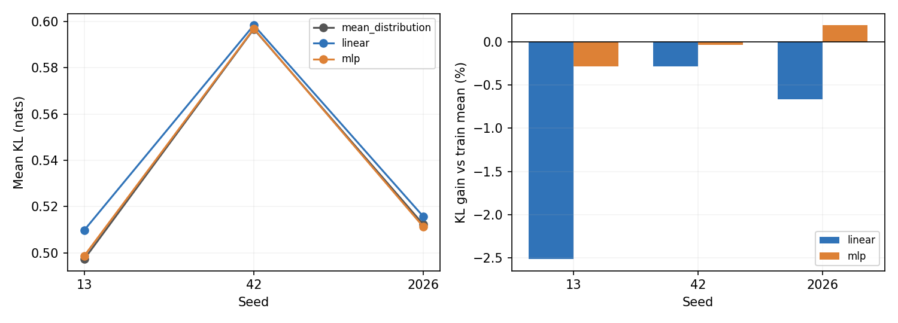
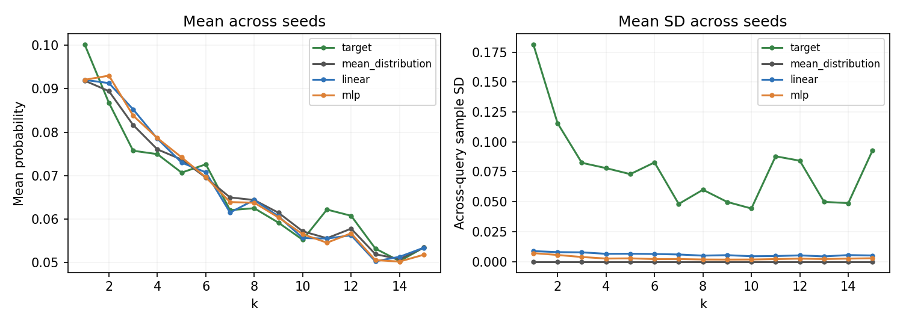
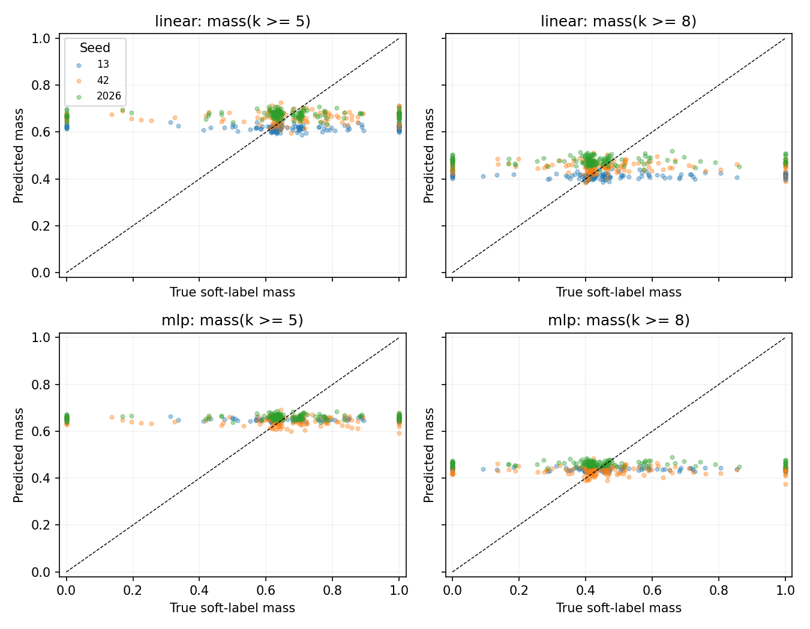

# Query-specific Soft Label 可学习性诊断

仅复用 `matrix_001` 中 Linear / MLP 的 Original Soft Label（λ=0.1、T=0.1）已有预测；未训练、未加载权重或 Embedding，未运行 RAG / LLM。

## 比较口径

Mean Distribution Baseline 仅对各 seed 的有效 **Train** Original Soft Label 求算术平均；不使用 Validation / Test 标签。每个 seed 的三种方法严格按相同有效 Test ID 连接，缺失预测即报错，不通过取交集缩小测试集。无效标签不进入本诊断。

| Seed | Train 全部 / 有效 | Validation 全部 / 有效 | Test 全部 / 有效 |
| --- | --- | --- | --- |
| 13 | 700 / 526 | 100 / 76 | 200 / 150 |
| 42 | 700 / 526 | 100 / 76 | 200 / 150 |
| 2026 | 700 / 526 | 100 / 76 | 200 / 150 |

KL 为 D_KL(P_oracle || P_pred)，自然对数，单位 nats。Soft CE = KL + H(P_oracle)，同一 seed 的目标熵完全相同。概率先校验并以 float64 归一化；预测概率下限 1e-12 后重新归一化，目标零项贡献为 0。因此若预测有零概率，所报为下限平滑后的有限 KL。当前共 0 个预测概率项低于下限。

所有 ± 为三个 seed 的**样本标准差**（ddof=1），相对改善先逐 seed 计算再汇总。种子同时改变划分与初始化，测试 ID 可重叠；这些波动不是置信区间，本文不作统计显著性声明。

## KL 与 Soft Cross Entropy

改善量 = KL_baseline − KL_model；相对改善 = 改善量 / KL_baseline。逐题胜率使用同一题的 KL，差值 >1e-12 算胜；负改善表示差于基线。

| Seed | 方法 | KL ↓ | Soft CE ↓ | KL 改善 ↑ | 相对改善 (%) ↑ | 逐题胜率 (%) |
| --- | --- | --- | --- | --- | --- | --- |
| 13 | mean_distribution | 0.4973 | 2.7017 | 0.0000 | 0.0000 | 0.0000 |
| 13 | linear | 0.5098 | 2.7142 | -0.0125 | -2.5142 | 34.0000 |
| 13 | mlp | 0.4987 | 2.7031 | -0.0014 | -0.2834 | 53.3333 |
| 42 | mean_distribution | 0.5967 | 2.6942 | 0.0000 | 0.0000 | 0.0000 |
| 42 | linear | 0.5984 | 2.6959 | -0.0017 | -0.2814 | 33.3333 |
| 42 | mlp | 0.5969 | 2.6944 | -0.0002 | -0.0343 | 48.6667 |
| 2026 | mean_distribution | 0.5122 | 2.6831 | 0.0000 | 0.0000 | 0.0000 |
| 2026 | linear | 0.5157 | 2.6865 | -0.0034 | -0.6679 | 28.0000 |
| 2026 | mlp | 0.5112 | 2.6821 | 0.0010 | 0.1939 | 46.0000 |
| 均值 ± SD | mean_distribution | 0.5354 ± 0.0536 | 2.6930 ± 0.0094 | 0.0000 ± 0.0000 | 0.0000 ± 0.0000 | 0.0000 ± 0.0000 |
| 均值 ± SD | linear | 0.5413 ± 0.0495 | 2.6989 ± 0.0141 | -0.0059 ± 0.0058 | -1.1545 ± 1.1933 | 31.7778 ± 3.2886 |
| 均值 ± SD | mlp | 0.5356 ± 0.0534 | 2.6932 ± 0.0106 | -0.0002 ± 0.0012 | -0.0413 ± 0.2387 | 49.3333 ± 3.7118 |

## 分布是否随 Query 改变

TV(P,Q)=½Σ|P−Q|。逐题 TV 至自身均值衡量变化幅度；至 Train 均值包含整体偏移。为区分整体校准与逐题信息，还把每个模型所有 Test **预测**取平均并广播，计算“自身均值 KL”；它不使用 Test 标签构造概率，仅用于消除逐题变化的描述性对照，不能替代 Train Mean Baseline。逐题增益 = 自身均值 KL − 原模型 KL，正值才表示保留逐题变化有帮助。

| Seed | 方法 | TV 至自身均值 | TV 至 Train 均值 | 自身均值 KL | 逐题增益 | argmax 为 1/2 (%) |
| --- | --- | --- | --- | --- | --- | --- |
| 13 | mean_distribution | 0.0000 | 0.0000 | 0.4973 | 0.000000 | 100.0000 |
| 13 | linear | 0.0222 | 0.0479 | 0.5099 | 0.000141 | 87.3333 |
| 13 | mlp | 0.0089 | 0.0152 | 0.4994 | 0.000708 | 100.0000 |
| 42 | mean_distribution | 0.0000 | 0.0000 | 0.5967 | 0.000000 | 100.0000 |
| 42 | linear | 0.0478 | 0.0505 | 0.5987 | 0.000288 | 61.3333 |
| 42 | mlp | 0.0260 | 0.0295 | 0.5987 | 0.001762 | 95.3333 |
| 2026 | mean_distribution | 0.0000 | 0.0000 | 0.5122 | 0.000000 | 100.0000 |
| 2026 | linear | 0.0357 | 0.0399 | 0.5151 | -0.000572 | 92.0000 |
| 2026 | mlp | 0.0159 | 0.0179 | 0.5127 | 0.001443 | 100.0000 |
| 均值 ± SD | mean_distribution | 0.0000 ± 0.0000 | 0.0000 ± 0.0000 | 0.5354 ± 0.0536 | 0.000000 ± 0.000000 | 100.0000 ± 0.0000 |
| 均值 ± SD | linear | 0.0352 ± 0.0128 | 0.0461 ± 0.0055 | 0.5412 ± 0.0498 | -0.000048 ± 0.000460 | 80.2222 ± 16.5238 |
| 均值 ± SD | mlp | 0.0169 ± 0.0086 | 0.0208 ± 0.0076 | 0.5369 ± 0.0539 | 0.001304 ± 0.000540 | 98.4444 ± 2.6943 |

左图为跨 seed 平均概率，右图为每个 seed 内逐题概率标准差的跨 seed 均值。完整逐 k 均值/标准差见 `per_k.csv`。

## 大 k 概率质量与相关性

质量是 Σ_{k≥阈值}P(k)，不是 argmax 落入大 k 的比例。若全部非零概率都在阈值内，质量精确记 1，避免浮点求和误差拆散 Spearman 并列秩。下表中的均值 / SD 是同一 seed 内不同 Query 的质量均值 / 样本标准差；末尾汇总的 ± 才是跨 seed 波动。Pearson / Spearman 逐 seed 计算，不混合跨 seed 重复问题；常量基线的相关性未定义，记 —（JSON 为 null）。

| Seed | 方法 | 阈值 | 真实质量 均值 / SD | 预测质量 均值 / SD | Pearson | Spearman |
| --- | --- | --- | --- | --- | --- | --- |
| 13 | mean_distribution | k≥5 | 0.6744 / 0.2235 | 0.6564 / 0.0000 | — | — |
| 13 | mean_distribution | k≥8 | 0.4802 / 0.2329 | 0.4462 / 0.0000 | — | — |
| 13 | linear | k≥5 | 0.6744 / 0.2235 | 0.6179 / 0.0111 | -0.0394 | 0.0425 |
| 13 | linear | k≥8 | 0.4802 / 0.2329 | 0.4124 / 0.0109 | 0.0116 | 0.0721 |
| 13 | mlp | k≥5 | 0.6744 / 0.2235 | 0.6509 / 0.0062 | -0.0277 | 0.0725 |
| 13 | mlp | k≥8 | 0.4802 / 0.2329 | 0.4383 / 0.0067 | 0.0016 | 0.0842 |
| 42 | mean_distribution | k≥5 | 0.6695 / 0.2359 | 0.6597 / 0.0000 | — | — |
| 42 | mean_distribution | k≥8 | 0.4681 / 0.2464 | 0.4471 / 0.0000 | — | — |
| 42 | linear | k≥5 | 0.6695 / 0.2359 | 0.6649 / 0.0229 | 0.0626 | 0.0670 |
| 42 | linear | k≥8 | 0.4681 / 0.2464 | 0.4525 / 0.0225 | 0.0406 | 0.0727 |
| 42 | mlp | k≥5 | 0.6695 / 0.2359 | 0.6448 / 0.0172 | 0.0322 | 0.0465 |
| 42 | mlp | k≥8 | 0.4681 / 0.2464 | 0.4328 / 0.0172 | 0.0349 | 0.0953 |
| 2026 | mean_distribution | k≥5 | 0.6434 / 0.2400 | 0.6669 / 0.0000 | — | — |
| 2026 | mean_distribution | k≥8 | 0.4227 / 0.2261 | 0.4648 / 0.0000 | — | — |
| 2026 | linear | k≥5 | 0.6434 / 0.2400 | 0.6759 / 0.0152 | 0.0598 | -0.0256 |
| 2026 | linear | k≥8 | 0.4227 / 0.2261 | 0.4780 / 0.0165 | 0.0739 | 0.0064 |
| 2026 | mlp | k≥5 | 0.6434 / 0.2400 | 0.6617 / 0.0098 | 0.0757 | 0.0227 |
| 2026 | mlp | k≥8 | 0.4227 / 0.2261 | 0.4629 / 0.0091 | 0.0659 | 0.0209 |

| 方法 | 阈值 | 真实质量均值 ± SD | 预测质量均值 ± SD | Pearson ± SD | Spearman ± SD |
| --- | --- | --- | --- | --- | --- |
| mean_distribution | k≥5 | 0.6624 ± 0.0166 | 0.6610 ± 0.0054 | — | — |
| mean_distribution | k≥8 | 0.4570 ± 0.0303 | 0.4527 ± 0.0105 | — | — |
| linear | k≥5 | 0.6624 ± 0.0166 | 0.6529 ± 0.0308 | 0.0277 ± 0.0581 | 0.0280 ± 0.0480 |
| linear | k≥8 | 0.4570 ± 0.0303 | 0.4476 ± 0.0331 | 0.0421 ± 0.0312 | 0.0504 ± 0.0381 |
| mlp | k≥5 | 0.6624 ± 0.0166 | 0.6525 ± 0.0086 | 0.0267 ± 0.0519 | 0.0473 ± 0.0249 |
| mlp | k≥8 | 0.4570 ± 0.0303 | 0.4447 ± 0.0160 | 0.0341 ± 0.0322 | 0.0668 ± 0.0401 |

虚线为理想的真实质量=预测质量；各 seed 的点仅用于可视化，相关系数仍逐 seed 计算。

## 结论与下一步

- **linear**：相对 Train Mean 的 KL 改善为 -1.1545 ± 1.1933%，0 / 3 个 seed 为正；逐题变化相对自身均值的 KL 增益仅 -0.000048 ± 0.000460 nats。
- **mlp**：相对 Train Mean 的 KL 改善为 -0.0413 ± 0.2387%，1 / 3 个 seed 为正；逐题变化相对自身均值的 KL 增益仅 0.001304 ± 0.000540 nats。
- **是否明显优于平均分布？** 当前没有：两个模型的跨 seed 平均 KL 改善均不为正，不能宣称有稳定收益。
- **能否预测大 k 偏好？** 模型逐 seed 的 Pearson / Spearman 范围为 -0.0394 至 0.0953。当前相关性接近零，证据很弱；均值质量接近不能替代逐题相关性。
- **是否有 Query-specific 分布信息？** 输出并非完全恒定，但变化幅度较小；消除逐题变化的对照仅有极小 KL 增益，且没有稳定超越 Train Mean。最多支持很弱的迹象，尚不足以证明有实用的逐题预算分布学习能力。此结论针对当前模型、数据量与标签。
- **概率学习与决策分开看。** argmax 集中在 1、2 本身不能判定 KL 学习失败；平均分布仍给大 k 分配大量概率。这里的判断来自配对 KL、变化幅度和大 k 相关性，而不是 argmax 频次。
- **扩大数据的启示。** 不宜直接假设扩大规模会改善动态预算。后续若扩充数据，应保留 Train Mean 与相同测试 ID 的配对评价，观察相对 KL 改善和大 k 相关性是否随有效训练样本增加而稳定提升；当前结果无法区分数据不足、Embedding 信号弱或标签噪声等原因。无需据此扩展本次诊断或立即启动新训练。

本次仅诊断有效标签的各 seed Test 子集，不能推广到无有效标签的问题。现有 HotpotQA Dev 已用于方法设计，结果为探索性。六次既有训练的最佳检查点在第 1–7 轮，不能仅凭本诊断判定训练数据是唯一瓶颈。

## 复现与产物

`diagnose_soft_labels.py` 仅读取标签、保存的划分、训练元数据和 `predictions.jsonl`。所需文件齐全；来源路径、SHA256 及运行后未改动校验见 `input_audit.json`。缺失文件时只写缺失报告并返回退出码 2，绝不补训。

- `baseline_distributions.json`：各 seed 有效 Train/Test ID、训练均值 15 维分布及划分计数。
- `per_seed.csv` / `summary.csv` / `summary.json`：逐 seed 指标与跨 seed 均值、样本标准差；不把 450 个跨 seed Test 行当作独立样本。
- `per_query.csv`：每题 KL、CE、基线差、大 k 质量与 argmax；`per_k.csv`：分布逐维均值与标准差。
- `verification.json`：实际运行后的计算测试与只读核验记录。
