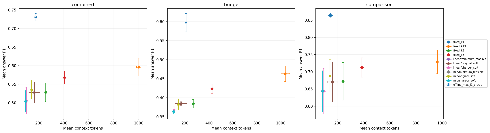

# Query-only Dynamic Top-K 探索性实验

输入仅为冻结 BGE-M3 的 Query Dense Embedding，预算取 15 类概率的 argmax（并列取最小 k）。
样本来自已用于方法设计的 HotpotQA Dev；本报告不构成独立泛化测试。每个 seed 内所有模型使用完全相同的测试 ID，主表包含全部无标签题。
训练与早停只使用有标签的 Train / Validation；Test 不参与参数、检查点或固定预算选择。固定 k=13 为用户预先指定，历史上曾在整批 Dev 上表现最好，也应按探索性结果解释。
均值 ± 样本标准差来自随机种子 [13, 42, 2026]，同时改变划分和初始化；跨 seed 测试集可重叠，不是独立置信区间。

offline_max_f1_oracle 使用真实逐 k F1，是保存结果表上的 F1 参考上界，不能部署；其成本不是成本下界。

## train 全部样本

| 方法 | 分组 | N | F1 | Context Tokens | Prompt Tokens | Evidence Recall | k1比例 | ≥95%同类的seed数 |
| --- | --- | --- | --- | --- | --- | --- | --- | --- |
| fixed_k1 | bridge | 350.0000 ± 0.0000 | 0.3643 ± 0.0024 | 99.5629 ± 1.0781 | 6521.1962 ± 1.0379 | 0.3204 ± 0.0080 | 1.0000 ± 0.0000 | 3 |
| fixed_k1 | combined | 700.0000 ± 0.0000 | 0.5117 ± 0.0107 | 93.3705 ± 0.3480 | 6511.8062 ± 0.2635 | 0.3562 ± 0.0013 | 1.0000 ± 0.0000 | 3 |
| fixed_k1 | comparison | 350.0000 ± 0.0000 | 0.6590 ± 0.0218 | 87.1781 ± 0.3877 | 6502.4162 ± 0.5110 | 0.3920 ± 0.0053 | 1.0000 ± 0.0000 | 3 |
| fixed_k13 | bridge | 350.0000 ± 0.0000 | 0.4475 ± 0.0036 | 1051.9667 ± 6.4930 | 7473.6010 ± 6.4581 | 0.5464 ± 0.0050 | 0.0000 ± 0.0000 | 3 |
| fixed_k13 | combined | 700.0000 ± 0.0000 | 0.5859 ± 0.0049 | 1021.3643 ± 3.4576 | 7439.8110 ± 3.3726 | 0.7212 ± 0.0064 | 0.0000 ± 0.0000 | 3 |
| fixed_k13 | comparison | 350.0000 ± 0.0000 | 0.7243 ± 0.0064 | 990.7619 ± 1.9862 | 7406.0210 ± 1.9059 | 0.8960 ± 0.0089 | 0.0000 ± 0.0000 | 3 |
| fixed_k3 | bridge | 350.0000 ± 0.0000 | 0.3928 ± 0.0028 | 267.1619 ± 4.3774 | 6688.8019 ± 4.3784 | 0.4561 ± 0.0077 | 0.0000 ± 0.0000 | 3 |
| fixed_k3 | combined | 700.0000 ± 0.0000 | 0.5417 ± 0.0070 | 259.6367 ± 2.0242 | 6678.0871 ± 2.0301 | 0.5886 ± 0.0078 | 0.0000 ± 0.0000 | 3 |
| fixed_k3 | comparison | 350.0000 ± 0.0000 | 0.6906 ± 0.0146 | 252.1114 ± 0.5613 | 6667.3724 ± 0.4476 | 0.7210 ± 0.0102 | 0.0000 ± 0.0000 | 3 |
| fixed_k5 | bridge | 350.0000 ± 0.0000 | 0.3990 ± 0.0062 | 425.5162 ± 5.9801 | 6847.1533 ± 5.9789 | 0.4949 ± 0.0049 | 0.0000 ± 0.0000 | 3 |
| fixed_k5 | combined | 700.0000 ± 0.0000 | 0.5519 ± 0.0088 | 415.5848 ± 2.0679 | 6834.0329 ± 2.0627 | 0.6506 ± 0.0053 | 0.0000 ± 0.0000 | 3 |
| fixed_k5 | comparison | 350.0000 ± 0.0000 | 0.7047 ± 0.0125 | 405.6533 ± 1.8446 | 6820.9124 ± 1.8598 | 0.8063 ± 0.0071 | 0.0000 ± 0.0000 | 3 |
| linear/minimum_feasible | bridge | 350.0000 ± 0.0000 | 0.3643 ± 0.0024 | 99.5629 ± 1.0781 | 6521.1962 ± 1.0379 | 0.3204 ± 0.0080 | 1.0000 ± 0.0000 | 3 |
| linear/minimum_feasible | combined | 700.0000 ± 0.0000 | 0.5117 ± 0.0107 | 93.3705 ± 0.3480 | 6511.8062 ± 0.2635 | 0.3562 ± 0.0013 | 1.0000 ± 0.0000 | 3 |
| linear/minimum_feasible | comparison | 350.0000 ± 0.0000 | 0.6590 ± 0.0218 | 87.1781 ± 0.3877 | 6502.4162 ± 0.5110 | 0.3920 ± 0.0053 | 1.0000 ± 0.0000 | 3 |
| linear/original_soft | bridge | 350.0000 ± 0.0000 | 0.4419 ± 0.0375 | 199.0524 ± 70.7309 | 6620.6914 ± 70.6889 | 0.3914 ± 0.0373 | 0.5019 ± 0.1986 | 0 |
| linear/original_soft | combined | 700.0000 ± 0.0000 | 0.5997 ± 0.0425 | 190.7276 ± 60.4398 | 6609.1686 ± 60.3617 | 0.4896 ± 0.0573 | 0.4457 ± 0.1847 | 0 |
| linear/original_soft | comparison | 350.0000 ± 0.0000 | 0.7575 ± 0.0478 | 182.4029 ± 51.0031 | 6597.6457 ± 50.8961 | 0.5877 ± 0.0774 | 0.3895 ± 0.1716 | 0 |
| linear/sharper_soft | bridge | 350.0000 ± 0.0000 | 0.3837 ± 0.0202 | 107.3410 ± 10.2021 | 6528.9743 ± 10.1871 | 0.3348 ± 0.0080 | 0.9190 ± 0.1005 | 2 |
| linear/sharper_soft | combined | 700.0000 ± 0.0000 | 0.5350 ± 0.0196 | 100.9576 ± 10.8233 | 6519.3938 ± 10.8045 | 0.3758 ± 0.0256 | 0.9210 ± 0.1095 | 2 |
| linear/sharper_soft | comparison | 350.0000 ± 0.0000 | 0.6864 ± 0.0191 | 94.5743 ± 11.6930 | 6509.8133 ± 11.6825 | 0.4169 ± 0.0439 | 0.9229 ± 0.1191 | 2 |
| mlp/minimum_feasible | bridge | 350.0000 ± 0.0000 | 0.3643 ± 0.0024 | 99.5629 ± 1.0781 | 6521.1962 ± 1.0379 | 0.3204 ± 0.0080 | 1.0000 ± 0.0000 | 3 |
| mlp/minimum_feasible | combined | 700.0000 ± 0.0000 | 0.5117 ± 0.0107 | 93.3705 ± 0.3480 | 6511.8062 ± 0.2635 | 0.3562 ± 0.0013 | 1.0000 ± 0.0000 | 3 |
| mlp/minimum_feasible | comparison | 350.0000 ± 0.0000 | 0.6590 ± 0.0218 | 87.1781 ± 0.3877 | 6502.4162 ± 0.5110 | 0.3920 ± 0.0053 | 1.0000 ± 0.0000 | 3 |
| mlp/original_soft | bridge | 350.0000 ± 0.0000 | 0.4168 ± 0.0160 | 154.6790 ± 5.8486 | 6576.3171 ± 5.8113 | 0.3850 ± 0.0079 | 0.4543 ± 0.0719 | 0 |
| mlp/original_soft | combined | 700.0000 ± 0.0000 | 0.5666 ± 0.0211 | 152.6252 ± 1.7239 | 6571.0662 ± 1.6386 | 0.4773 ± 0.0085 | 0.3890 ± 0.0767 | 0 |
| mlp/original_soft | comparison | 350.0000 ± 0.0000 | 0.7163 ± 0.0263 | 150.5714 ± 2.8150 | 6565.8152 ± 2.9253 | 0.5696 ± 0.0106 | 0.3238 ± 0.0886 | 0 |
| mlp/sharper_soft | bridge | 350.0000 ± 0.0000 | 0.3706 ± 0.0087 | 101.4638 ± 4.0399 | 6523.0981 ± 4.0012 | 0.3250 ± 0.0134 | 0.9819 ± 0.0313 | 2 |
| mlp/sharper_soft | combined | 700.0000 ± 0.0000 | 0.5164 ± 0.0162 | 94.6819 ± 2.5170 | 6513.1181 ± 2.4405 | 0.3598 ± 0.0070 | 0.9871 ± 0.0223 | 3 |
| mlp/sharper_soft | comparison | 350.0000 ± 0.0000 | 0.6623 ± 0.0253 | 87.9000 ± 1.1114 | 6503.1381 ± 1.0352 | 0.3946 ± 0.0057 | 0.9924 ± 0.0132 | 3 |
| offline_max_f1_oracle | bridge | 350.0000 ± 0.0000 | 0.5864 ± 0.0116 | 222.7705 ± 4.1775 | 6644.4067 ± 4.2008 | 0.4124 ± 0.0111 | 0.6724 ± 0.0033 | 0 |
| offline_max_f1_oracle | combined | 700.0000 ± 0.0000 | 0.7364 ± 0.0060 | 185.6919 ± 5.1551 | 6604.1310 ± 5.1686 | 0.4574 ± 0.0017 | 0.7010 ± 0.0097 | 0 |
| offline_max_f1_oracle | comparison | 350.0000 ± 0.0000 | 0.8865 ± 0.0039 | 148.6133 ± 6.6362 | 6563.8552 ± 6.6230 | 0.5024 ± 0.0110 | 0.7295 ± 0.0207 | 0 |

## validation 全部样本

| 方法 | 分组 | N | F1 | Context Tokens | Prompt Tokens | Evidence Recall | k1比例 | ≥95%同类的seed数 |
| --- | --- | --- | --- | --- | --- | --- | --- | --- |
| fixed_k1 | bridge | 50.0000 ± 0.0000 | 0.3190 ± 0.0056 | 100.6467 ± 6.8077 | 6520.7533 ± 5.5719 | 0.3283 ± 0.0176 | 1.0000 ± 0.0000 | 3 |
| fixed_k1 | combined | 100.0000 ± 0.0000 | 0.4981 ± 0.0174 | 96.8567 ± 8.5402 | 6514.7733 ± 7.7011 | 0.3523 ± 0.0222 | 1.0000 ± 0.0000 | 3 |
| fixed_k1 | comparison | 50.0000 ± 0.0000 | 0.6771 ± 0.0334 | 93.0667 ± 10.6348 | 6508.7933 ± 10.3636 | 0.3763 ± 0.0305 | 1.0000 ± 0.0000 | 3 |
| fixed_k13 | bridge | 50.0000 ± 0.0000 | 0.3896 ± 0.0212 | 1047.5133 ± 23.2397 | 7467.6467 ± 24.6333 | 0.5465 ± 0.0327 | 0.0000 ± 0.0000 | 3 |
| fixed_k13 | combined | 100.0000 ± 0.0000 | 0.5543 ± 0.0136 | 1037.4800 ± 14.8314 | 7455.4233 ± 15.5808 | 0.7212 ± 0.0195 | 0.0000 ± 0.0000 | 3 |
| fixed_k13 | comparison | 50.0000 ± 0.0000 | 0.7190 ± 0.0255 | 1027.4467 ± 16.3181 | 7443.2000 ± 16.6120 | 0.8960 ± 0.0081 | 0.0000 ± 0.0000 | 3 |
| fixed_k3 | bridge | 50.0000 ± 0.0000 | 0.3530 ± 0.0046 | 266.2667 ± 11.6345 | 6686.4200 ± 11.1066 | 0.4627 ± 0.0110 | 0.0000 ± 0.0000 | 3 |
| fixed_k3 | combined | 100.0000 ± 0.0000 | 0.5317 ± 0.0189 | 264.5300 ± 13.8973 | 6682.4733 ± 13.1186 | 0.5850 ± 0.0217 | 0.0000 ± 0.0000 | 3 |
| fixed_k3 | comparison | 50.0000 ± 0.0000 | 0.7104 ± 0.0410 | 262.7933 ± 19.5122 | 6678.5267 ± 19.2233 | 0.7073 ± 0.0495 | 0.0000 ± 0.0000 | 3 |
| fixed_k5 | bridge | 50.0000 ± 0.0000 | 0.3486 ± 0.0186 | 418.8067 ± 10.8275 | 6838.9267 ± 10.8825 | 0.4877 ± 0.0025 | 0.0000 ± 0.0000 | 3 |
| fixed_k5 | combined | 100.0000 ± 0.0000 | 0.5286 ± 0.0308 | 418.4333 ± 10.0315 | 6836.3567 ± 9.2075 | 0.6346 ± 0.0093 | 0.0000 ± 0.0000 | 3 |
| fixed_k5 | comparison | 50.0000 ± 0.0000 | 0.7087 ± 0.0435 | 418.0600 ± 19.1631 | 6833.7867 ± 18.9334 | 0.7816 ± 0.0187 | 0.0000 ± 0.0000 | 3 |
| linear/minimum_feasible | bridge | 50.0000 ± 0.0000 | 0.3190 ± 0.0056 | 100.6467 ± 6.8077 | 6520.7533 ± 5.5719 | 0.3283 ± 0.0176 | 1.0000 ± 0.0000 | 3 |
| linear/minimum_feasible | combined | 100.0000 ± 0.0000 | 0.4981 ± 0.0174 | 96.8567 ± 8.5402 | 6514.7733 ± 7.7011 | 0.3523 ± 0.0222 | 1.0000 ± 0.0000 | 3 |
| linear/minimum_feasible | comparison | 50.0000 ± 0.0000 | 0.6771 ± 0.0334 | 93.0667 ± 10.6348 | 6508.7933 ± 10.3636 | 0.3763 ± 0.0305 | 1.0000 ± 0.0000 | 3 |
| linear/original_soft | bridge | 50.0000 ± 0.0000 | 0.3325 ± 0.0129 | 159.3400 ± 51.8044 | 6579.4533 ± 52.0015 | 0.3705 ± 0.0328 | 0.6000 ± 0.2458 | 0 |
| linear/original_soft | combined | 100.0000 ± 0.0000 | 0.5173 ± 0.0136 | 165.2200 ± 54.5721 | 6583.1367 ± 54.5644 | 0.4548 ± 0.0482 | 0.5000 ± 0.2536 | 0 |
| linear/original_soft | comparison | 50.0000 ± 0.0000 | 0.7020 ± 0.0143 | 171.1000 ± 57.3622 | 6586.8200 ± 57.1326 | 0.5390 ± 0.0653 | 0.4000 ± 0.2615 | 0 |
| linear/sharper_soft | bridge | 50.0000 ± 0.0000 | 0.3231 ± 0.0097 | 104.3800 ± 3.1354 | 6524.4867 ± 1.9795 | 0.3316 ± 0.0133 | 0.9600 ± 0.0529 | 2 |
| linear/sharper_soft | combined | 100.0000 ± 0.0000 | 0.5035 ± 0.0266 | 101.1633 ± 6.1910 | 6519.0767 ± 5.7328 | 0.3642 ± 0.0232 | 0.9500 ± 0.0781 | 2 |
| linear/sharper_soft | comparison | 50.0000 ± 0.0000 | 0.6838 ± 0.0449 | 97.9467 ± 9.4645 | 6513.6667 ± 9.5102 | 0.3968 ± 0.0437 | 0.9400 ± 0.1039 | 2 |
| mlp/minimum_feasible | bridge | 50.0000 ± 0.0000 | 0.3190 ± 0.0056 | 100.6467 ± 6.8077 | 6520.7533 ± 5.5719 | 0.3283 ± 0.0176 | 1.0000 ± 0.0000 | 3 |
| mlp/minimum_feasible | combined | 100.0000 ± 0.0000 | 0.4981 ± 0.0174 | 96.8567 ± 8.5402 | 6514.7733 ± 7.7011 | 0.3523 ± 0.0222 | 1.0000 ± 0.0000 | 3 |
| mlp/minimum_feasible | comparison | 50.0000 ± 0.0000 | 0.6771 ± 0.0334 | 93.0667 ± 10.6348 | 6508.7933 ± 10.3636 | 0.3763 ± 0.0305 | 1.0000 ± 0.0000 | 3 |
| mlp/original_soft | bridge | 50.0000 ± 0.0000 | 0.3478 ± 0.0378 | 148.3800 ± 10.6868 | 6568.4933 ± 9.5237 | 0.3905 ± 0.0228 | 0.4867 ± 0.0611 | 0 |
| mlp/original_soft | combined | 100.0000 ± 0.0000 | 0.5238 ± 0.0236 | 155.0433 ± 18.5923 | 6572.9567 ± 17.7622 | 0.4661 ± 0.0367 | 0.3967 ± 0.0666 | 0 |
| mlp/original_soft | comparison | 50.0000 ± 0.0000 | 0.6998 ± 0.0334 | 161.7067 ± 26.9155 | 6577.4200 ± 26.5865 | 0.5417 ± 0.0529 | 0.3067 ± 0.0808 | 0 |
| mlp/sharper_soft | bridge | 50.0000 ± 0.0000 | 0.3257 ± 0.0162 | 101.9467 ± 7.0146 | 6522.0533 ± 6.0635 | 0.3316 ± 0.0180 | 0.9867 ± 0.0231 | 3 |
| mlp/sharper_soft | combined | 100.0000 ± 0.0000 | 0.5014 ± 0.0164 | 97.6867 ± 8.1910 | 6515.6033 ± 7.3616 | 0.3539 ± 0.0206 | 0.9900 ± 0.0173 | 3 |
| mlp/sharper_soft | comparison | 50.0000 ± 0.0000 | 0.6771 ± 0.0334 | 93.4267 ± 10.3556 | 6509.1533 ± 10.0690 | 0.3763 ± 0.0305 | 0.9933 ± 0.0115 | 3 |
| offline_max_f1_oracle | bridge | 50.0000 ± 0.0000 | 0.5394 ± 0.0359 | 242.6533 ± 30.2462 | 6662.7533 ± 30.7665 | 0.4110 ± 0.0106 | 0.6667 ± 0.0115 | 0 |
| offline_max_f1_oracle | combined | 100.0000 ± 0.0000 | 0.7145 ± 0.0244 | 201.1367 ± 18.7109 | 6619.0467 ± 18.0938 | 0.4380 ± 0.0224 | 0.7100 ± 0.0100 | 0 |
| offline_max_f1_oracle | comparison | 50.0000 ± 0.0000 | 0.8896 ± 0.0186 | 159.6200 ± 33.6492 | 6575.3400 ± 33.3492 | 0.4650 ± 0.0467 | 0.7533 ± 0.0306 | 0 |

## test 全部样本

| 方法 | 分组 | N | F1 | Context Tokens | Prompt Tokens | Evidence Recall | k1比例 | ≥95%同类的seed数 |
| --- | --- | --- | --- | --- | --- | --- | --- | --- |
| fixed_k1 | bridge | 100.0000 ± 0.0000 | 0.3635 ± 0.0058 | 104.6967 ± 2.0883 | 6525.5367 ± 2.2439 | 0.3472 ± 0.0358 | 1.0000 ± 0.0000 | 3 |
| fixed_k1 | combined | 200.0000 ± 0.0000 | 0.5036 ± 0.0289 | 94.0750 ± 3.1851 | 6512.1417 ± 2.9886 | 0.3814 ± 0.0135 | 1.0000 ± 0.0000 | 3 |
| fixed_k1 | comparison | 100.0000 ± 0.0000 | 0.6437 ± 0.0596 | 83.4533 ± 6.6738 | 6498.7467 ± 6.9619 | 0.4156 ± 0.0201 | 1.0000 ± 0.0000 | 3 |
| fixed_k13 | bridge | 100.0000 ± 0.0000 | 0.4630 ± 0.0202 | 1036.2500 ± 34.3282 | 7457.1033 ± 34.8971 | 0.5600 ± 0.0074 | 0.0000 ± 0.0000 | 3 |
| fixed_k13 | combined | 200.0000 ± 0.0000 | 0.5959 ± 0.0240 | 999.9450 ± 18.0563 | 7418.0350 ± 18.2244 | 0.7281 ± 0.0128 | 0.0000 ± 0.0000 | 3 |
| fixed_k13 | comparison | 100.0000 ± 0.0000 | 0.7289 ± 0.0337 | 963.6400 ± 2.1095 | 7378.9667 ± 2.1610 | 0.8963 ± 0.0274 | 0.0000 ± 0.0000 | 3 |
| fixed_k3 | bridge | 100.0000 ± 0.0000 | 0.3841 ± 0.0110 | 268.2900 ± 9.5665 | 6689.1433 ± 9.7718 | 0.4772 ± 0.0303 | 0.0000 ± 0.0000 | 3 |
| fixed_k3 | combined | 200.0000 ± 0.0000 | 0.5282 ± 0.0250 | 254.1767 ± 4.3209 | 6672.2633 ± 4.3825 | 0.5987 ± 0.0292 | 0.0000 ± 0.0000 | 3 |
| fixed_k3 | comparison | 100.0000 ± 0.0000 | 0.6723 ± 0.0545 | 240.0633 ± 9.1580 | 6655.3833 ± 9.2991 | 0.7202 ± 0.0282 | 0.0000 ± 0.0000 | 3 |
| fixed_k5 | bridge | 100.0000 ± 0.0000 | 0.4233 ± 0.0126 | 425.5500 ± 16.4728 | 6846.3800 ± 16.8967 | 0.5133 ± 0.0176 | 0.0000 ± 0.0000 | 3 |
| fixed_k5 | combined | 200.0000 ± 0.0000 | 0.5680 ± 0.0176 | 405.2067 ± 4.5995 | 6823.2767 ± 4.7732 | 0.6470 ± 0.0220 | 0.0000 ± 0.0000 | 3 |
| fixed_k5 | comparison | 100.0000 ± 0.0000 | 0.7127 ± 0.0281 | 384.8633 ± 13.1109 | 6800.1733 ± 13.2974 | 0.7808 ± 0.0281 | 0.0000 ± 0.0000 | 3 |
| linear/minimum_feasible | bridge | 100.0000 ± 0.0000 | 0.3635 ± 0.0058 | 104.6967 ± 2.0883 | 6525.5367 ± 2.2439 | 0.3472 ± 0.0358 | 1.0000 ± 0.0000 | 3 |
| linear/minimum_feasible | combined | 200.0000 ± 0.0000 | 0.5036 ± 0.0289 | 94.0750 ± 3.1851 | 6512.1417 ± 2.9886 | 0.3814 ± 0.0135 | 1.0000 ± 0.0000 | 3 |
| linear/minimum_feasible | comparison | 100.0000 ± 0.0000 | 0.6437 ± 0.0596 | 83.4533 ± 6.6738 | 6498.7467 ± 6.9619 | 0.4156 ± 0.0201 | 1.0000 ± 0.0000 | 3 |
| linear/original_soft | bridge | 100.0000 ± 0.0000 | 0.3849 ± 0.0048 | 167.5567 ± 48.5094 | 6588.3933 ± 48.2467 | 0.4022 ± 0.0380 | 0.5933 ± 0.2113 | 0 |
| linear/original_soft | combined | 200.0000 ± 0.0000 | 0.5277 ± 0.0282 | 163.5150 ± 42.5907 | 6581.5850 ± 42.6849 | 0.4823 ± 0.0468 | 0.5133 ± 0.1891 | 0 |
| linear/original_soft | comparison | 100.0000 ± 0.0000 | 0.6705 ± 0.0572 | 159.4733 ± 36.6990 | 6574.7767 ± 37.1621 | 0.5624 ± 0.0615 | 0.4333 ± 0.1686 | 0 |
| linear/sharper_soft | bridge | 100.0000 ± 0.0000 | 0.3679 ± 0.0081 | 108.2900 ± 7.3590 | 6529.1300 ± 7.0983 | 0.3505 ± 0.0415 | 0.9467 ± 0.0839 | 2 |
| linear/sharper_soft | combined | 200.0000 ± 0.0000 | 0.5058 ± 0.0357 | 100.5433 ± 12.0466 | 6518.6117 ± 11.7972 | 0.3948 ± 0.0292 | 0.9250 ± 0.1050 | 2 |
| linear/sharper_soft | comparison | 100.0000 ± 0.0000 | 0.6438 ± 0.0659 | 92.7967 ± 17.7918 | 6508.0933 ± 17.8468 | 0.4392 ± 0.0224 | 0.9033 ± 0.1266 | 2 |
| mlp/minimum_feasible | bridge | 100.0000 ± 0.0000 | 0.3635 ± 0.0058 | 104.6967 ± 2.0883 | 6525.5367 ± 2.2439 | 0.3472 ± 0.0358 | 1.0000 ± 0.0000 | 3 |
| mlp/minimum_feasible | combined | 200.0000 ± 0.0000 | 0.5036 ± 0.0289 | 94.0750 ± 3.1851 | 6512.1417 ± 2.9886 | 0.3814 ± 0.0135 | 1.0000 ± 0.0000 | 3 |
| mlp/minimum_feasible | comparison | 100.0000 ± 0.0000 | 0.6437 ± 0.0596 | 83.4533 ± 6.6738 | 6498.7467 ± 6.9619 | 0.4156 ± 0.0201 | 1.0000 ± 0.0000 | 3 |
| mlp/original_soft | bridge | 100.0000 ± 0.0000 | 0.3824 ± 0.0148 | 144.6833 ± 5.6755 | 6565.5267 ± 5.8959 | 0.3861 ± 0.0331 | 0.5333 ± 0.1012 | 0 |
| mlp/original_soft | combined | 200.0000 ± 0.0000 | 0.5352 ± 0.0247 | 141.8867 ± 4.0369 | 6559.9633 ± 3.7990 | 0.4725 ± 0.0147 | 0.4300 ± 0.0901 | 0 |
| mlp/original_soft | comparison | 100.0000 ± 0.0000 | 0.6881 ± 0.0471 | 139.0900 ± 4.9517 | 6554.4000 ± 4.9709 | 0.5589 ± 0.0126 | 0.3267 ± 0.0850 | 0 |
| mlp/sharper_soft | bridge | 100.0000 ± 0.0000 | 0.3635 ± 0.0058 | 105.0467 ± 1.4978 | 6525.8867 ± 1.6391 | 0.3488 ± 0.0351 | 0.9933 ± 0.0115 | 3 |
| mlp/sharper_soft | combined | 200.0000 ± 0.0000 | 0.5036 ± 0.0289 | 94.2900 ± 3.2715 | 6512.3567 ± 3.0960 | 0.3822 ± 0.0140 | 0.9950 ± 0.0087 | 3 |
| mlp/sharper_soft | comparison | 100.0000 ± 0.0000 | 0.6437 ± 0.0596 | 83.5333 ± 6.7409 | 6498.8267 ± 7.0350 | 0.4156 ± 0.0201 | 0.9967 ± 0.0058 | 3 |
| offline_max_f1_oracle | bridge | 100.0000 ± 0.0000 | 0.5973 ± 0.0241 | 208.6167 ± 4.8057 | 6629.4600 ± 5.3743 | 0.4211 ± 0.0399 | 0.6833 ± 0.0058 | 0 |
| offline_max_f1_oracle | combined | 200.0000 ± 0.0000 | 0.7307 ± 0.0102 | 176.2400 ± 9.5650 | 6594.3083 ± 9.7913 | 0.4645 ± 0.0145 | 0.7117 ± 0.0306 | 0 |
| offline_max_f1_oracle | comparison | 100.0000 ± 0.0000 | 0.8641 ± 0.0056 | 143.8633 ± 19.0406 | 6559.1567 ± 19.4520 | 0.5080 ± 0.0264 | 0.7400 ± 0.0624 | 0 |

## Test 相对固定预算的配对差

同一 seed、同一完整测试集先相减，再跨 seed 汇总。ΔF1>0 表示质量增加，ΔTokens<0 表示成本减少。

| 模型/标签 | 固定基线 | ΔF1 | ΔContext Tokens |
| --- | --- | --- | --- |
| linear/minimum_feasible | fixed_k1 | 0.0000 ± 0.0000 | 0.0000 ± 0.0000 |
| linear/minimum_feasible | fixed_k3 | -0.0246 ± 0.0039 | -160.1017 ± 3.9735 |
| linear/minimum_feasible | fixed_k5 | -0.0644 ± 0.0173 | -311.1317 ± 5.8047 |
| linear/minimum_feasible | fixed_k13 | -0.0923 ± 0.0338 | -905.8700 ± 21.2144 |
| linear/original_soft | fixed_k1 | 0.0241 ± 0.0034 | 69.4400 ± 41.6575 |
| linear/original_soft | fixed_k3 | -0.0005 ± 0.0046 | -90.6617 ± 38.3310 |
| linear/original_soft | fixed_k5 | -0.0403 ± 0.0149 | -241.6917 ± 38.4266 |
| linear/original_soft | fixed_k13 | -0.0682 ± 0.0309 | -836.4300 ± 53.3200 |
| linear/sharper_soft | fixed_k1 | 0.0022 ± 0.0070 | 6.4683 ± 9.2473 |
| linear/sharper_soft | fixed_k3 | -0.0224 ± 0.0108 | -153.6333 ± 12.5396 |
| linear/sharper_soft | fixed_k5 | -0.0621 ± 0.0225 | -304.6633 ± 14.8509 |
| linear/sharper_soft | fixed_k13 | -0.0901 ± 0.0379 | -899.4017 ± 28.9322 |
| mlp/minimum_feasible | fixed_k1 | 0.0000 ± 0.0000 | 0.0000 ± 0.0000 |
| mlp/minimum_feasible | fixed_k3 | -0.0246 ± 0.0039 | -160.1017 ± 3.9735 |
| mlp/minimum_feasible | fixed_k5 | -0.0644 ± 0.0173 | -311.1317 ± 5.8047 |
| mlp/minimum_feasible | fixed_k13 | -0.0923 ± 0.0338 | -905.8700 ± 21.2144 |
| mlp/original_soft | fixed_k1 | 0.0316 ± 0.0051 | 47.8117 ± 3.8562 |
| mlp/original_soft | fixed_k3 | 0.0070 ± 0.0029 | -112.2900 ± 7.4150 |
| mlp/original_soft | fixed_k5 | -0.0327 ± 0.0122 | -263.3200 ± 8.4777 |
| mlp/original_soft | fixed_k13 | -0.0607 ± 0.0288 | -858.0583 ± 19.7211 |
| mlp/sharper_soft | fixed_k1 | 0.0000 ± 0.0000 | 0.2150 ± 0.3724 |
| mlp/sharper_soft | fixed_k3 | -0.0246 ± 0.0039 | -159.8867 ± 3.6451 |
| mlp/sharper_soft | fixed_k5 | -0.0644 ± 0.0173 | -310.9167 ± 5.5625 |
| mlp/sharper_soft | fixed_k13 | -0.0923 ± 0.0338 | -905.6550 ± 21.3267 |

## 训练与预测诊断

| 模型 | 标签 | Seed | 最佳轮数 | Validation Loss |
| --- | --- | --- | --- | --- |
| linear | minimum_feasible | 13 | 2 | 1.654791 |
| linear | original_soft | 13 | 1 | 2.696150 |
| linear | sharper_soft | 13 | 2 | 2.104154 |
| mlp | minimum_feasible | 13 | 6 | 1.657065 |
| mlp | original_soft | 13 | 3 | 2.688933 |
| mlp | sharper_soft | 13 | 3 | 2.093094 |
| linear | minimum_feasible | 42 | 2 | 1.894858 |
| linear | original_soft | 42 | 3 | 2.693761 |
| linear | sharper_soft | 42 | 1 | 2.232316 |
| mlp | minimum_feasible | 42 | 10 | 1.890107 |
| mlp | original_soft | 42 | 7 | 2.695221 |
| mlp | sharper_soft | 42 | 3 | 2.221790 |
| linear | minimum_feasible | 2026 | 3 | 1.639567 |
| linear | original_soft | 2026 | 2 | 2.683358 |
| linear | sharper_soft | 2026 | 5 | 2.111493 |
| mlp | minimum_feasible | 2026 | 5 | 1.628639 |
| mlp | original_soft | 2026 | 5 | 2.681069 |
| mlp | sharper_soft | 2026 | 5 | 2.101676 |

每次运行的 history.json 保存逐轮 Train/Validation Loss；evaluation/predictions.jsonl 保存全部 ID 的概率和 k。summary.json 同时提供各 k 平均计数、k1比例、有效/无标签分组和相对固定 k 的差。95%同类标志只是预测塌缩的描述性阈值；固定 k 天然会触发此标志。

