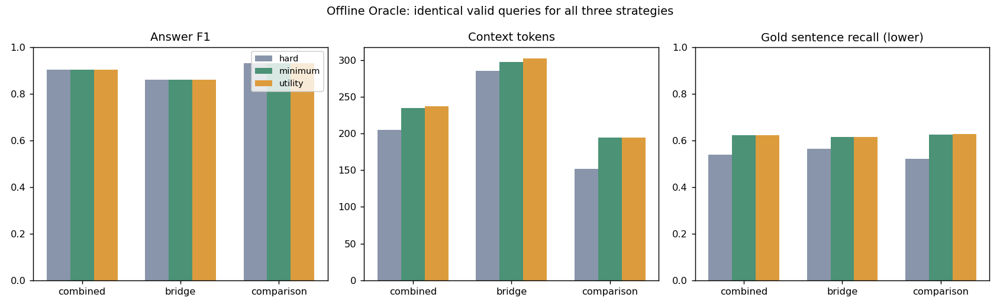
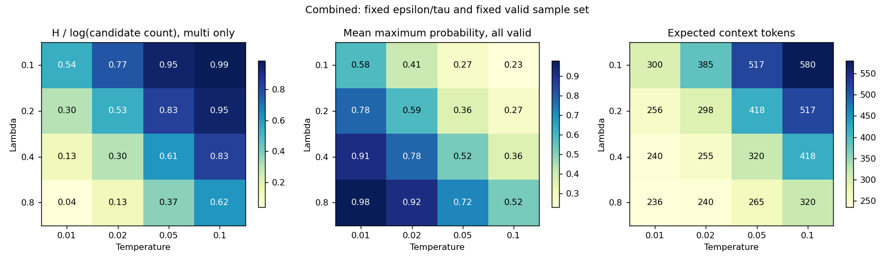
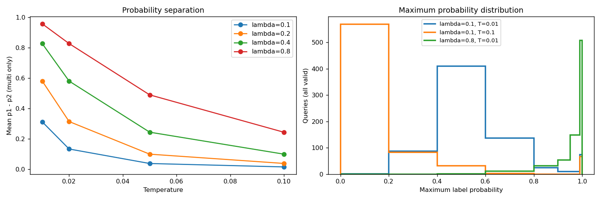
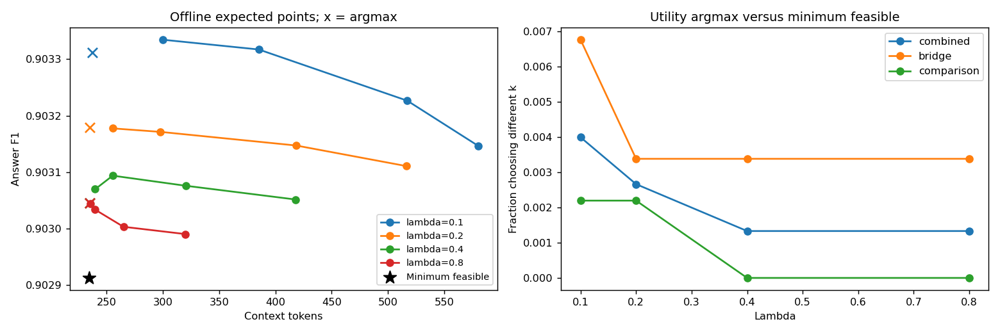
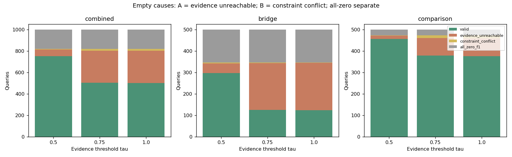
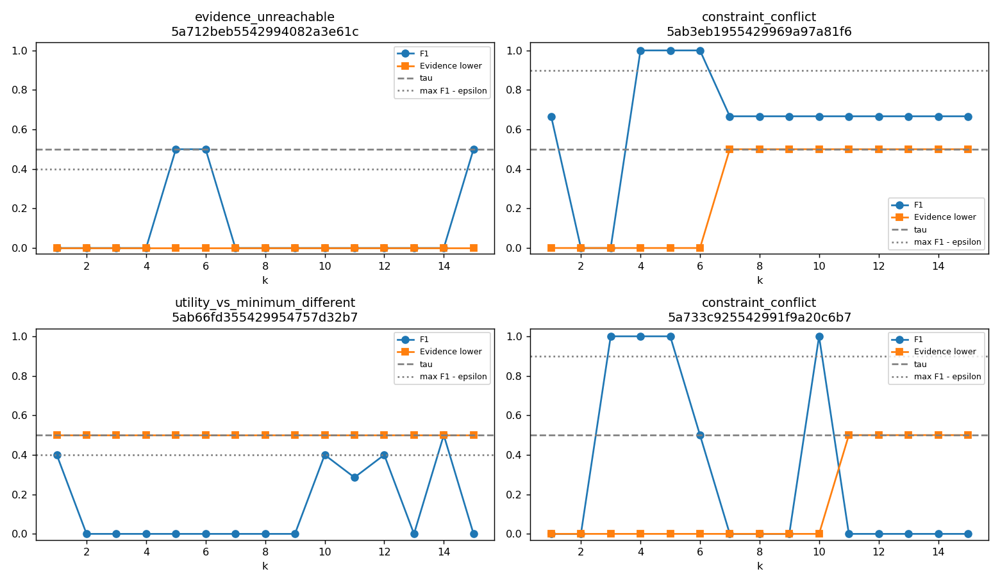

# Soft Oracle 后续诊断与标签参数分析

分析日期：2026-10-30（Asia/Shanghai）。输入仅为2026-10-14正式实验的已有F1、Token和模型可见上下文Evidence诊断，以及原Soft Oracle experiment_002。所有结果均为 **Offline Oracle / Label Analysis**，未调用检索器或LLM，未训练或扩大数据集。

## 1. 直接结论与适用边界

参考参数 ε=0.1、τ=0.5、λ=0.1、T=0.1，有效题 752/1000（75.20%），Bridge/Comparison分别 296/500、456/500；181道全零F1继续单列。旧标签与旧参数扫描交叉核对通过，本次未改变原Soft Oracle实现或旧结果。

**Utility相对最小可行预算的边际收益很小。** 仅 3/752（0.40%）题选出不同k，平均F1增加 0.0399 个百分点，平均Context Tokens增加 2.322。这说明当前参数下多数决策已被近优F1和Evidence门槛决定，Utility主要处理少量边界权衡，不能为了保留Utility而夸大收益。

**平滑可由参数调节，但尖锐不等于更好的监督。** λ/T网格涵盖16组参数、每组相同752个有效题。参考多候选归一化熵=0.9860；最大概率均值=0.2308。降低T能在不改变最优预算的情况下显著改变概率形状，增大λ则可能改变预算。不能仅按低熵或离线F1自动选训练参数。

**参考空候选主要是未观察到足够Gold句覆盖。** 非零空候选67题中，A类62题（92.54%）在全部k下Evidence均不过门槛，B类5题（7.46%）是F1/Evidence集合冲突。该分类限于k≤15、当前检索及渲染上下文的Gold字面匹配代理，不能严格证明检索器失败或模型回答的因果机制。

当前证据支持把Minimum Feasible保留为必要的简单预算基线，并在训练目标中明确概率分布的用途。进入模型训练前仍需处理类型选择偏差、无标签样本、人工证据复核以及独立数据划分；本轮不能证明仅输入Query可预测预算。本报告不宣布最佳参数，不执行任何训练。

## 2. 方法、复用范围与分母

直接复用上级 `build_soft_oracle.py` 的 `context/load_data`、`build_label`、成本归一化、稳定Softmax、边界容差和写表函数；复用 `analyze_soft_oracle.py` 的均值、分位数和直方图函数。未重写F1/Evidence筛选或Utility。每个有效标签与原experiment_002逐题核对，重叠网格的汇总指标也与原parameter_sweep.csv核对。所有候选集合均取全15点Smax、成本最大值，温度不参与预算排序。

Minimum Feasible定义为候选中实际Context Tokens最少，成本并列取较小k；代码不假设Token随k单调。Hard Oracle仍从全部15个k选最大F1并列最小k，可能不满足Evidence约束；三策略仅在同一D有效题集上评估。全体1000题逐题表保留无标签状态；无标签不回退，未给出伪装成全体性能的均值。

尖锐度指标中：H使用自然对数；H/ln|C|、top1-top2概率差和top1-top2 Utility差仅在|C|>1时定义。单候选H=0、pmax=1，其余指标null，单候选数量单列。接近One-hot仅作描述，阈值pmax≥0.95，同时给出全有效题和多候选题的比例。分位数为线性插值，无显著性或因果检验。

## 3. 最小可行预算与Utility最优预算

| 组 | 策略 | 有效/原组 | 平均F1 | 平均Context | 平均E lower | 相对逐题max F1损失 | E达标比例 |
| --- | --- | --- | --- | --- | --- | --- | --- |
| combined | hard | 752/1000 | 90.36% | 204.438 | 53.83% | 0.0000个百分点 | 86.04% |
| combined | minimum | 752/1000 | 90.29% | 234.668 | 62.16% | 0.0680个百分点 | 100.00% |
| combined | utility | 752/1000 | 90.33% | 236.989 | 62.22% | 0.0281个百分点 | 100.00% |
| bridge | hard | 296/500 | 86.09% | 285.588 | 56.42% | 0.0000个百分点 | 91.55% |
| bridge | minimum | 296/500 | 85.95% | 297.307 | 61.54% | 0.1389个百分点 | 100.00% |
| bridge | utility | 296/500 | 86.02% | 302.311 | 61.54% | 0.0713个百分点 | 100.00% |
| comparison | hard | 456/500 | 93.13% | 151.761 | 52.15% | 0.0000个百分点 | 82.46% |
| comparison | minimum | 456/500 | 93.11% | 194.007 | 62.55% | 0.0219个百分点 | 100.00% |
| comparison | utility | 456/500 | 93.13% | 194.588 | 62.66% | 0.0000个百分点 | 100.00% |

Utility−Minimum Feasible的逐题配对差（所有有效题，而非仅差异题作分母）：

| 组 | 选不同k/有效 | ΔF1(百分点) | ΔContext Tokens | 仅差异题平均F1增益(百分点) | 仅差异题平均额外Token |
| --- | --- | --- | --- | --- | --- |
| combined | 3/752 (0.40%) | 0.0399 | 2.322 | 10.0000 | 582.000 |
| bridge | 2/296 (0.68%) | 0.0676 | 5.003 | 10.0000 | 740.500 |
| comparison | 1/456 (0.22%) | 0.0219 | 0.581 | 10.0000 | 265.000 |

在相同候选集、非负λ下，最小成本是下界；Utility选择更昂贵的候选，必须由F1收益抵偿λ乘归一化成本增量。它不会额外加入被门槛排除的k。Hard Oracle具有最大F1保证，但Gold证据不足的比例需另看；不能用其F1优势否认证据目标，也不能把门槛保证的Evidence达标率当成学到的效果。

所有参考配置下的预算差异题均列于下表，不从中选择收益最大的个例：

| qid | 类型 | 最小可行k | Utility k | F1增益(百分点) | 额外Context Tokens |
| --- | --- | --- | --- | --- | --- |
| 5ab66fd355429954757d32b7 | bridge | 1 | 14 | 10.0000 | 1403 |
| 5adebc9b554299728e26c79d | bridge | 2 | 3 | 10.0000 | 78 |
| 5ab6dbc15542995eadef00cd | comparison | 1 | 5 | 10.0000 | 265 |

## 4. λ、Temperature与Soft Label尖锐度

以下只扫描用户指定网格，ε/τ固定。不同λ/T均采用相同有效题集，归一化熵和top1/top2差的分母为各组多候选题，pmax均值包括单候选。Answer F1同时列argmax和概率加权期望，避免混用。

| 组 | λ | T | n/多候选n | H | H/lnC | pmax | p1−p2(多候选) | 期望Context | argmax Context | 期望F1 | argmax F1 |
| --- | --- | --- | --- | --- | --- | --- | --- | --- | --- | --- | --- |
| combined | 0.1 | 0.01 | 752/686 | 1.126 | 0.536 | 0.584 | 0.312 | 299.75 | 236.99 | 90.33% | 90.33% |
| bridge | 0.1 | 0.01 | 296/262 | 1.048 | 0.551 | 0.607 | 0.320 | 363.26 | 302.31 | 86.03% | 86.02% |
| comparison | 0.1 | 0.01 | 456/424 | 1.176 | 0.528 | 0.570 | 0.308 | 258.52 | 194.59 | 93.13% | 93.13% |
| combined | 0.1 | 0.02 | 752/686 | 1.642 | 0.772 | 0.408 | 0.134 | 385.18 | 236.99 | 90.33% | 90.33% |
| bridge | 0.1 | 0.02 | 296/262 | 1.517 | 0.781 | 0.442 | 0.143 | 444.56 | 302.31 | 86.02% | 86.02% |
| comparison | 0.1 | 0.02 | 456/424 | 1.723 | 0.767 | 0.386 | 0.129 | 346.63 | 194.59 | 93.13% | 93.13% |
| combined | 0.1 | 0.05 | 752/686 | 2.024 | 0.948 | 0.273 | 0.039 | 517.17 | 236.99 | 90.32% | 90.33% |
| bridge | 0.1 | 0.05 | 296/262 | 1.862 | 0.950 | 0.315 | 0.044 | 568.15 | 302.31 | 86.01% | 86.02% |
| comparison | 0.1 | 0.05 | 456/424 | 2.130 | 0.946 | 0.246 | 0.036 | 484.09 | 194.59 | 93.12% | 93.13% |
| combined | 0.1 | 0.1 | 752/686 | 2.106 | 0.986 | 0.231 | 0.016 | 580.18 | 236.99 | 90.31% | 90.33% |
| bridge | 0.1 | 0.1 | 296/262 | 1.935 | 0.987 | 0.274 | 0.019 | 626.54 | 302.31 | 86.00% | 86.02% |
| comparison | 0.1 | 0.1 | 456/424 | 2.218 | 0.986 | 0.203 | 0.015 | 550.09 | 194.59 | 93.11% | 93.13% |
| combined | 0.2 | 0.01 | 752/686 | 0.627 | 0.304 | 0.776 | 0.580 | 255.60 | 235.12 | 90.32% | 90.32% |
| bridge | 0.2 | 0.01 | 296/262 | 0.590 | 0.318 | 0.786 | 0.584 | 317.60 | 297.57 | 85.99% | 85.99% |
| comparison | 0.2 | 0.01 | 456/424 | 0.651 | 0.296 | 0.769 | 0.578 | 215.36 | 194.59 | 93.13% | 93.13% |
| combined | 0.2 | 0.02 | 752/686 | 1.124 | 0.535 | 0.585 | 0.315 | 297.73 | 235.12 | 90.32% | 90.32% |
| bridge | 0.2 | 0.02 | 296/262 | 1.044 | 0.546 | 0.609 | 0.326 | 358.16 | 297.57 | 85.99% | 85.99% |
| comparison | 0.2 | 0.02 | 456/424 | 1.177 | 0.528 | 0.570 | 0.308 | 258.51 | 194.59 | 93.13% | 93.13% |
| combined | 0.2 | 0.05 | 752/686 | 1.776 | 0.834 | 0.364 | 0.100 | 418.34 | 235.12 | 90.31% | 90.32% |
| bridge | 0.2 | 0.05 | 296/262 | 1.638 | 0.840 | 0.402 | 0.111 | 473.91 | 297.57 | 85.99% | 85.99% |
| comparison | 0.2 | 0.05 | 456/424 | 1.866 | 0.830 | 0.340 | 0.093 | 382.27 | 194.59 | 93.12% | 93.13% |
| combined | 0.2 | 0.1 | 752/686 | 2.025 | 0.948 | 0.273 | 0.039 | 516.67 | 235.12 | 90.31% | 90.32% |
| bridge | 0.2 | 0.1 | 296/262 | 1.863 | 0.951 | 0.315 | 0.045 | 566.83 | 297.57 | 85.99% | 85.99% |
| comparison | 0.2 | 0.1 | 456/424 | 2.131 | 0.947 | 0.246 | 0.035 | 484.11 | 194.59 | 93.11% | 93.13% |
| combined | 0.4 | 0.01 | 752/686 | 0.266 | 0.132 | 0.915 | 0.827 | 239.78 | 234.77 | 90.31% | 90.30% |
| bridge | 0.4 | 0.01 | 296/262 | 0.256 | 0.142 | 0.918 | 0.826 | 302.52 | 297.57 | 85.99% | 85.99% |
| comparison | 0.4 | 0.01 | 456/424 | 0.273 | 0.126 | 0.913 | 0.827 | 199.05 | 194.01 | 93.11% | 93.11% |
| combined | 0.4 | 0.02 | 752/686 | 0.628 | 0.304 | 0.776 | 0.580 | 255.38 | 234.77 | 90.31% | 90.30% |
| bridge | 0.4 | 0.02 | 296/262 | 0.590 | 0.318 | 0.786 | 0.584 | 317.59 | 297.57 | 85.99% | 85.99% |
| comparison | 0.4 | 0.02 | 456/424 | 0.652 | 0.296 | 0.769 | 0.578 | 214.99 | 194.01 | 93.12% | 93.11% |
| combined | 0.4 | 0.05 | 752/686 | 1.299 | 0.615 | 0.523 | 0.245 | 320.15 | 234.77 | 90.31% | 90.30% |
| bridge | 0.4 | 0.05 | 296/262 | 1.202 | 0.624 | 0.552 | 0.258 | 379.63 | 297.57 | 85.98% | 85.99% |
| comparison | 0.4 | 0.05 | 456/424 | 1.362 | 0.609 | 0.505 | 0.236 | 281.54 | 194.01 | 93.12% | 93.11% |
| combined | 0.4 | 0.1 | 752/686 | 1.777 | 0.834 | 0.364 | 0.100 | 418.02 | 234.77 | 90.31% | 90.30% |
| bridge | 0.4 | 0.1 | 296/262 | 1.637 | 0.839 | 0.403 | 0.112 | 473.15 | 297.57 | 85.98% | 85.99% |
| comparison | 0.4 | 0.1 | 456/424 | 1.867 | 0.830 | 0.339 | 0.093 | 382.24 | 194.01 | 93.11% | 93.11% |
| combined | 0.8 | 0.01 | 752/686 | 0.076 | 0.038 | 0.979 | 0.957 | 235.55 | 234.77 | 90.30% | 90.30% |
| bridge | 0.8 | 0.01 | 296/262 | 0.074 | 0.041 | 0.979 | 0.955 | 298.35 | 297.57 | 85.99% | 85.99% |
| comparison | 0.8 | 0.01 | 456/424 | 0.077 | 0.036 | 0.980 | 0.957 | 194.78 | 194.01 | 93.11% | 93.11% |
| combined | 0.8 | 0.02 | 752/686 | 0.266 | 0.132 | 0.915 | 0.827 | 239.70 | 234.77 | 90.30% | 90.30% |
| bridge | 0.8 | 0.02 | 296/262 | 0.257 | 0.142 | 0.917 | 0.825 | 302.50 | 297.57 | 85.98% | 85.99% |
| comparison | 0.8 | 0.02 | 456/424 | 0.272 | 0.125 | 0.914 | 0.828 | 198.94 | 194.01 | 93.11% | 93.11% |
| combined | 0.8 | 0.05 | 752/686 | 0.777 | 0.374 | 0.717 | 0.490 | 264.94 | 234.77 | 90.30% | 90.30% |
| bridge | 0.8 | 0.05 | 296/262 | 0.728 | 0.388 | 0.731 | 0.494 | 326.83 | 297.57 | 85.98% | 85.99% |
| comparison | 0.8 | 0.05 | 456/424 | 0.808 | 0.365 | 0.708 | 0.487 | 224.77 | 194.01 | 93.11% | 93.11% |
| combined | 0.8 | 0.1 | 752/686 | 1.300 | 0.615 | 0.523 | 0.244 | 320.04 | 234.77 | 90.30% | 90.30% |
| bridge | 0.8 | 0.1 | 296/262 | 1.203 | 0.624 | 0.551 | 0.256 | 379.53 | 297.57 | 85.97% | 85.99% |
| comparison | 0.8 | 0.1 | 456/424 | 1.362 | 0.609 | 0.505 | 0.236 | 281.43 | 194.01 | 93.11% | 93.11% |

pmax分布与接近One-hot的比例（Combined）：

| λ | T | pmax P25 | 中位数 | P75 | P90 | pmax≥阈值/全有效 | pmax≥阈值/多候选 | 与Minimum不同k |
| --- | --- | --- | --- | --- | --- | --- | --- | --- |
| 0.1 | 0.01 | 0.448 | 0.527 | 0.662 | 0.977 | 11.17% | 2.62% | 0.40% |
| 0.1 | 0.02 | 0.275 | 0.317 | 0.435 | 0.808 | 9.04% | 0.29% | 0.40% |
| 0.1 | 0.05 | 0.145 | 0.160 | 0.259 | 0.579 | 8.78% | 0.00% | 0.40% |
| 0.1 | 0.1 | 0.104 | 0.113 | 0.198 | 0.526 | 8.78% | 0.00% | 0.40% |
| 0.2 | 0.01 | 0.667 | 0.766 | 0.900 | 1.000 | 18.48% | 10.64% | 0.27% |
| 0.2 | 0.02 | 0.448 | 0.527 | 0.662 | 0.976 | 11.57% | 3.06% | 0.27% |
| 0.2 | 0.05 | 0.232 | 0.266 | 0.372 | 0.739 | 8.91% | 0.15% | 0.27% |
| 0.2 | 0.1 | 0.144 | 0.160 | 0.256 | 0.611 | 8.78% | 0.00% | 0.27% |
| 0.4 | 0.01 | 0.876 | 0.946 | 0.993 | 1.000 | 49.07% | 44.17% | 0.13% |
| 0.4 | 0.02 | 0.667 | 0.766 | 0.900 | 1.000 | 18.48% | 10.64% | 0.13% |
| 0.4 | 0.05 | 0.388 | 0.452 | 0.588 | 0.961 | 10.24% | 1.60% | 0.13% |
| 0.4 | 0.1 | 0.232 | 0.266 | 0.371 | 0.745 | 8.91% | 0.15% | 0.13% |
| 0.8 | 0.01 | 0.982 | 0.998 | 1.000 | 1.000 | 87.23% | 86.01% | 0.13% |
| 0.8 | 0.02 | 0.876 | 0.946 | 0.993 | 1.000 | 49.07% | 44.17% | 0.13% |
| 0.8 | 0.05 | 0.595 | 0.688 | 0.831 | 0.999 | 14.49% | 6.27% | 0.13% |
| 0.8 | 0.1 | 0.388 | 0.453 | 0.586 | 0.951 | 10.11% | 1.46% | 0.13% |

argmax k=1…15分布（每格为数量，n相同；T不影响排序，因此每λ只列一次）：

| 组 | λ | n | k=1…15 |
| --- | --- | --- | --- |
| combined | 0.1 | 752 | 397, 150, 52, 37, 26, 14, 7, 15, 9, 8, 8, 12, 5, 5, 7 |
| bridge | 0.1 | 296 | 142, 54, 22, 19, 7, 3, 3, 12, 5, 4, 5, 7, 3, 4, 6 |
| comparison | 0.1 | 456 | 255, 96, 30, 18, 19, 11, 4, 3, 4, 4, 3, 5, 2, 1, 1 |
| combined | 0.2 | 752 | 398, 150, 52, 37, 26, 14, 7, 15, 9, 8, 8, 12, 5, 4, 7 |
| bridge | 0.2 | 296 | 143, 54, 22, 19, 7, 3, 3, 12, 5, 4, 5, 7, 3, 3, 6 |
| comparison | 0.2 | 456 | 255, 96, 30, 18, 19, 11, 4, 3, 4, 4, 3, 5, 2, 1, 1 |
| combined | 0.4 | 752 | 399, 150, 52, 37, 25, 14, 7, 15, 9, 8, 8, 12, 5, 4, 7 |
| bridge | 0.4 | 296 | 143, 54, 22, 19, 7, 3, 3, 12, 5, 4, 5, 7, 3, 3, 6 |
| comparison | 0.4 | 456 | 256, 96, 30, 18, 18, 11, 4, 3, 4, 4, 3, 5, 2, 1, 1 |
| combined | 0.8 | 752 | 399, 150, 52, 37, 25, 14, 7, 15, 9, 8, 8, 12, 5, 4, 7 |
| bridge | 0.8 | 296 | 143, 54, 22, 19, 7, 3, 3, 12, 5, 4, 5, 7, 3, 3, 6 |
| comparison | 0.8 | 456 | 256, 96, 30, 18, 18, 11, 4, 3, 4, 4, 3, 5, 2, 1, 1 |

同λ下T的变化不改变argmax，已逐题验证；增大λ的预算Token不增加，也逐题验证。较低T保留同一Utility偏好但强化概率集中；较高λ改变质量与成本的偏好，不能解释成单纯温度缩放。对于候选F1完全相同的题，P只依赖λ/T及成本差，相同λ/T会产生相同分布；对F1不同的题则不成立。

## 5. 原标签较均匀的原因

对于至少两个候选，ln(p1/p2)=(U1−U2)/T。这给出可检查的尺度关系；top1/top2差只说明最佳两项接近，整个候选集是否接近均匀还需看全Utility跨度/T以及候选数。不能单凭小top1/top2差就说全部概率均匀。

| λ | T | 多候选n | ΔU12均值 | ΔU12中位数 | ΔU12/T均值 | Utility跨度/T均值 | 候选F1完全相同/多候选 | 最佳Utility精确并列题数 |
| --- | --- | --- | --- | --- | --- | --- | --- | --- |
| 0.1 | 0.01 | 686 | 0.0094 | 0.0070 | 0.9395 | 7.7545 | 98.25% | 1 |
| 0.1 | 0.02 | 686 | 0.0094 | 0.0070 | 0.4697 | 3.8772 | 98.25% | 1 |
| 0.1 | 0.05 | 686 | 0.0094 | 0.0070 | 0.1879 | 1.5509 | 98.25% | 1 |
| 0.1 | 0.1 | 686 | 0.0094 | 0.0070 | 0.0939 | 0.7754 | 98.25% | 1 |
| 0.2 | 0.01 | 686 | 0.0189 | 0.0140 | 1.8857 | 15.4560 | 98.25% | 1 |
| 0.2 | 0.02 | 686 | 0.0189 | 0.0140 | 0.9429 | 7.7280 | 98.25% | 1 |
| 0.2 | 0.05 | 686 | 0.0189 | 0.0140 | 0.3771 | 3.0912 | 98.25% | 1 |
| 0.2 | 0.1 | 686 | 0.0189 | 0.0140 | 0.1886 | 1.5456 | 98.25% | 1 |
| 0.4 | 0.01 | 686 | 0.0377 | 0.0280 | 3.7706 | 30.8889 | 98.25% | 1 |
| 0.4 | 0.02 | 686 | 0.0377 | 0.0280 | 1.8853 | 15.4445 | 98.25% | 1 |
| 0.4 | 0.05 | 686 | 0.0377 | 0.0280 | 0.7541 | 6.1778 | 98.25% | 1 |
| 0.4 | 0.1 | 686 | 0.0377 | 0.0280 | 0.3771 | 3.0889 | 98.25% | 1 |
| 0.8 | 0.01 | 686 | 0.0752 | 0.0561 | 7.5230 | 61.7875 | 98.25% | 1 |
| 0.8 | 0.02 | 686 | 0.0752 | 0.0561 | 3.7615 | 30.8938 | 98.25% | 1 |
| 0.8 | 0.05 | 686 | 0.0752 | 0.0561 | 1.5046 | 12.3575 | 98.25% | 1 |
| 0.8 | 0.1 | 686 | 0.0752 | 0.0561 | 0.7523 | 6.1788 | 98.25% | 1 |

参考配置中，多候选题的ΔU12中位数=0.0070，ΔU12/T均值=0.0939，候选F1完全相同占98.25%；归一化熵=0.9860。近优F1筛选保留了大量并列或相近F1，λ=0.1又将全题相对成本惩罚幅度限制在较小范围，和T=0.1一起产生平滑概率。对相同λ降低T，Utility差不变而相对温度尺度增大，故标签可以变尖锐；对真正Utility并列的多个预算，降低T仍不能区分它们。

降低熵不增加新的回答观测，也不会消除F1平坦曲线的不可辨识性。分布的多候选信息与实际预算决策应分开：按Soft Label随机采样的期望成本和直接argmax成本不同；未来若采用KL/交叉熵训练，再以argmax推理，也不能假定训练分布的期望就是部署结果。当前只作离线标签分析。

## 6. 无有效候选：A类与B类

分类采用原实现的1e-12阈值容差。先单列全零F1；非零空候选中，A类为没有任何Evidence达标预算，B类为有Evidence达标预算但无同时F1近优预算。两类互斥且完备，不能把181道全零题计入其中。B类的全局F1−证据达标集合最大F1就是恢复交集所需的最小ε（仅作诊断，不自动放宽阈值）。

| 组 | τ | 有效/原组 | 全零 | 非零空集 | A数 | B数 | A/空集 | B/空集 |
| --- | --- | --- | --- | --- | --- | --- | --- | --- |
| combined | 0.5 | 752/1000 | 181 | 67 | 62 | 5 | 92.54% | 7.46% |
| bridge | 0.5 | 296/500 | 154 | 50 | 46 | 4 | 92.00% | 8.00% |
| comparison | 0.5 | 456/500 | 27 | 17 | 16 | 1 | 94.12% | 5.88% |
| combined | 0.75 | 503/1000 | 181 | 316 | 300 | 16 | 94.94% | 5.06% |
| bridge | 0.75 | 125/500 | 154 | 221 | 218 | 3 | 98.64% | 1.36% |
| comparison | 0.75 | 378/500 | 27 | 95 | 82 | 13 | 86.32% | 13.68% |
| combined | 1.0 | 499/1000 | 181 | 320 | 303 | 17 | 94.69% | 5.31% |
| bridge | 1.0 | 124/500 | 154 | 222 | 220 | 2 | 99.10% | 0.90% |
| comparison | 1.0 | 375/500 | 27 | 98 | 83 | 15 | 84.69% | 15.31% |

A类最大Evidence Recall分布（每题取全部15个k的最大值；列出全部离散值与数量）：

| 组 | τ | A数 | max E均值 | 中位数 | 最大值 | 离散频数 |
| --- | --- | --- | --- | --- | --- | --- |
| combined | 0.5 | 62 | 0.1567 | 0.0000 | 0.4000 | {"0.0": 33, "0.25": 1, "0.3333333333333333": 26, "0.4": 2} |
| bridge | 0.5 | 46 | 0.1301 | 0.0000 | 0.4000 | {"0.0": 28, "0.25": 1, "0.3333333333333333": 16, "0.4": 1} |
| comparison | 0.5 | 16 | 0.2333 | 0.3333 | 0.4000 | {"0.0": 5, "0.3333333333333333": 10, "0.4": 1} |
| combined | 0.75 | 300 | 0.4507 | 0.5000 | 0.6667 | {"0.0": 33, "0.25": 1, "0.3333333333333333": 26, "0.4": 2, "0.5": 198, "0.5714285714285714": 1, "0.6": 1, "0.6666666666666666": 38} |
| bridge | 0.75 | 218 | 0.4441 | 0.5000 | 0.6667 | {"0.0": 28, "0.25": 1, "0.3333333333333333": 16, "0.4": 1, "0.5": 142, "0.5714285714285714": 1, "0.6": 1, "0.6666666666666666": 28} |
| comparison | 0.75 | 82 | 0.4683 | 0.5000 | 0.6667 | {"0.0": 5, "0.3333333333333333": 10, "0.4": 1, "0.5": 56, "0.6666666666666666": 10} |
| combined | 1.0 | 303 | 0.4539 | 0.5000 | 0.8000 | {"0.0": 33, "0.25": 1, "0.3333333333333333": 26, "0.4": 2, "0.5": 198, "0.5714285714285714": 1, "0.6": 1, "0.6666666666666666": 38, "0.75": 2, "0.8": 1} |
| bridge | 1.0 | 220 | 0.4469 | 0.5000 | 0.7500 | {"0.0": 28, "0.25": 1, "0.3333333333333333": 16, "0.4": 1, "0.5": 142, "0.5714285714285714": 1, "0.6": 1, "0.6666666666666666": 28, "0.75": 2} |
| comparison | 1.0 | 83 | 0.4723 | 0.5000 | 0.8000 | {"0.0": 5, "0.3333333333333333": 10, "0.4": 1, "0.5": 56, "0.6666666666666666": 10, "0.8": 1} |

B类质量冲突程度：

| 组 | τ | B数 | 全局max F1−证据达标最佳F1：均值 | 最小 | 中位数 | P90 | 最大 | 超出ε部分均值 |
| --- | --- | --- | --- | --- | --- | --- | --- | --- |
| combined | 0.5 | 5 | 0.4067 | 0.1667 | 0.3333 | 0.7333 | 1.0000 | 0.3067 |
| bridge | 0.5 | 4 | 0.2583 | 0.1667 | 0.2667 | 0.3333 | 0.3333 | 0.1583 |
| comparison | 0.5 | 1 | 1.0000 | 1.0000 | 1.0000 | 1.0000 | 1.0000 | 0.9000 |
| combined | 0.75 | 16 | 0.6026 | 0.1667 | 0.4778 | 1.0000 | 1.0000 | 0.5026 |
| bridge | 0.75 | 3 | 0.2778 | 0.1667 | 0.3333 | 0.3333 | 0.3333 | 0.1778 |
| comparison | 0.75 | 13 | 0.6775 | 0.1667 | 0.8000 | 1.0000 | 1.0000 | 0.5775 |
| combined | 1.0 | 17 | 0.6652 | 0.1667 | 0.8000 | 1.0000 | 1.0000 | 0.5652 |
| bridge | 1.0 | 2 | 0.2500 | 0.1667 | 0.2500 | 0.3167 | 0.3333 | 0.1500 |
| comparison | 1.0 | 15 | 0.7205 | 0.1667 | 1.0000 | 1.0000 | 1.0000 | 0.6205 |

提高τ带来的新增样本损失，应只在前一个τ仍有效的题中统计，不能简单相减A/B总数（旧B可能转为A）：

| 组 | τ变化 | 原有效n | 新增失效n | 新增A | 新增B | 旧B→A |
| --- | --- | --- | --- | --- | --- | --- |
| combined | 0.5→0.75 | 752 | 249 | 235 | 14 | 3 |
| bridge | 0.5→0.75 | 296 | 171 | 170 | 1 | 2 |
| comparison | 0.5→0.75 | 456 | 78 | 65 | 13 | 1 |
| combined | 0.75→1.0 | 503 | 4 | 2 | 2 | 1 |
| bridge | 0.75→1.0 | 125 | 1 | 1 | 0 | 1 |
| comparison | 0.75→1.0 | 378 | 3 | 1 | 2 | 0 |

A只表示当前保存的模型可见上下文没有达到Gold匹配门槛；可能涉及k范围、语料/排名、上下文过滤/截断、等价证据未被Gold覆盖或匹配不确定。B说明在这些已观测预算上存在质量与证据约束冲突，不能证明额外证据导致回答变差。unknown保留上下界及计数，未当作确定缺失，未自动使用upper或回退。所有τ、所有1000题的完整曲线都在empty_candidate_per_question.jsonl。

## 7. 具体案例与完整曲线

A/B按类型及qid字典序各选前两题；Utility与Minimum不同的3题全部展示。案例是目的性选例，不代表总体频率。所有案例保留问题、Gold、15点F1/Evidence/Token和预测；未选取收益最大者代替总体。

### Utility与Minimum预算不同 / bridge / 5ab66fd355429954757d32b7

问题：For which University did the quarterback featured on the cover of Madden NFL 06 play basketball ?；Gold：Syracuse University.。本类型该类别共2题。

原Hard k=14，Minimum k=1，Utility k=14；max E=0.5000，证据达标集合最佳F1=0.5000，相对全局最大F1差=0.0000。

| k | F1 | E lower | E upper | unknown数 | Context Tokens | Utility | 概率 |
| --- | --- | --- | --- | --- | --- | --- | --- |
| 1 | 0.4000 | 0.5000 | 0.5000 | 0 | 123 | 0.3923 | 0.3194 |
| 2 | 0.0000 | 0.5000 | 0.5000 | 0 | 250 | -0.0157 | 0.0000 |
| 3 | 0.0000 | 0.5000 | 0.5000 | 0 | 302 | -0.0190 | 0.0000 |
| 4 | 0.0000 | 0.5000 | 0.5000 | 0 | 413 | -0.0259 | 0.0000 |
| 5 | 0.0000 | 0.5000 | 0.5000 | 0 | 456 | -0.0286 | 0.0000 |
| 6 | 0.0000 | 0.5000 | 0.5000 | 0 | 565 | -0.0355 | 0.0000 |
| 7 | 0.0000 | 0.5000 | 0.5000 | 0 | 718 | -0.0451 | 0.0000 |
| 8 | 0.0000 | 0.5000 | 0.5000 | 0 | 807 | -0.0507 | 0.0000 |
| 9 | 0.0000 | 0.5000 | 0.5000 | 0 | 893 | -0.0561 | 0.0000 |
| 10 | 0.4000 | 0.5000 | 0.5000 | 0 | 1086 | 0.3318 | 0.1745 |
| 11 | 0.2857 | 0.5000 | 0.5000 | 0 | 1212 | 0.2096 | 0.0000 |
| 12 | 0.4000 | 0.5000 | 0.5000 | 0 | 1368 | 0.3141 | 0.1462 |
| 13 | 0.0000 | 0.5000 | 0.5000 | 0 | 1479 | -0.0928 | 0.0000 |
| 14 | 0.5000 | 0.5000 | 0.5000 | 0 | 1526 | 0.4042 | 0.3599 |
| 15 | 0.0000 | 0.5000 | 0.5000 | 0 | 1593 | -0.1000 | 0.0000 |

### Utility与Minimum预算不同 / bridge / 5adebc9b554299728e26c79d

问题：Agnes Body was the founding head of a state secondary school located on what road?；Gold：Wragby Road。本类型该类别共2题。

原Hard k=3，Minimum k=2，Utility k=3；max E=0.6667，证据达标集合最佳F1=0.5000，相对全局最大F1差=0.0000。

| k | F1 | E lower | E upper | unknown数 | Context Tokens | Utility | 概率 |
| --- | --- | --- | --- | --- | --- | --- | --- |
| 1 | 0.0000 | 0.6667 | 0.6667 | 0 | 64 | -0.0055 | 0.0000 |
| 2 | 0.4000 | 0.6667 | 0.6667 | 0 | 91 | 0.3922 | 0.0716 |
| 3 | 0.5000 | 0.6667 | 0.6667 | 0 | 169 | 0.4855 | 0.1820 |
| 4 | 0.0000 | 0.6667 | 0.6667 | 0 | 268 | -0.0229 | 0.0000 |
| 5 | 0.5000 | 0.6667 | 0.6667 | 0 | 433 | 0.4629 | 0.1452 |
| 6 | 0.5000 | 0.6667 | 0.6667 | 0 | 491 | 0.4580 | 0.1381 |
| 7 | 0.5000 | 0.6667 | 0.6667 | 0 | 582 | 0.4502 | 0.1278 |
| 8 | 0.4000 | 0.6667 | 0.6667 | 0 | 653 | 0.3441 | 0.0442 |
| 9 | 0.3333 | 0.6667 | 0.6667 | 0 | 704 | 0.2731 | 0.0000 |
| 10 | 0.4000 | 0.6667 | 0.6667 | 0 | 747 | 0.3360 | 0.0408 |
| 11 | 0.3333 | 0.6667 | 0.6667 | 0 | 805 | 0.2644 | 0.0000 |
| 12 | 0.5000 | 0.6667 | 0.6667 | 0 | 996 | 0.4147 | 0.0896 |
| 13 | 0.0000 | 0.6667 | 0.6667 | 0 | 1048 | -0.0897 | 0.0000 |
| 14 | 0.5000 | 0.6667 | 0.6667 | 0 | 1081 | 0.4074 | 0.0833 |
| 15 | 0.5000 | 0.6667 | 0.6667 | 0 | 1168 | 0.4000 | 0.0774 |

### A：全部预算证据门槛未达 / bridge / 5a712beb5542994082a3e61c

问题：What Golden Globe Award actor starred in the film Little Fugitive?；Gold：Peter Dinklage。本类型该类别共46题。

原Hard k=5，Minimum k=None，Utility k=None；max E=0.0000，证据达标集合最佳F1=—，相对全局最大F1差=—。

| k | F1 | E lower | E upper | unknown数 | Context Tokens | Utility | 概率 |
| --- | --- | --- | --- | --- | --- | --- | --- |
| 1 | 0.0000 | 0.0000 | 0.0000 | 0 | 27 | -0.0049 | null |
| 2 | 0.0000 | 0.0000 | 0.0000 | 0 | 59 | -0.0107 | null |
| 3 | 0.0000 | 0.0000 | 0.0000 | 0 | 83 | -0.0150 | null |
| 4 | 0.0000 | 0.0000 | 0.0000 | 0 | 120 | -0.0217 | null |
| 5 | 0.5000 | 0.0000 | 0.0000 | 0 | 161 | 0.4709 | null |
| 6 | 0.5000 | 0.0000 | 0.0000 | 0 | 161 | 0.4709 | null |
| 7 | 0.0000 | 0.0000 | 0.0000 | 0 | 186 | -0.0336 | null |
| 8 | 0.0000 | 0.0000 | 0.0000 | 0 | 212 | -0.0383 | null |
| 9 | 0.0000 | 0.0000 | 0.0000 | 0 | 238 | -0.0430 | null |
| 10 | 0.0000 | 0.0000 | 0.0000 | 0 | 285 | -0.0515 | null |
| 11 | 0.0000 | 0.0000 | 0.0000 | 0 | 427 | -0.0772 | null |
| 12 | 0.0000 | 0.0000 | 0.0000 | 0 | 458 | -0.0828 | null |
| 13 | 0.0000 | 0.0000 | 0.0000 | 0 | 458 | -0.0828 | null |
| 14 | 0.0000 | 0.0000 | 0.0000 | 0 | 506 | -0.0915 | null |
| 15 | 0.5000 | 0.0000 | 0.0000 | 0 | 553 | 0.4000 | null |

### A：全部预算证据门槛未达 / bridge / 5a7283365542991f9a20c4b2

问题：Allison Gross is a character in a story which applies what writing technique that introduces characters in threes?；Gold：rule of three。本类型该类别共46题。

原Hard k=1，Minimum k=None，Utility k=None；max E=0.2500，证据达标集合最佳F1=—，相对全局最大F1差=—。

| k | F1 | E lower | E upper | unknown数 | Context Tokens | Utility | 概率 |
| --- | --- | --- | --- | --- | --- | --- | --- |
| 1 | 1.0000 | 0.2500 | 0.2500 | 0 | 106 | 0.9911 | null |
| 2 | 1.0000 | 0.2500 | 0.2500 | 0 | 144 | 0.9879 | null |
| 3 | 1.0000 | 0.2500 | 0.2500 | 0 | 194 | 0.9837 | null |
| 4 | 1.0000 | 0.2500 | 0.2500 | 0 | 219 | 0.9816 | null |
| 5 | 1.0000 | 0.2500 | 0.2500 | 0 | 284 | 0.9762 | null |
| 6 | 1.0000 | 0.2500 | 0.2500 | 0 | 365 | 0.9694 | null |
| 7 | 1.0000 | 0.2500 | 0.2500 | 0 | 460 | 0.9614 | null |
| 8 | 1.0000 | 0.2500 | 0.2500 | 0 | 677 | 0.9432 | null |
| 9 | 1.0000 | 0.2500 | 0.2500 | 0 | 735 | 0.9383 | null |
| 10 | 1.0000 | 0.2500 | 0.2500 | 0 | 762 | 0.9360 | null |
| 11 | 1.0000 | 0.2500 | 0.2500 | 0 | 870 | 0.9270 | null |
| 12 | 1.0000 | 0.2500 | 0.2500 | 0 | 938 | 0.9212 | null |
| 13 | 1.0000 | 0.2500 | 0.2500 | 0 | 1107 | 0.9071 | null |
| 14 | 1.0000 | 0.2500 | 0.2500 | 0 | 1152 | 0.9033 | null |
| 15 | 1.0000 | 0.2500 | 0.2500 | 0 | 1191 | 0.9000 | null |

### B：F1与Evidence约束冲突 / bridge / 5ab3eb1955429969a97a81f6

问题：The comedy play written by Shakespeare titled Twelfth Night is also know by what name?；Gold：What You Will。本类型该类别共4题。

原Hard k=4，Minimum k=None，Utility k=None；max E=0.5000，证据达标集合最佳F1=0.6667，相对全局最大F1差=0.3333。

| k | F1 | E lower | E upper | unknown数 | Context Tokens | Utility | 概率 |
| --- | --- | --- | --- | --- | --- | --- | --- |
| 1 | 0.6667 | 0.0000 | 0.0000 | 0 | 44 | 0.6632 | null |
| 2 | 0.0000 | 0.0000 | 0.0000 | 0 | 67 | -0.0053 | null |
| 3 | 0.0000 | 0.0000 | 0.0000 | 0 | 116 | -0.0092 | null |
| 4 | 1.0000 | 0.0000 | 0.0000 | 0 | 202 | 0.9840 | null |
| 5 | 1.0000 | 0.0000 | 0.0000 | 0 | 269 | 0.9787 | null |
| 6 | 1.0000 | 0.0000 | 0.0000 | 0 | 349 | 0.9723 | null |
| 7 | 0.6667 | 0.5000 | 0.5000 | 0 | 573 | 0.6212 | null |
| 8 | 0.6667 | 0.5000 | 0.5000 | 0 | 624 | 0.6171 | null |
| 9 | 0.6667 | 0.5000 | 0.5000 | 0 | 703 | 0.6109 | null |
| 10 | 0.6667 | 0.5000 | 0.5000 | 0 | 815 | 0.6020 | null |
| 11 | 0.6667 | 0.5000 | 0.5000 | 0 | 931 | 0.5928 | null |
| 12 | 0.6667 | 0.5000 | 0.5000 | 0 | 1020 | 0.5857 | null |
| 13 | 0.6667 | 0.5000 | 0.5000 | 0 | 1171 | 0.5737 | null |
| 14 | 0.6667 | 0.5000 | 0.5000 | 0 | 1224 | 0.5695 | null |
| 15 | 0.6667 | 0.5000 | 0.5000 | 0 | 1260 | 0.5667 | null |

### B：F1与Evidence约束冲突 / bridge / 5adcbb815542994ed6169bde

问题：Beer Wars covers the differences between large corporate breweries, and small breweries, such as what brewery that is headquartered in Escondido, california?；Gold：Stone Brewing。本类型该类别共4题。

原Hard k=1，Minimum k=None，Utility k=None；max E=0.5000，证据达标集合最佳F1=0.8000，相对全局最大F1差=0.2000。

| k | F1 | E lower | E upper | unknown数 | Context Tokens | Utility | 概率 |
| --- | --- | --- | --- | --- | --- | --- | --- |
| 1 | 1.0000 | 0.0000 | 0.0000 | 0 | 83 | 0.9926 | null |
| 2 | 0.0000 | 0.0000 | 0.0000 | 0 | 170 | -0.0152 | null |
| 3 | 0.0000 | 0.0000 | 0.0000 | 0 | 205 | -0.0184 | null |
| 4 | 0.0000 | 0.0000 | 0.0000 | 0 | 289 | -0.0259 | null |
| 5 | 0.0000 | 0.0000 | 0.0000 | 0 | 349 | -0.0313 | null |
| 6 | 0.0000 | 0.0000 | 0.0000 | 0 | 444 | -0.0398 | null |
| 7 | 0.0000 | 0.0000 | 0.0000 | 0 | 508 | -0.0456 | null |
| 8 | 0.0000 | 0.0000 | 0.0000 | 0 | 545 | -0.0489 | null |
| 9 | 0.0000 | 0.0000 | 0.0000 | 0 | 569 | -0.0510 | null |
| 10 | 0.8000 | 0.5000 | 0.5000 | 0 | 679 | 0.7391 | null |
| 11 | 0.8000 | 0.5000 | 0.5000 | 0 | 733 | 0.7343 | null |
| 12 | 0.8000 | 0.5000 | 0.5000 | 0 | 785 | 0.7296 | null |
| 13 | 0.0000 | 0.5000 | 0.5000 | 0 | 953 | -0.0855 | null |
| 14 | 0.0000 | 0.5000 | 0.5000 | 0 | 1025 | -0.0919 | null |
| 15 | 0.0000 | 0.5000 | 0.5000 | 0 | 1115 | -0.1000 | null |

### Utility与Minimum预算不同 / comparison / 5ab6dbc15542995eadef00cd

问题：Securinega and Zamioculcas are both examples of what?；Gold：genus of plants。本类型该类别共1题。

原Hard k=5，Minimum k=1，Utility k=5；max E=1.0000，证据达标集合最佳F1=0.5000，相对全局最大F1差=0.0000。

| k | F1 | E lower | E upper | unknown数 | Context Tokens | Utility | 概率 |
| --- | --- | --- | --- | --- | --- | --- | --- |
| 1 | 0.4000 | 0.5000 | 0.5000 | 0 | 98 | 0.3892 | 0.0561 |
| 2 | 0.0000 | 0.5000 | 0.5000 | 0 | 138 | -0.0152 | 0.0000 |
| 3 | 0.0000 | 1.0000 | 1.0000 | 0 | 221 | -0.0243 | 0.0000 |
| 4 | 0.0000 | 1.0000 | 1.0000 | 0 | 274 | -0.0302 | 0.0000 |
| 5 | 0.5000 | 1.0000 | 1.0000 | 0 | 363 | 0.4600 | 0.1139 |
| 6 | 0.5000 | 1.0000 | 1.0000 | 0 | 403 | 0.4556 | 0.1090 |
| 7 | 0.5000 | 1.0000 | 1.0000 | 0 | 467 | 0.4486 | 0.1015 |
| 8 | 0.5000 | 1.0000 | 1.0000 | 0 | 508 | 0.4441 | 0.0971 |
| 9 | 0.5000 | 1.0000 | 1.0000 | 0 | 571 | 0.4371 | 0.0906 |
| 10 | 0.5000 | 1.0000 | 1.0000 | 0 | 642 | 0.4293 | 0.0837 |
| 11 | 0.5000 | 1.0000 | 1.0000 | 0 | 719 | 0.4208 | 0.0769 |
| 12 | 0.5000 | 1.0000 | 1.0000 | 0 | 788 | 0.4132 | 0.0713 |
| 13 | 0.5000 | 1.0000 | 1.0000 | 0 | 811 | 0.4107 | 0.0695 |
| 14 | 0.5000 | 1.0000 | 1.0000 | 0 | 832 | 0.4084 | 0.0679 |
| 15 | 0.5000 | 1.0000 | 1.0000 | 0 | 908 | 0.4000 | 0.0625 |

### A：全部预算证据门槛未达 / comparison / 5a72abb95542992359bc3162

问题：Which film was not a 3D computer-animation Cars 3 or Smith!?；Gold：Smith!。本类型该类别共16题。

原Hard k=1，Minimum k=None，Utility k=None；max E=0.3333，证据达标集合最佳F1=—，相对全局最大F1差=—。

| k | F1 | E lower | E upper | unknown数 | Context Tokens | Utility | 概率 |
| --- | --- | --- | --- | --- | --- | --- | --- |
| 1 | 1.0000 | 0.0000 | 0.0000 | 0 | 81 | 0.9937 | null |
| 2 | 1.0000 | 0.0000 | 0.0000 | 0 | 182 | 0.9858 | null |
| 3 | 0.0000 | 0.3333 | 0.3333 | 0 | 346 | -0.0271 | null |
| 4 | 1.0000 | 0.3333 | 0.3333 | 0 | 559 | 0.9563 | null |
| 5 | 1.0000 | 0.3333 | 0.3333 | 0 | 634 | 0.9504 | null |
| 6 | 1.0000 | 0.3333 | 0.3333 | 0 | 694 | 0.9457 | null |
| 7 | 1.0000 | 0.3333 | 0.3333 | 0 | 791 | 0.9381 | null |
| 8 | 1.0000 | 0.3333 | 0.3333 | 0 | 812 | 0.9365 | null |
| 9 | 1.0000 | 0.3333 | 0.3333 | 0 | 878 | 0.9313 | null |
| 10 | 1.0000 | 0.3333 | 0.3333 | 0 | 929 | 0.9273 | null |
| 11 | 1.0000 | 0.3333 | 0.3333 | 0 | 1102 | 0.9138 | null |
| 12 | 1.0000 | 0.3333 | 0.3333 | 0 | 1133 | 0.9113 | null |
| 13 | 1.0000 | 0.3333 | 0.3333 | 0 | 1198 | 0.9063 | null |
| 14 | 1.0000 | 0.3333 | 0.3333 | 0 | 1225 | 0.9041 | null |
| 15 | 1.0000 | 0.3333 | 0.3333 | 0 | 1278 | 0.9000 | null |

### A：全部预算证据门槛未达 / comparison / 5a77671255429966f1a36d21

问题：What aspect of the board game Diplomacy is not found in the board game Uncle Wiggily?；Gold：negotiation phases。本类型该类别共16题。

原Hard k=4，Minimum k=None，Utility k=None；max E=0.3333，证据达标集合最佳F1=—，相对全局最大F1差=—。

| k | F1 | E lower | E upper | unknown数 | Context Tokens | Utility | 概率 |
| --- | --- | --- | --- | --- | --- | --- | --- |
| 1 | 0.2857 | 0.3333 | 0.3333 | 0 | 163 | 0.2695 | null |
| 2 | 0.0000 | 0.3333 | 0.3333 | 0 | 268 | -0.0266 | null |
| 3 | 0.2857 | 0.3333 | 0.3333 | 0 | 290 | 0.2569 | null |
| 4 | 0.5000 | 0.3333 | 0.3333 | 0 | 351 | 0.4651 | null |
| 5 | 0.0000 | 0.3333 | 0.3333 | 0 | 427 | -0.0424 | null |
| 6 | 0.0000 | 0.3333 | 0.3333 | 0 | 497 | -0.0494 | null |
| 7 | 0.0000 | 0.3333 | 0.3333 | 0 | 583 | -0.0580 | null |
| 8 | 0.3333 | 0.3333 | 0.3333 | 0 | 662 | 0.2675 | null |
| 9 | 0.3333 | 0.3333 | 0.3333 | 0 | 691 | 0.2646 | null |
| 10 | 0.3333 | 0.3333 | 0.3333 | 0 | 776 | 0.2562 | null |
| 11 | 0.0000 | 0.3333 | 0.3333 | 0 | 838 | -0.0833 | null |
| 12 | 0.3333 | 0.3333 | 0.3333 | 0 | 888 | 0.2451 | null |
| 13 | 0.3333 | 0.3333 | 0.3333 | 0 | 949 | 0.2390 | null |
| 14 | 0.3333 | 0.3333 | 0.3333 | 0 | 978 | 0.2361 | null |
| 15 | 0.3333 | 0.3333 | 0.3333 | 0 | 1006 | 0.2333 | null |

### B：F1与Evidence约束冲突 / comparison / 5a733c925542991f9a20c6b7

问题：The Polar Bear and Daiquiri are both examples of what?；Gold：cocktails。本类型该类别共1题。

原Hard k=3，Minimum k=None，Utility k=None；max E=0.5000，证据达标集合最佳F1=0.0000，相对全局最大F1差=1.0000。

| k | F1 | E lower | E upper | unknown数 | Context Tokens | Utility | 概率 |
| --- | --- | --- | --- | --- | --- | --- | --- |
| 1 | 0.0000 | 0.0000 | 0.0000 | 0 | 56 | -0.0049 | null |
| 2 | 0.0000 | 0.0000 | 0.0000 | 0 | 113 | -0.0099 | null |
| 3 | 1.0000 | 0.0000 | 0.0000 | 0 | 143 | 0.9874 | null |
| 4 | 1.0000 | 0.0000 | 0.0000 | 0 | 164 | 0.9856 | null |
| 5 | 1.0000 | 0.0000 | 0.0000 | 0 | 400 | 0.9649 | null |
| 6 | 0.5000 | 0.0000 | 0.0000 | 0 | 503 | 0.4558 | null |
| 7 | 0.0000 | 0.0000 | 0.0000 | 0 | 574 | -0.0504 | null |
| 8 | 0.0000 | 0.0000 | 0.0000 | 0 | 625 | -0.0549 | null |
| 9 | 0.0000 | 0.0000 | 0.0000 | 0 | 660 | -0.0579 | null |
| 10 | 1.0000 | 0.0000 | 0.0000 | 0 | 765 | 0.9328 | null |
| 11 | 0.0000 | 0.5000 | 0.5000 | 0 | 814 | -0.0715 | null |
| 12 | 0.0000 | 0.5000 | 0.5000 | 0 | 927 | -0.0814 | null |
| 13 | 0.0000 | 0.5000 | 0.5000 | 0 | 1025 | -0.0900 | null |
| 14 | 0.0000 | 0.5000 | 0.5000 | 0 | 1107 | -0.0972 | null |
| 15 | 0.0000 | 0.5000 | 0.5000 | 0 | 1139 | -0.1000 | null |

## 8. 训练可行性与仍待解决的问题

1. **预算决策基线。** Minimum Feasible与当前Utility几乎相同，未来任何学习方案都需要与该离线基线和可部署固定k基线比较；它本身仍使用所有k的Gold结果，不能在部署时直接获得。小幅离线优势是否值得增加目标复杂度，尚无训练证据。

2. **先确定分布用途。** 若目标是近优候选之间保留替代预算，平滑分布有用途；若目标是最小满足条件的预算，强成本偏好可能贴近Minimum。应预先定义质量容忍、绝对成本、证据目标、概率到预算的规则，不能只追求低熵。

3. **类型偏差与缺失监督。** Bridge全零与A类更多，筛选后训练题的类型比例偏离原500+500；无标签并不表示容易或不需要检索。训练前必须定义这类问题如何参与、评估覆盖与回退，不能只汇报有效子集性能。

4. **证据语义。** τ=0.5只是部分Gold句匹配，τ=1也不是语义充分性的证明；应复核A类、B类、正确但Gold不足和unknown样本。当前数据不能区分语料/排名问题、过滤截断、Gold替代路径和匹配误差的贡献。

5. **泛化与数据划分。** 这些离线标签使用已知答案和全预算结果；尚未验证Query-only能识别预算。未来训练/选参/测试应分开，现开发集不能兼作调参和泛化证据。也没有量化单次生成的随机性和曲线稳定性。

结论：本次诊断足以说明主要样本流失机制，并给出可控的尖锐度范围；仍不足以据此选出最佳训练参数或宣称可学习。建议研究者先明确目标与无标签政策、人工复核代理偏差，再决定是否开展独立的小规模训练验证。本轮仅完成离线诊断。

## 9. 输出、验证与复现

新增文件及完整命令见本子目录README。输出含3策略公平比较、全部1000题逐题预算、16组参数的12032条逐题概率、3个τ的全部3000条状态与曲线、分位数/直方图、案例及6张PNG。metadata.json记录输入与旧结果SHA256、复用代码与新代码SHA256、运行配置、命令、时区、全体已有文件快照；validation.json记录落盘重读和参数不变量核验。输出目录存在即拒绝，默认自动分配新编号。
