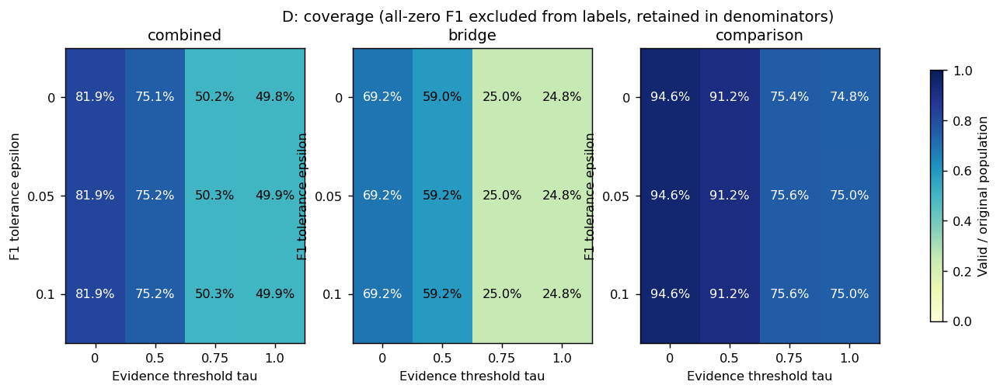
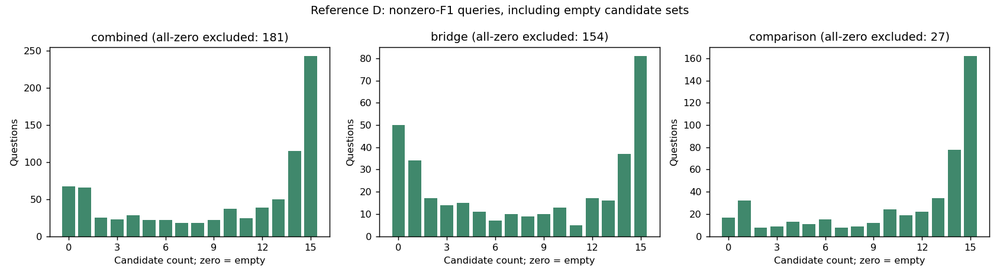
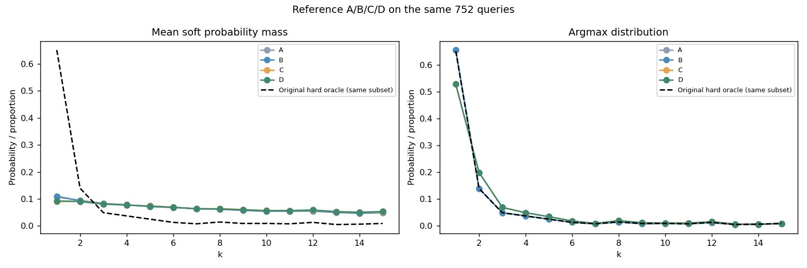
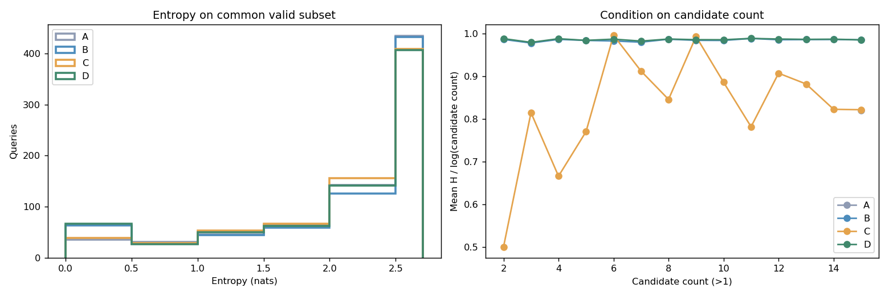
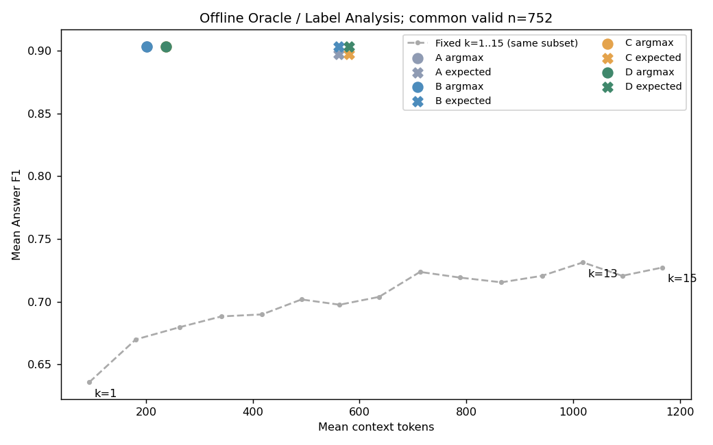

# HotpotQA 1000 题 Soft Oracle 构造与可行性分析

范围：2026-10-14 正式实验，500 Bridge + 500 Comparison，k=1～15。本文所有质量/成本均为 **Offline Oracle / Label Analysis**，使用每题全部 k 的已知回答结果，不能视为仅输入 Query 的预测模型能力。未运行检索、LLM、训练或扩大数据。

## 1. 主要判断

参考配置 ε=0.1、τ=0.5、λ=0.1、T=0.1（预设示例，未择优），方案 D 有效 752/1000（75.20%），非零但空候选 67 题，全零 F1 181 题；有效题中单候选 66 题，多候选 686 题（91.22%），平均候选 10.657 个。

Soft Label 在有效题上保留多个预算的概率与效用信息；但 argmax k=1 仍占 52.79%，k=1 平均概率质量为 9.29%。概率分散与 argmax 决策集中可以同时发生，不能据此宣布不均衡已经解决。

参考标签中 306 / 752 题的正值 F1 曲线完全平坦；这些题的预算概率差异来自成本偏好，而非已观察到的答案质量差异。按概率采样时的期望 Context Tokens 为 580.2，明显高于取 argmax 的 237.0（2.45 倍）。后续必须明确如何将分布转成预算决策，否则平滑标签可能掩盖成本差异。

在同一 752 题上，B→D（加入 Evidence 约束）使 argmax 平均 Context Tokens 改变 35.4，F1 改变 -0.006 个百分点，平均证据 Recall 改变 8.389 个百分点。这是约束导致的离线选择差异，不能识别证据增加的因果收益；是否值得成本取决于应用是否要求 Gold 证据覆盖。

建议保留本轮方法作为可审计的候选标签方案，先检查证据阈值的语义、类型选择偏差与 Query 对预算需求的可预测性，再由研究者决定是否进入训练和扩大自然采样。当前结果不足以承诺泛化收益，也没有自动选取最佳参数。

## 2. 数据完整性与字段依据

| 校验项 | 结果 |
| --- | --- |
| 唯一 Query / (qid,k) | 1000 / 15000 |
| Bridge / Comparison | 500 / 500 |
| 重复 / 缺失 / F1、EM 不一致 / Token 异常 | 0 / 0 / 0 / 0 |
| 全零 F1 | 181 |
| sentence unknown 的题 / 对数 | 1 / 1 |
| 最小 Context Tokens | 18 |
| Context Tokens 相邻下降对数 | 0 |

实际曲线字段为 `scores[str(k)].f1/em`、`best_k`、`tied_best_ks`、`context_tokens[str(k)]`、`api_token_usage[str(k)]`；问题文本来自 processed dataset 的 `question_text`。Evidence CSV 同时有 `qid` 与 `question_id`，两列必须相同。四源按主键严格连接；分类型数量、每题完整 k、官方分数与原 Oracle 均核对，不静默填补或删除。

复用 `evidence_diagnostic/analyze_evidence.py` 与原 `summary.md` 的已有定义：实际传入 LLM 的过滤后 contexts 经 `para_to_text(...,350)` 截断、添加标题；原诊断已核对 context SHA256。`sentence_recall_lower = sentence_hit / sentence_total`，upper 将 unknown 加入分子；本次只加载和核对计数/边界，不重做文本匹配或重跑旧脚本。unknown 表示不确定，不是确定未命中；Gold 字面覆盖也不等于所有等价证据路径。

## 3. 构造规则、状态与统计分母

Smax 从每题全部 15 个 k 计算；D 候选满足 F1≥Smax−ε 且 E≥τ。A 无约束，B 仅 F1，C 仅 Evidence，D 双约束。各方案均先按同一规则标记全零 F1，不生成训练标签。浮点阈值比较允许 1e-12 绝对舍入误差；原 Hard Oracle 并列判断沿用原始分数的精确相等。

成本 C(k)=Tokens(k)/max_j Tokens(j)，分母始终取全部 k。U=F1−λC，仅在候选中做减最大值的稳定 Softmax。无效候选概率严格为 0；单候选是 One-hot。空候选不回退。`all_zero_f1` 优先于空候选状态：两类无标签记录的 `soft_label=null`、argmax/entropy=null，保留原始候选 mask 和数量；每题都保存在 labels.jsonl。

所有有效率、非零空候选率、全零率的分母是原始 Combined=1000 / Bridge=500 / Comparison=500，三种状态互斥且合计为原组样本数。`constraint_empty_all_n` 另计原始约束空集，可能与全零重叠。候选数量同时保存全体、非零、有效三个直方图；下面平均候选数与单/多候选比例的分母均为有效题。候选排除统计按 (qid,k)，分别给出全体与非零分母，F1 排除和 Evidence 排除可能重叠。

## 4. ε、τ 对候选集合的影响

τ=0 是不施加实际证据限制的消融。下表每行属于方案 D，包含原组分母。

固定参考 ε，τ 对有效数的影响为 τ=0：819题、τ=0.5：752题、τ=0.75：503题、τ=1.0：499题；固定参考 τ，ε 扫描的有效数范围仅 751～752。因此本批数据的覆盖对证据阈值更敏感，放宽 F1 容忍度并未补回多数证据无解题。

| 组 | ε | τ | 有效/原组 | 非零空集 | 全零 | 单候选/有效 | 多候选/有效 | 平均候选 |
| --- | --- | --- | --- | --- | --- | --- | --- | --- |
| combined | 0 | 0 | 819/1000 (81.90%) | 0 | 181 | 83/819 | 736/819 | 10.645 |
| bridge | 0 | 0 | 346/500 (69.20%) | 0 | 154 | 50/346 | 296/346 | 9.301 |
| comparison | 0 | 0 | 473/500 (94.60%) | 0 | 27 | 33/473 | 440/473 | 11.628 |
| combined | 0 | 0.5 | 751/1000 (75.10%) | 68 | 181 | 70/751 | 681/751 | 10.613 |
| bridge | 0 | 0.5 | 295/500 (59.00%) | 51 | 154 | 38/295 | 257/295 | 9.502 |
| comparison | 0 | 0.5 | 456/500 (91.20%) | 17 | 27 | 32/456 | 424/456 | 11.331 |
| combined | 0 | 0.75 | 502/1000 (50.20%) | 317 | 181 | 25/502 | 477/502 | 10.257 |
| bridge | 0 | 0.75 | 125/500 (25.00%) | 221 | 154 | 10/125 | 115/125 | 9.752 |
| comparison | 0 | 0.75 | 377/500 (75.40%) | 96 | 27 | 15/377 | 362/377 | 10.424 |
| combined | 0 | 1.0 | 498/1000 (49.80%) | 321 | 181 | 24/498 | 474/498 | 10.299 |
| bridge | 0 | 1.0 | 124/500 (24.80%) | 222 | 154 | 11/124 | 113/124 | 9.806 |
| comparison | 0 | 1.0 | 374/500 (74.80%) | 99 | 27 | 13/374 | 361/374 | 10.463 |
| combined | 0.05 | 0 | 819/1000 (81.90%) | 0 | 181 | 80/819 | 739/819 | 10.670 |
| bridge | 0.05 | 0 | 346/500 (69.20%) | 0 | 154 | 47/346 | 299/346 | 9.332 |
| comparison | 0.05 | 0 | 473/500 (94.60%) | 0 | 27 | 33/473 | 440/473 | 11.649 |
| combined | 0.05 | 0.5 | 752/1000 (75.20%) | 67 | 181 | 69/752 | 683/752 | 10.625 |
| bridge | 0.05 | 0.5 | 296/500 (59.20%) | 50 | 154 | 37/296 | 259/296 | 9.503 |
| comparison | 0.05 | 0.5 | 456/500 (91.20%) | 17 | 27 | 32/456 | 424/456 | 11.353 |
| combined | 0.05 | 0.75 | 503/1000 (50.30%) | 316 | 181 | 25/503 | 478/503 | 10.243 |
| bridge | 0.05 | 0.75 | 125/500 (25.00%) | 221 | 154 | 10/125 | 115/125 | 9.752 |
| comparison | 0.05 | 0.75 | 378/500 (75.60%) | 95 | 27 | 15/378 | 363/378 | 10.405 |
| combined | 0.05 | 1.0 | 499/1000 (49.90%) | 320 | 181 | 24/499 | 475/499 | 10.285 |
| bridge | 0.05 | 1.0 | 124/500 (24.80%) | 222 | 154 | 11/124 | 113/124 | 9.806 |
| comparison | 0.05 | 1.0 | 375/500 (75.00%) | 98 | 27 | 13/375 | 362/375 | 10.443 |
| combined | 0.1 | 0 | 819/1000 (81.90%) | 0 | 181 | 77/819 | 742/819 | 10.701 |
| bridge | 0.1 | 0 | 346/500 (69.20%) | 0 | 154 | 44/346 | 302/346 | 9.382 |
| comparison | 0.1 | 0 | 473/500 (94.60%) | 0 | 27 | 33/473 | 440/473 | 11.666 |
| combined | 0.1 | 0.5 | 752/1000 (75.20%) | 67 | 181 | 66/752 | 686/752 | 10.657 |
| bridge | 0.1 | 0.5 | 296/500 (59.20%) | 50 | 154 | 34/296 | 262/296 | 9.557 |
| comparison | 0.1 | 0.5 | 456/500 (91.20%) | 17 | 27 | 32/456 | 424/456 | 11.371 |
| combined | 0.1 | 0.75 | 503/1000 (50.30%) | 316 | 181 | 25/503 | 478/503 | 10.250 |
| bridge | 0.1 | 0.75 | 125/500 (25.00%) | 221 | 154 | 10/125 | 115/125 | 9.752 |
| comparison | 0.1 | 0.75 | 378/500 (75.60%) | 95 | 27 | 15/378 | 363/378 | 10.415 |
| combined | 0.1 | 1.0 | 499/1000 (49.90%) | 320 | 181 | 24/499 | 475/499 | 10.293 |
| bridge | 0.1 | 1.0 | 124/500 (24.80%) | 222 | 154 | 11/124 | 113/124 | 9.806 |
| comparison | 0.1 | 1.0 | 375/500 (75.00%) | 98 | 27 | 13/375 | 362/375 | 10.453 |

参考配置候选排除的互斥分解（非零 F1 题；每题 15 个候选）：

| 组 | 候选分母 | 仅 F1 不过 | 仅 Evidence 不过 | 两者不过 | 两者通过 |
| --- | --- | --- | --- | --- | --- |
| combined | 12285 | 2815 | 750 | 706 | 8014 |
| bridge | 5190 | 1427 | 417 | 517 | 2829 |
| comparison | 7095 | 1388 | 333 | 189 | 5185 |

## 5. 四种消融：覆盖率与各自/共同有效集

首先分别看各方案自身有效集，性能行不能跨不同分母直接排序。随后固定 A∩B∩C∩D 的共同有效题（对同一 ε、τ 等于 D 有效集），比较约束自身的作用。全零题在四方案中处理完全一致。

| 组 | 方案 | 有效/原组 | 平均熵 | 平均最大概率 | k1概率质量 | argmax k1 | argmax F1 | argmax上下文 |
| --- | --- | --- | --- | --- | --- | --- | --- | --- |
| combined | A | 819/1000 | 2.192 | 21.96% | 10.68% | 64.22% | 89.49% | 202.9 |
| combined | B | 819/1000 | 2.097 | 23.82% | 11.00% | 64.22% | 89.49% | 202.9 |
| combined | C | 757/1000 | 2.186 | 21.52% | 8.96% | 52.44% | 89.99% | 239.2 |
| combined | D | 752/1000 | 2.106 | 23.08% | 9.29% | 52.79% | 90.33% | 237.0 |
| bridge | A | 346/500 | 2.061 | 25.60% | 10.16% | 53.76% | 84.33% | 272.0 |
| bridge | B | 346/500 | 1.899 | 28.75% | 10.62% | 53.76% | 84.33% | 272.0 |
| bridge | C | 300/500 | 2.074 | 24.63% | 8.79% | 47.33% | 85.53% | 305.1 |
| bridge | D | 296/500 | 1.935 | 27.38% | 9.21% | 47.97% | 86.02% | 302.3 |
| comparison | A | 473/500 | 2.288 | 19.30% | 11.07% | 71.88% | 93.27% | 152.3 |
| comparison | B | 473/500 | 2.241 | 20.22% | 11.28% | 71.88% | 93.27% | 152.3 |
| comparison | C | 457/500 | 2.260 | 19.48% | 9.06% | 55.80% | 92.93% | 195.9 |
| comparison | D | 456/500 | 2.218 | 20.30% | 9.33% | 55.92% | 93.13% | 194.6 |

共同有效集公平对比：

| 组 | 方案 | 共同n | argmax F1 | 期望F1 | argmax Context | 期望Context | argmax E | 期望 E | 与原Hard不同 |
| --- | --- | --- | --- | --- | --- | --- | --- | --- | --- |
| combined | A | 752 | 90.34% | 89.75% | 201.6 | 560.4 | 53.83% | 76.21% | 0.40% |
| combined | B | 752 | 90.34% | 90.32% | 201.6 | 561.1 | 53.83% | 76.20% | 0.40% |
| combined | C | 752 | 90.33% | 89.76% | 237.0 | 579.9 | 62.22% | 78.64% | 14.36% |
| combined | D | 752 | 90.33% | 90.31% | 237.0 | 580.2 | 62.22% | 78.58% | 14.36% |
| bridge | A | 296 | 86.04% | 85.02% | 278.3 | 611.1 | 56.42% | 68.17% | 1.01% |
| bridge | B | 296 | 86.04% | 86.01% | 278.3 | 614.5 | 56.42% | 68.29% | 1.01% |
| bridge | C | 296 | 86.02% | 85.04% | 302.3 | 623.8 | 61.54% | 69.64% | 9.46% |
| bridge | D | 296 | 86.02% | 86.00% | 302.3 | 626.5 | 61.54% | 69.68% | 9.46% |
| comparison | A | 456 | 93.13% | 92.81% | 151.8 | 527.4 | 52.15% | 81.43% | 0.00% |
| comparison | B | 456 | 93.13% | 93.11% | 151.8 | 526.5 | 52.15% | 81.33% | 0.00% |
| comparison | C | 456 | 93.13% | 92.82% | 194.6 | 551.3 | 62.66% | 84.49% | 17.54% |
| comparison | D | 456 | 93.13% | 93.11% | 194.6 | 550.1 | 62.66% | 84.37% | 17.54% |

约束的成对边际作用（共同有效集 Combined）：

| 对照 | Δargmax F1(百分点) | Δ期望F1(百分点) | Δargmax Context | Δ期望Context | Δargmax E(百分点) |
| --- | --- | --- | --- | --- | --- |
| A→B | 0.000 | 0.571 | 0.0 | 0.7 | 0.000 |
| A→C | -0.006 | 0.012 | 35.4 | 19.5 | 8.389 |
| B→D | -0.006 | -0.002 | 35.4 | 19.1 | 8.389 |
| C→D | 0.000 | 0.556 | 0.0 | 0.3 | 0.000 |

F1 约束主要剔除超过容忍损失的预算；Evidence 约束可能机械排除较小 k，同时选择易于命中 Gold 的题。D 覆盖率下降既包括原有全零排除，也包括证据门槛与高 F1 区间无交集，必须分别看待。τ=0.5 只要求一半标注句覆盖，不能称作完整证据充分；τ=1 要求完整匹配，但会带来更强选择偏差。

本批数据 k=1 的完整 Gold 支持句覆盖题数为 0，因此 τ=1 时 k=1 标签必然消失。这是候选规则的机械结果，不能作为标签更合理或回答更准确的证据。参考 D 相对非零819题额外排除67题（8.18%），而不是把全部248个无标签题都归因于双重约束。

## 6. Soft Label 分布、熵与原 Hard Oracle

原 Hard Oracle 全体分布与参考 D 有效集上的原 Hard、Soft argmax、平均概率质量如下；同一行的三种分布均使用同一有效集。原全体 Hard 包含全零并列取 k=1，不能直接与已排除全零的标签对比推断改善。

| 组/集合 | n | k=1…15 的数量或概率质量 |
| --- | --- | --- |
| combined 原全体Hard | 1000 | 704, 115, 45, 33, 24, 11, 8, 12, 7, 8, 6, 11, 4, 5, 7 |
| bridge 原全体Hard | 500 | 337, 51, 27, 20, 11, 4, 4, 10, 5, 5, 5, 8, 3, 4, 6 |
| comparison 原全体Hard | 500 | 367, 64, 18, 13, 13, 7, 4, 2, 2, 3, 1, 3, 1, 1, 1 |
| combined D有效集 原Hard | 752 | 490, 105, 37, 28, 19, 10, 6, 11, 7, 7, 6, 10, 4, 5, 7 |
| combined D有效集 Soft argmax | 752 | 397, 150, 52, 37, 26, 14, 7, 15, 9, 8, 8, 12, 5, 5, 7 |
| combined D有效集 平均Soft概率 | 752 | 0.0929, 0.0905, 0.0807, 0.0773, 0.0731, 0.0692, 0.0637, 0.0630, 0.0601, 0.0563, 0.0571, 0.0591, 0.0533, 0.0505, 0.0534 |
| bridge D有效集 原Hard | 296 | 160, 42, 20, 18, 7, 3, 3, 9, 5, 4, 5, 7, 3, 4, 6 |
| bridge D有效集 Soft argmax | 296 | 142, 54, 22, 19, 7, 3, 3, 12, 5, 4, 5, 7, 3, 4, 6 |
| bridge D有效集 平均Soft概率 | 296 | 0.0921, 0.0878, 0.0765, 0.0823, 0.0657, 0.0593, 0.0616, 0.0678, 0.0607, 0.0556, 0.0606, 0.0590, 0.0549, 0.0524, 0.0635 |
| comparison D有效集 原Hard | 456 | 330, 63, 17, 10, 12, 7, 3, 2, 2, 3, 1, 3, 1, 1, 1 |
| comparison D有效集 Soft argmax | 456 | 255, 96, 30, 18, 19, 11, 4, 3, 4, 4, 3, 5, 2, 1, 1 |
| comparison D有效集 平均Soft概率 | 456 | 0.0933, 0.0922, 0.0835, 0.0740, 0.0779, 0.0755, 0.0650, 0.0599, 0.0596, 0.0567, 0.0548, 0.0591, 0.0522, 0.0492, 0.0469 |

H=−Σp ln p（nats），同时输出 H/ln15 与 H/ln|C|。单候选时 H=0，H/ln|C| 无定义，保存 null 并在均值中排除；对应有效计数单独输出。不能直接把较大候选集造成的高熵解释成更优监督。`distribution_summary.json` 对每组参数、方案、类型、评估集合保存熵/最大概率的分位数、直方图，并按候选数分层保存熵。

| 组 | 方案 | 平均H | H/ln15 | 多候选 H/lnC | 对应n | 最大概率均值 |
| --- | --- | --- | --- | --- | --- | --- |
| combined | A | 2.222 | 0.820 | 0.820 | 752 | 0.211 |
| combined | B | 2.139 | 0.790 | 0.985 | 689 | 0.226 |
| combined | C | 2.188 | 0.808 | 0.826 | 752 | 0.215 |
| combined | D | 2.106 | 0.778 | 0.986 | 686 | 0.231 |
| bridge | A | 2.099 | 0.775 | 0.775 | 296 | 0.243 |
| bridge | B | 1.957 | 0.723 | 0.986 | 263 | 0.270 |
| bridge | C | 2.074 | 0.766 | 0.786 | 296 | 0.247 |
| bridge | D | 1.935 | 0.714 | 0.987 | 262 | 0.274 |
| comparison | A | 2.301 | 0.850 | 0.850 | 456 | 0.190 |
| comparison | B | 2.257 | 0.833 | 0.985 | 426 | 0.198 |
| comparison | C | 2.261 | 0.835 | 0.851 | 456 | 0.195 |
| comparison | D | 2.218 | 0.819 | 0.986 | 424 | 0.203 |

## 7. 离线质量与成本：严格保持相同评估题集

全体 1000 题的固定 k 与原 Hard Oracle（无覆盖率筛选）：

| 组 | 策略 | n/原组 | F1 | Context Tokens | Gold句 Recall Lower |
| --- | --- | --- | --- | --- | --- |
| combined | 固定k=1 | 1000/1000 | 50.87% | 93.9 | 36.08% |
| combined | 固定k=13 | 1000/1000 | 58.48% | 1,018.7 | 72.26% |
| combined | 固定k=15 | 1000/1000 | 57.80% | 1,167.2 | 72.84% |
| bridge | 固定k=1 | 500/500 | 35.97% | 100.7 | 32.65% |
| bridge | 固定k=13 | 500/500 | 44.48% | 1,048.4 | 54.91% |
| bridge | 固定k=15 | 500/500 | 43.02% | 1,197.9 | 55.75% |
| comparison | 固定k=1 | 500/500 | 65.78% | 87.0 | 39.51% |
| comparison | 固定k=13 | 500/500 | 72.47% | 989.0 | 89.61% |
| comparison | 固定k=15 | 500/500 | 72.58% | 1,136.6 | 89.94% |
| combined | 原Hard | 1000 | 73.31% | 185.3 | 45.69% |
| bridge | 原Hard | 500 | 58.39% | 221.9 | 41.40% |
| comparison | 原Hard | 500 | 88.23% | 148.8 | 49.98% |

参考 D 的有效子集（也等于参考 A/B/C/D 共同有效集）：

| 组 | 策略 | 覆盖n/原组 | F1 | Context Tokens | 相对逐题max F1损失 |
| --- | --- | --- | --- | --- | --- |
| combined | argmax | 752/1000 | 90.33% | 237.0 | 0.03% |
| combined | expected | 752/1000 | 90.31% | 580.2 | 0.04% |
| bridge | argmax | 296/500 | 86.02% | 302.3 | 0.07% |
| bridge | expected | 296/500 | 86.00% | 626.5 | 0.09% |
| comparison | argmax | 456/500 | 93.13% | 194.6 | 0.00% |
| comparison | expected | 456/500 | 93.11% | 550.1 | 0.02% |
| combined | 固定k=1 | 752/1000 | 63.60% | 94.0 | 26.76% |
| combined | 固定k=13 | 752/1000 | 73.14% | 1,018.5 | 17.22% |
| bridge | 固定k=1 | 296/500 | 53.95% | 104.1 | 32.14% |
| bridge | 固定k=13 | 296/500 | 66.88% | 1,068.1 | 19.21% |
| comparison | 固定k=1 | 456/500 | 69.87% | 87.4 | 23.26% |
| comparison | 固定k=13 | 456/500 | 77.20% | 986.4 | 15.93% |

期望策略是按 Soft Label 对已有分数和成本加权，不是模型对答案的期望置信度。所有 D 候选的逐题 F1 损失≤ε，因此 argmax 与期望 F1 损失均受此界限约束；这是构造保证，不是模型学到的性能。无标签题保留在覆盖分母，本次未定义回退策略，因此不给出伪装为全体 1000 的 D 平均性能。原全体基线与子集结果不能直接相减。

## 8. 参数敏感性与类型差异

完整扫描 3×4×3×3=108 组数值参数，每组 4 方案、3 类型、2 集合（自身/共同），共 2592 行 parameter_sweep.csv；候选集合扫描 144 行。A/B/C 中不启用的约束参数仍完整记录，可能出现相同统计，这是控制消融的预期，不是缺失实验。未自动优化任何指标。

固定参考 ε、τ，改变 λ、T（D，各自有效集）：

在该 λ/T 网格中，Combined 的期望 Context Tokens 范围为 418.3～631.4，平均熵为 1.776～2.134；argmax F1 仅在 90.32%～90.35% 间变化。该统计进一步说明，概率形状与实际选取最大概率预算的质量/成本行为需要分别评估。

| 组 | λ | T | n | 平均H | 最大概率均值 | argmax F1 | 期望F1 | argmax Context | 期望Context |
| --- | --- | --- | --- | --- | --- | --- | --- | --- | --- |
| combined | 0.05 | 0.05 | 752 | 2.105 | 23.18% | 90.35% | 90.33% | 239.9 | 580.6 |
| combined | 0.05 | 0.1 | 752 | 2.128 | 21.21% | 90.35% | 90.32% | 239.9 | 614.3 |
| combined | 0.05 | 0.2 | 752 | 2.134 | 20.28% | 90.35% | 90.31% | 239.9 | 631.4 |
| combined | 0.1 | 0.05 | 752 | 2.024 | 27.33% | 90.33% | 90.32% | 237.0 | 517.2 |
| combined | 0.1 | 0.1 | 752 | 2.106 | 23.08% | 90.33% | 90.31% | 237.0 | 580.2 |
| combined | 0.1 | 0.2 | 752 | 2.129 | 21.16% | 90.33% | 90.31% | 237.0 | 614.1 |
| combined | 0.2 | 0.05 | 752 | 1.776 | 36.44% | 90.32% | 90.31% | 235.1 | 418.3 |
| combined | 0.2 | 0.1 | 752 | 2.025 | 27.32% | 90.32% | 90.31% | 235.1 | 516.7 |
| combined | 0.2 | 0.2 | 752 | 2.107 | 23.08% | 90.32% | 90.31% | 235.1 | 580.0 |
| bridge | 0.05 | 0.05 | 296 | 1.933 | 27.59% | 86.08% | 86.02% | 309.6 | 627.8 |
| bridge | 0.05 | 0.1 | 296 | 1.954 | 25.61% | 86.08% | 86.01% | 309.6 | 658.4 |
| bridge | 0.05 | 0.2 | 296 | 1.959 | 24.67% | 86.08% | 86.00% | 309.6 | 674.0 |
| bridge | 0.1 | 0.05 | 296 | 1.862 | 31.46% | 86.02% | 86.01% | 302.3 | 568.1 |
| bridge | 0.1 | 0.1 | 296 | 1.935 | 27.38% | 86.02% | 86.00% | 302.3 | 626.5 |
| bridge | 0.1 | 0.2 | 296 | 1.955 | 25.50% | 86.02% | 86.00% | 302.3 | 657.8 |
| bridge | 0.2 | 0.05 | 296 | 1.638 | 40.24% | 85.99% | 85.99% | 297.6 | 473.9 |
| bridge | 0.2 | 0.1 | 296 | 1.863 | 31.50% | 85.99% | 85.99% | 297.6 | 566.8 |
| bridge | 0.2 | 0.2 | 296 | 1.935 | 27.39% | 85.99% | 85.99% | 297.6 | 626.0 |
| comparison | 0.05 | 0.05 | 456 | 2.217 | 20.32% | 93.13% | 93.12% | 194.6 | 550.0 |
| comparison | 0.05 | 0.1 | 456 | 2.241 | 18.35% | 93.13% | 93.11% | 194.6 | 585.6 |
| comparison | 0.05 | 0.2 | 456 | 2.248 | 17.43% | 93.13% | 93.11% | 194.6 | 603.8 |
| comparison | 0.1 | 0.05 | 456 | 2.130 | 24.64% | 93.13% | 93.12% | 194.6 | 484.1 |
| comparison | 0.1 | 0.1 | 456 | 2.218 | 20.30% | 93.13% | 93.11% | 194.6 | 550.1 |
| comparison | 0.1 | 0.2 | 456 | 2.242 | 18.34% | 93.13% | 93.11% | 194.6 | 585.7 |
| comparison | 0.2 | 0.05 | 456 | 1.866 | 33.97% | 93.13% | 93.12% | 194.6 | 382.3 |
| comparison | 0.2 | 0.1 | 456 | 2.131 | 24.61% | 93.13% | 93.11% | 194.6 | 484.1 |
| comparison | 0.2 | 0.2 | 456 | 2.218 | 20.28% | 93.13% | 93.11% | 194.6 | 550.1 |

T 只改变概率平滑程度，正温度下不改变 Utility 的排序，因此同 λ 的 argmax 应恒定；λ 改变质量与相对成本的权衡。若候选 F1 并列，分布由 λ/T 和成本差决定，高熵未必意味着强回答质量信号。固定 ε、τ 的候选集不受 λ、T 影响。每题最大 Token 归一化后，同一个相对成本在不同题的绝对 Token 含义不同。

τ 敏感性若各用自身有效集会混入题集变化。下面将 D 在全部扫描 τ 下共同有效的题固定（按每题 mask 重算），再比较阈值，λ、T、ε 保持参考：

| 组 | τ | 跨τ共同n | argmax F1 | argmax Context | argmax E | 期望F1 | 期望Context |
| --- | --- | --- | --- | --- | --- | --- | --- |
| combined | 0 | 499 | 92.99% | 181.9 | 56.95% | 92.98% | 581.0 |
| combined | 0.5 | 499 | 92.99% | 217.5 | 66.82% | 92.98% | 599.6 |
| combined | 0.75 | 499 | 92.98% | 383.9 | 99.65% | 92.98% | 696.0 |
| combined | 1.0 | 499 | 92.98% | 386.2 | 100.00% | 92.98% | 697.2 |
| bridge | 0 | 124 | 91.91% | 290.4 | 66.06% | 91.91% | 685.0 |
| bridge | 0.5 | 124 | 91.91% | 318.1 | 73.45% | 91.91% | 699.6 |
| bridge | 0.75 | 124 | 91.91% | 480.6 | 99.80% | 91.91% | 790.4 |
| bridge | 1.0 | 124 | 91.91% | 482.6 | 100.00% | 91.91% | 791.5 |
| comparison | 0 | 375 | 93.35% | 146.1 | 53.93% | 93.33% | 546.6 |
| comparison | 0.5 | 375 | 93.35% | 184.3 | 64.62% | 93.33% | 566.5 |
| comparison | 0.75 | 375 | 93.34% | 352.0 | 99.60% | 93.33% | 664.8 |
| comparison | 1.0 | 375 | 93.34% | 354.3 | 100.00% | 93.33% | 666.0 |

Bridge/Comparison 参考 D 的覆盖分别为 296/500、456/500；平均候选、标签熵和质量成本均应分类型阅读。全零 F1 的154/27差异与 Gold 检索覆盖差异共同影响可训练题构成，不能将有效子集当成原始自然分布。

## 9. 典型问题（目的性分类、固定 qid 顺序选例）

每一类别在 Bridge/Comparison 内选择 qid 字典序第一题，不按结果收益排序；显示类别总体数量，类别可重叠，不能由案例频率外推。分类条件、预测、Gold 答案、全部曲线与概率保存在 examples.jsonl。不存在的类别如实列为空，不编造。

### k=1 正确但 Gold Evidence 不完整 / bridge（本组共 122 题）

qid=`5a7283365542991f9a20c4b2`；问题：Allison Gross is a character in a story which applies what writing technique that introduces characters in threes?；Gold：rule of three。

状态=empty_candidates，原 Hard k=1，候选=[]，Soft argmax=None；k1 预测=the rule of three。

| k | F1 | E lower | E upper | unknown数 | Context Tokens | 候选 | 概率 |
| --- | --- | --- | --- | --- | --- | --- | --- |
| 1 | 1.000 | 0.250 | 0.250 | 0 | 106 | 否 | null |
| 2 | 1.000 | 0.250 | 0.250 | 0 | 144 | 否 | null |
| 3 | 1.000 | 0.250 | 0.250 | 0 | 194 | 否 | null |
| 4 | 1.000 | 0.250 | 0.250 | 0 | 219 | 否 | null |
| 5 | 1.000 | 0.250 | 0.250 | 0 | 284 | 否 | null |
| 6 | 1.000 | 0.250 | 0.250 | 0 | 365 | 否 | null |
| 7 | 1.000 | 0.250 | 0.250 | 0 | 460 | 否 | null |
| 8 | 1.000 | 0.250 | 0.250 | 0 | 677 | 否 | null |
| 9 | 1.000 | 0.250 | 0.250 | 0 | 735 | 否 | null |
| 10 | 1.000 | 0.250 | 0.250 | 0 | 762 | 否 | null |
| 11 | 1.000 | 0.250 | 0.250 | 0 | 870 | 否 | null |
| 12 | 1.000 | 0.250 | 0.250 | 0 | 938 | 否 | null |
| 13 | 1.000 | 0.250 | 0.250 | 0 | 1107 | 否 | null |
| 14 | 1.000 | 0.250 | 0.250 | 0 | 1152 | 否 | null |
| 15 | 1.000 | 0.250 | 0.250 | 0 | 1191 | 否 | null |

观察：答案正确与 Gold 字面覆盖不同；小 k 被保留或剔除取决于阈值，不能断言模型已完成 Gold 推理链，也不能排除等价证据。

### k=1 正确但 Gold Evidence 不完整 / comparison（本组共 289 题）

qid=`5a7108fa5542994082a3e4ef`；问题：Which battle, the Battle of Cold Harbor, or the Second Battle of Bull Run, was fought first?；Gold：Second Battle of Bull Run。

状态=valid，原 Hard k=1，候选=[1, 2, 3, 5]，Soft argmax=1；k1 预测=the Second Battle of Bull Run。

| k | F1 | E lower | E upper | unknown数 | Context Tokens | 候选 | 概率 |
| --- | --- | --- | --- | --- | --- | --- | --- |
| 1 | 1.000 | 0.500 | 0.500 | 0 | 130 | 是 | 0.2704 |
| 2 | 1.000 | 0.500 | 0.500 | 0 | 184 | 是 | 0.2591 |
| 3 | 1.000 | 0.500 | 0.500 | 0 | 245 | 是 | 0.2468 |
| 4 | 0.000 | 0.500 | 0.500 | 0 | 307 | 否 | 0.0000 |
| 5 | 1.000 | 0.500 | 0.500 | 0 | 369 | 是 | 0.2237 |
| 6 | 0.000 | 0.500 | 0.500 | 0 | 399 | 否 | 0.0000 |
| 7 | 0.444 | 0.500 | 0.500 | 0 | 472 | 否 | 0.0000 |
| 8 | 0.000 | 0.500 | 0.500 | 0 | 629 | 否 | 0.0000 |
| 9 | 0.444 | 1.000 | 1.000 | 0 | 749 | 否 | 0.0000 |
| 10 | 0.444 | 1.000 | 1.000 | 0 | 813 | 否 | 0.0000 |
| 11 | 0.444 | 1.000 | 1.000 | 0 | 913 | 否 | 0.0000 |
| 12 | 0.444 | 1.000 | 1.000 | 0 | 985 | 否 | 0.0000 |
| 13 | 0.444 | 1.000 | 1.000 | 0 | 1095 | 否 | 0.0000 |
| 14 | 0.444 | 1.000 | 1.000 | 0 | 1143 | 否 | 0.0000 |
| 15 | 0.444 | 1.000 | 1.000 | 0 | 1258 | 否 | 0.0000 |

观察：答案正确与 Gold 字面覆盖不同；小 k 被保留或剔除取决于阈值，不能断言模型已完成 Gold 推理链，也不能排除等价证据。

### 多个 k 满足双重约束 / bridge（本组共 262 题）

qid=`5a726ba35542997f827839c0`；问题：Which racecar driver who performed in the 1971 Canadian Grand Prix was born in 1937?；Gold：Mark Neary Donohue Jr.。

状态=valid，原 Hard k=2，候选=[2, 3, 4, 5, 12]，Soft argmax=2；k1 预测=no。

| k | F1 | E lower | E upper | unknown数 | Context Tokens | 候选 | 概率 |
| --- | --- | --- | --- | --- | --- | --- | --- |
| 1 | 0.000 | 0.667 | 0.667 | 0 | 120 | 否 | 0.0000 |
| 2 | 0.667 | 0.667 | 0.667 | 0 | 167 | 是 | 0.2392 |
| 3 | 0.667 | 0.667 | 0.667 | 0 | 319 | 是 | 0.2157 |
| 4 | 0.667 | 0.667 | 0.667 | 0 | 366 | 是 | 0.2089 |
| 5 | 0.667 | 0.667 | 0.667 | 0 | 410 | 是 | 0.2027 |
| 6 | 0.000 | 0.667 | 0.667 | 0 | 490 | 否 | 0.0000 |
| 7 | 0.000 | 0.667 | 0.667 | 0 | 545 | 否 | 0.0000 |
| 8 | 0.000 | 0.667 | 0.667 | 0 | 606 | 否 | 0.0000 |
| 9 | 0.000 | 0.667 | 0.667 | 0 | 635 | 否 | 0.0000 |
| 10 | 0.000 | 0.667 | 0.667 | 0 | 762 | 否 | 0.0000 |
| 11 | 0.000 | 0.667 | 0.667 | 0 | 888 | 否 | 0.0000 |
| 12 | 0.667 | 0.667 | 0.667 | 0 | 1024 | 是 | 0.1334 |
| 13 | 0.000 | 0.667 | 0.667 | 0 | 1221 | 否 | 0.0000 |
| 14 | 0.000 | 0.667 | 0.667 | 0 | 1341 | 否 | 0.0000 |
| 15 | 0.000 | 0.667 | 0.667 | 0 | 1468 | 否 | 0.0000 |

### 多个 k 满足双重约束 / comparison（本组共 424 题）

qid=`5a70f11a5542994082a3e40b`；问题：Which dog breed, the Schapendoes or the Bull Terrier, has its origins in a greater number of other dog breeds?；Gold：Bull Terrier。

状态=valid，原 Hard k=2，候选=[2, 4, 5, 8, 15]，Soft argmax=2；k1 预测=Schapendoes。

| k | F1 | E lower | E upper | unknown数 | Context Tokens | 候选 | 概率 |
| --- | --- | --- | --- | --- | --- | --- | --- |
| 1 | 0.000 | 0.000 | 0.000 | 0 | 132 | 否 | 0.0000 |
| 2 | 1.000 | 0.500 | 0.500 | 0 | 194 | 是 | 0.2542 |
| 3 | 0.000 | 0.500 | 0.500 | 0 | 238 | 否 | 0.0000 |
| 4 | 1.000 | 0.500 | 0.500 | 0 | 308 | 是 | 0.2315 |
| 5 | 1.000 | 0.500 | 0.500 | 0 | 358 | 是 | 0.2221 |
| 6 | 0.000 | 0.500 | 0.500 | 0 | 483 | 否 | 0.0000 |
| 7 | 0.000 | 0.500 | 0.500 | 0 | 507 | 否 | 0.0000 |
| 8 | 1.000 | 0.500 | 0.500 | 0 | 597 | 是 | 0.1825 |
| 9 | 0.000 | 0.500 | 0.500 | 0 | 662 | 否 | 0.0000 |
| 10 | 0.000 | 0.500 | 0.500 | 0 | 767 | 否 | 0.0000 |
| 11 | 0.000 | 0.500 | 0.500 | 0 | 894 | 否 | 0.0000 |
| 12 | 0.000 | 0.500 | 0.500 | 0 | 924 | 否 | 0.0000 |
| 13 | 0.000 | 0.500 | 0.500 | 0 | 1114 | 否 | 0.0000 |
| 14 | 0.800 | 1.000 | 1.000 | 0 | 1174 | 否 | 0.0000 |
| 15 | 1.000 | 1.000 | 1.000 | 0 | 1215 | 是 | 0.1097 |

### 只有一个 k 满足约束 / bridge（本组共 34 题）

qid=`5a719bf25542994082a3e891`；问题：The astronomer who formulated the theory of stellar nucleosynthesis co-authored what landmark paper?；Gold：BFH。

状态=valid，原 Hard k=13，候选=[13]，Soft argmax=13；k1 预测=On Nuclear Reactions Occurring in the Stars. I. Carbon, Nitrogen, and Oxygen。

| k | F1 | E lower | E upper | unknown数 | Context Tokens | 候选 | 概率 |
| --- | --- | --- | --- | --- | --- | --- | --- |
| 1 | 0.000 | 0.000 | 0.000 | 0 | 299 | 否 | 0.0000 |
| 2 | 0.667 | 0.000 | 0.000 | 0 | 457 | 否 | 0.0000 |
| 3 | 0.667 | 0.500 | 0.500 | 0 | 549 | 否 | 0.0000 |
| 4 | 0.000 | 1.000 | 1.000 | 0 | 671 | 否 | 0.0000 |
| 5 | 0.667 | 1.000 | 1.000 | 0 | 760 | 否 | 0.0000 |
| 6 | 0.667 | 1.000 | 1.000 | 0 | 825 | 否 | 0.0000 |
| 7 | 0.667 | 1.000 | 1.000 | 0 | 854 | 否 | 0.0000 |
| 8 | 0.667 | 1.000 | 1.000 | 0 | 957 | 否 | 0.0000 |
| 9 | 0.667 | 1.000 | 1.000 | 0 | 1000 | 否 | 0.0000 |
| 10 | 0.667 | 1.000 | 1.000 | 0 | 1137 | 否 | 0.0000 |
| 11 | 0.667 | 1.000 | 1.000 | 0 | 1396 | 否 | 0.0000 |
| 12 | 0.667 | 1.000 | 1.000 | 0 | 1447 | 否 | 0.0000 |
| 13 | 1.000 | 1.000 | 1.000 | 0 | 1496 | 是 | 1.0000 |
| 14 | 0.667 | 1.000 | 1.000 | 0 | 1553 | 否 | 0.0000 |
| 15 | 0.667 | 1.000 | 1.000 | 0 | 1590 | 否 | 0.0000 |

### 只有一个 k 满足约束 / comparison（本组共 32 题）

qid=`5a72224755429971e9dc92be`；问题：Which was founded first, Dain Rauscher Wessels or Berenberg Bank?；Gold：Dain Rauscher Wessels。

状态=valid，原 Hard k=2，候选=[2]，Soft argmax=2；k1 预测=Berenberg Bank。

| k | F1 | E lower | E upper | unknown数 | Context Tokens | 候选 | 概率 |
| --- | --- | --- | --- | --- | --- | --- | --- |
| 1 | 0.000 | 0.667 | 0.667 | 0 | 64 | 否 | 0.0000 |
| 2 | 1.000 | 0.667 | 0.667 | 0 | 130 | 是 | 1.0000 |
| 3 | 0.000 | 1.000 | 1.000 | 0 | 316 | 否 | 0.0000 |
| 4 | 0.000 | 1.000 | 1.000 | 0 | 395 | 否 | 0.0000 |
| 5 | 0.000 | 1.000 | 1.000 | 0 | 583 | 否 | 0.0000 |
| 6 | 0.000 | 1.000 | 1.000 | 0 | 641 | 否 | 0.0000 |
| 7 | 0.000 | 1.000 | 1.000 | 0 | 787 | 否 | 0.0000 |
| 8 | 0.000 | 1.000 | 1.000 | 0 | 942 | 否 | 0.0000 |
| 9 | 0.000 | 1.000 | 1.000 | 0 | 994 | 否 | 0.0000 |
| 10 | 0.000 | 1.000 | 1.000 | 0 | 1056 | 否 | 0.0000 |
| 11 | 0.000 | 1.000 | 1.000 | 0 | 1181 | 否 | 0.0000 |
| 12 | 0.000 | 1.000 | 1.000 | 0 | 1268 | 否 | 0.0000 |
| 13 | 0.000 | 1.000 | 1.000 | 0 | 1433 | 否 | 0.0000 |
| 14 | 0.000 | 1.000 | 1.000 | 0 | 1457 | 否 | 0.0000 |
| 15 | 0.000 | 1.000 | 1.000 | 0 | 1605 | 否 | 0.0000 |

### 非零 F1 但无 k 满足约束 / bridge（本组共 50 题）

qid=`5a712beb5542994082a3e61c`；问题：What Golden Globe Award actor starred in the film Little Fugitive?；Gold：Peter Dinklage。

状态=empty_candidates，原 Hard k=5，候选=[]，Soft argmax=None；k1 预测=no。

| k | F1 | E lower | E upper | unknown数 | Context Tokens | 候选 | 概率 |
| --- | --- | --- | --- | --- | --- | --- | --- |
| 1 | 0.000 | 0.000 | 0.000 | 0 | 27 | 否 | null |
| 2 | 0.000 | 0.000 | 0.000 | 0 | 59 | 否 | null |
| 3 | 0.000 | 0.000 | 0.000 | 0 | 83 | 否 | null |
| 4 | 0.000 | 0.000 | 0.000 | 0 | 120 | 否 | null |
| 5 | 0.500 | 0.000 | 0.000 | 0 | 161 | 否 | null |
| 6 | 0.500 | 0.000 | 0.000 | 0 | 161 | 否 | null |
| 7 | 0.000 | 0.000 | 0.000 | 0 | 186 | 否 | null |
| 8 | 0.000 | 0.000 | 0.000 | 0 | 212 | 否 | null |
| 9 | 0.000 | 0.000 | 0.000 | 0 | 238 | 否 | null |
| 10 | 0.000 | 0.000 | 0.000 | 0 | 285 | 否 | null |
| 11 | 0.000 | 0.000 | 0.000 | 0 | 427 | 否 | null |
| 12 | 0.000 | 0.000 | 0.000 | 0 | 458 | 否 | null |
| 13 | 0.000 | 0.000 | 0.000 | 0 | 458 | 否 | null |
| 14 | 0.000 | 0.000 | 0.000 | 0 | 506 | 否 | null |
| 15 | 0.500 | 0.000 | 0.000 | 0 | 553 | 否 | null |

观察：F1 近优集合与证据门槛的交集为空，不能强制指定 k=15；当前无法产生正常训练标签。

### 非零 F1 但无 k 满足约束 / comparison（本组共 17 题）

qid=`5a72abb95542992359bc3162`；问题：Which film was not a 3D computer-animation Cars 3 or Smith!?；Gold：Smith!。

状态=empty_candidates，原 Hard k=1，候选=[]，Soft argmax=None；k1 预测=Smith!。

| k | F1 | E lower | E upper | unknown数 | Context Tokens | 候选 | 概率 |
| --- | --- | --- | --- | --- | --- | --- | --- |
| 1 | 1.000 | 0.000 | 0.000 | 0 | 81 | 否 | null |
| 2 | 1.000 | 0.000 | 0.000 | 0 | 182 | 否 | null |
| 3 | 0.000 | 0.333 | 0.333 | 0 | 346 | 否 | null |
| 4 | 1.000 | 0.333 | 0.333 | 0 | 559 | 否 | null |
| 5 | 1.000 | 0.333 | 0.333 | 0 | 634 | 否 | null |
| 6 | 1.000 | 0.333 | 0.333 | 0 | 694 | 否 | null |
| 7 | 1.000 | 0.333 | 0.333 | 0 | 791 | 否 | null |
| 8 | 1.000 | 0.333 | 0.333 | 0 | 812 | 否 | null |
| 9 | 1.000 | 0.333 | 0.333 | 0 | 878 | 否 | null |
| 10 | 1.000 | 0.333 | 0.333 | 0 | 929 | 否 | null |
| 11 | 1.000 | 0.333 | 0.333 | 0 | 1102 | 否 | null |
| 12 | 1.000 | 0.333 | 0.333 | 0 | 1133 | 否 | null |
| 13 | 1.000 | 0.333 | 0.333 | 0 | 1198 | 否 | null |
| 14 | 1.000 | 0.333 | 0.333 | 0 | 1225 | 否 | null |
| 15 | 1.000 | 0.333 | 0.333 | 0 | 1278 | 否 | null |

观察：F1 近优集合与证据门槛的交集为空，不能强制指定 k=15；当前无法产生正常训练标签。

### 所有 k 的 F1 均为 0 / bridge（本组共 154 题）

qid=`5a71148b5542994082a3e567`；问题：What was the population of the city where Penobscot Marine Museum is located?；Gold：The population was 2,615。

状态=all_zero_f1，原 Hard k=1，候选=[1, 2, 3, 4, 5, 6, 7, 8, 9, 10, 11, 12, 13, 14, 15]，Soft argmax=None；k1 预测=no data。

| k | F1 | E lower | E upper | unknown数 | Context Tokens | 候选 | 概率 |
| --- | --- | --- | --- | --- | --- | --- | --- |
| 1 | 0.000 | 0.500 | 0.500 | 0 | 82 | 是 | null |
| 2 | 0.000 | 0.500 | 0.500 | 0 | 164 | 是 | null |
| 3 | 0.000 | 0.500 | 0.500 | 0 | 231 | 是 | null |
| 4 | 0.000 | 0.500 | 0.500 | 0 | 288 | 是 | null |
| 5 | 0.000 | 0.500 | 0.500 | 0 | 338 | 是 | null |
| 6 | 0.000 | 0.500 | 0.500 | 0 | 473 | 是 | null |
| 7 | 0.000 | 0.500 | 0.500 | 0 | 552 | 是 | null |
| 8 | 0.000 | 0.500 | 0.500 | 0 | 676 | 是 | null |
| 9 | 0.000 | 0.500 | 0.500 | 0 | 777 | 是 | null |
| 10 | 0.000 | 0.500 | 0.500 | 0 | 817 | 是 | null |
| 11 | 0.000 | 0.500 | 0.500 | 0 | 869 | 是 | null |
| 12 | 0.000 | 0.500 | 0.500 | 0 | 942 | 是 | null |
| 13 | 0.000 | 0.500 | 0.500 | 0 | 997 | 是 | null |
| 14 | 0.000 | 0.500 | 0.500 | 0 | 1076 | 是 | null |
| 15 | 0.000 | 0.500 | 0.500 | 0 | 1102 | 是 | null |

观察：即使原始约束下存在候选，也没有可辨识回答质量差异，按统一规则保存 null 标签；原 Hard 因并列取 1。

### 所有 k 的 F1 均为 0 / comparison（本组共 27 题）

qid=`5a71443f5542994082a3e727`；问题：Is Gasherbrum II or Nuptse closest to the tallest mountain in the world?；Gold：It lies two kilometres WSW of Mount Everest.。

状态=all_zero_f1，原 Hard k=1，候选=[7, 8, 9, 10, 11, 12, 13, 14, 15]，Soft argmax=None；k1 预测=Nuptse。

| k | F1 | E lower | E upper | unknown数 | Context Tokens | 候选 | 概率 |
| --- | --- | --- | --- | --- | --- | --- | --- |
| 1 | 0.000 | 0.333 | 0.333 | 0 | 129 | 否 | null |
| 2 | 0.000 | 0.333 | 0.333 | 0 | 173 | 否 | null |
| 3 | 0.000 | 0.333 | 0.333 | 0 | 348 | 否 | null |
| 4 | 0.000 | 0.333 | 0.333 | 0 | 512 | 否 | null |
| 5 | 0.000 | 0.333 | 0.333 | 0 | 604 | 否 | null |
| 6 | 0.000 | 0.333 | 0.333 | 0 | 673 | 否 | null |
| 7 | 0.000 | 1.000 | 1.000 | 0 | 786 | 是 | null |
| 8 | 0.000 | 1.000 | 1.000 | 0 | 906 | 是 | null |
| 9 | 0.000 | 1.000 | 1.000 | 0 | 1052 | 是 | null |
| 10 | 0.000 | 1.000 | 1.000 | 0 | 1176 | 是 | null |
| 11 | 0.000 | 1.000 | 1.000 | 0 | 1263 | 是 | null |
| 12 | 0.000 | 1.000 | 1.000 | 0 | 1327 | 是 | null |
| 13 | 0.000 | 1.000 | 1.000 | 0 | 1446 | 是 | null |
| 14 | 0.000 | 1.000 | 1.000 | 0 | 1538 | 是 | null |
| 15 | 0.000 | 1.000 | 1.000 | 0 | 1627 | 是 | null |

观察：即使原始约束下存在候选，也没有可辨识回答质量差异，按统一规则保存 null 标签；原 Hard 因并列取 1。

### 增加检索文档后 F1 下降 / bridge（本组共 191 题）

qid=`5a712beb5542994082a3e61c`；问题：What Golden Globe Award actor starred in the film Little Fugitive?；Gold：Peter Dinklage。

状态=empty_candidates，原 Hard k=5，候选=[]，Soft argmax=None；k1 预测=no。

| k | F1 | E lower | E upper | unknown数 | Context Tokens | 候选 | 概率 |
| --- | --- | --- | --- | --- | --- | --- | --- |
| 1 | 0.000 | 0.000 | 0.000 | 0 | 27 | 否 | null |
| 2 | 0.000 | 0.000 | 0.000 | 0 | 59 | 否 | null |
| 3 | 0.000 | 0.000 | 0.000 | 0 | 83 | 否 | null |
| 4 | 0.000 | 0.000 | 0.000 | 0 | 120 | 否 | null |
| 5 | 0.500 | 0.000 | 0.000 | 0 | 161 | 否 | null |
| 6 | 0.500 | 0.000 | 0.000 | 0 | 161 | 否 | null |
| 7 | 0.000 | 0.000 | 0.000 | 0 | 186 | 否 | null |
| 8 | 0.000 | 0.000 | 0.000 | 0 | 212 | 否 | null |
| 9 | 0.000 | 0.000 | 0.000 | 0 | 238 | 否 | null |
| 10 | 0.000 | 0.000 | 0.000 | 0 | 285 | 否 | null |
| 11 | 0.000 | 0.000 | 0.000 | 0 | 427 | 否 | null |
| 12 | 0.000 | 0.000 | 0.000 | 0 | 458 | 否 | null |
| 13 | 0.000 | 0.000 | 0.000 | 0 | 458 | 否 | null |
| 14 | 0.000 | 0.000 | 0.000 | 0 | 506 | 否 | null |
| 15 | 0.500 | 0.000 | 0.000 | 0 | 553 | 否 | null |

观察：相邻下降点=[[6, 7]]；增加 k 未保证答案更好，即使已有 Gold 证据保留也可能退化。无法仅凭这些曲线确认干扰或模型随机性的因果解释。

### 增加检索文档后 F1 下降 / comparison（本组共 210 题）

qid=`5a70f11a5542994082a3e40b`；问题：Which dog breed, the Schapendoes or the Bull Terrier, has its origins in a greater number of other dog breeds?；Gold：Bull Terrier。

状态=valid，原 Hard k=2，候选=[2, 4, 5, 8, 15]，Soft argmax=2；k1 预测=Schapendoes。

| k | F1 | E lower | E upper | unknown数 | Context Tokens | 候选 | 概率 |
| --- | --- | --- | --- | --- | --- | --- | --- |
| 1 | 0.000 | 0.000 | 0.000 | 0 | 132 | 否 | 0.0000 |
| 2 | 1.000 | 0.500 | 0.500 | 0 | 194 | 是 | 0.2542 |
| 3 | 0.000 | 0.500 | 0.500 | 0 | 238 | 否 | 0.0000 |
| 4 | 1.000 | 0.500 | 0.500 | 0 | 308 | 是 | 0.2315 |
| 5 | 1.000 | 0.500 | 0.500 | 0 | 358 | 是 | 0.2221 |
| 6 | 0.000 | 0.500 | 0.500 | 0 | 483 | 否 | 0.0000 |
| 7 | 0.000 | 0.500 | 0.500 | 0 | 507 | 否 | 0.0000 |
| 8 | 1.000 | 0.500 | 0.500 | 0 | 597 | 是 | 0.1825 |
| 9 | 0.000 | 0.500 | 0.500 | 0 | 662 | 否 | 0.0000 |
| 10 | 0.000 | 0.500 | 0.500 | 0 | 767 | 否 | 0.0000 |
| 11 | 0.000 | 0.500 | 0.500 | 0 | 894 | 否 | 0.0000 |
| 12 | 0.000 | 0.500 | 0.500 | 0 | 924 | 否 | 0.0000 |
| 13 | 0.000 | 0.500 | 0.500 | 0 | 1114 | 否 | 0.0000 |
| 14 | 0.800 | 1.000 | 1.000 | 0 | 1174 | 否 | 0.0000 |
| 15 | 1.000 | 1.000 | 1.000 | 0 | 1215 | 是 | 0.1097 |

观察：相邻下降点=[[2, 3], [5, 6], [8, 9]]；增加 k 未保证答案更好，即使已有 Gold 证据保留也可能退化。无法仅凭这些曲线确认干扰或模型随机性的因果解释。

### Evidence 匹配存在 unknown / bridge（本组共 0 题）

该组该类别为空。

### Evidence 匹配存在 unknown / comparison（本组共 1 题）

qid=`5abc7bc45542993a06baf8ef`；问题：Which as more species Cassiope or Deutzia?；Gold：Deutzia。

状态=valid，原 Hard k=1，候选=[3, 4, 5, 6, 7, 8, 9, 10, 11, 12, 13, 14, 15]，Soft argmax=3；k1 预测=Deutzia。

| k | F1 | E lower | E upper | unknown数 | Context Tokens | 候选 | 概率 |
| --- | --- | --- | --- | --- | --- | --- | --- |
| 1 | 1.000 | 0.000 | 0.000 | 0 | 32 | 否 | 0.0000 |
| 2 | 1.000 | 0.000 | 0.000 | 0 | 72 | 否 | 0.0000 |
| 3 | 1.000 | 0.500 | 0.500 | 0 | 149 | 是 | 0.1141 |
| 4 | 1.000 | 0.500 | 0.500 | 0 | 190 | 是 | 0.1103 |
| 5 | 1.000 | 0.500 | 0.500 | 0 | 260 | 是 | 0.1041 |
| 6 | 1.000 | 0.500 | 0.500 | 0 | 326 | 是 | 0.0986 |
| 7 | 1.000 | 0.500 | 1.000 | 1 | 494 | 是 | 0.0858 |
| 8 | 1.000 | 1.000 | 1.000 | 0 | 604 | 是 | 0.0784 |
| 9 | 1.000 | 1.000 | 1.000 | 0 | 660 | 是 | 0.0748 |
| 10 | 1.000 | 1.000 | 1.000 | 0 | 791 | 是 | 0.0672 |
| 11 | 1.000 | 1.000 | 1.000 | 0 | 880 | 是 | 0.0624 |
| 12 | 1.000 | 1.000 | 1.000 | 0 | 995 | 是 | 0.0568 |
| 13 | 1.000 | 1.000 | 1.000 | 0 | 1121 | 是 | 0.0512 |
| 14 | 1.000 | 1.000 | 1.000 | 0 | 1175 | 是 | 0.0489 |
| 15 | 1.000 | 1.000 | 1.000 | 0 | 1212 | 是 | 0.0475 |

观察：上下界与 unknown 同时保存；Lower 门槛是保守筛选。未将 unknown 当作确定缺失，也未自动用 Upper 或其他 k 回退。

## 10. 局限、下一步与复现

1. 这是单次模型/提示词/检索器在既定 k 下的观察。F1 曲线可能包含解码波动与答案指标局限，Soft Label 平滑不能恢复未观察的因果预算需求。

2. Gold 支持句的保守字面覆盖不是语义证据充分性的真值。τ=0.5 只覆盖一半，τ=1 也可能漏掉替代证明或因文本匹配不确定被排除；需要人工复核并报告分类型检索失败。

3. 相同或接近 F1 的预算获得不同概率，部分来自人为 λ/T 成本偏好；标签保留更多已观测预算信息，却不保证包含更多可由 Query 预测的信息。正值平坦与全零失败要区分。

4. 统一排除全零再做门槛筛选造成非随机缺失，Bridge 比重尤其可能下降。无标签不等于容易/不需要检索，不能把该子集质量当成所有问题的部署表现。

5. ε、τ 改变样本覆盖与候选数，λ/T 改变分布形状；本次没有挑选最优配置、显著性检验或证明某一配置优于其他配置。参数扫描统计是描述性的，不把k1减少视为成功指标。

6. 当前数据来自分层抽取的开发集；若未来训练，不应在同一批数据上选参又宣称测试泛化。应先明确训练目标（答案效用还是Gold覆盖）、部署时输入、无标签策略、绝对/相对成本定义，再由用户决定独立 Train 自然随机采样、训练/验证/测试划分与Query-only可预测性检查。本轮未执行这些后续实验。

7. 后续可先人工审阅30～50个 k1正确但证据不足、门槛无解、unknown及Bridge失败样本；核实替代证据和匹配偏差。若需要因果验证、k=0或Gold上下文对照，必须另设实验，本轮不补跑。

代码和命令见同目录 README.md。metadata.json 保存四个输入的绝对路径/SHA256、配置与代码SHA256、版本、运行命令、Python/绘图库版本、成本和证据定义；validation.json 同时检查真实落盘文件。输出目录创建时拒绝覆盖，默认分配新实验编号。

完整输出：labels.jsonl（1000行）、per_k_details.csv（15000行）、feasibility_summary.csv（144行）、parameter_sweep.csv（2592行）、distribution_summary.json、examples.jsonl、report.md、metadata.json、validation.json与5张PNG。无论是否有有效标签，所有问题都保留。
