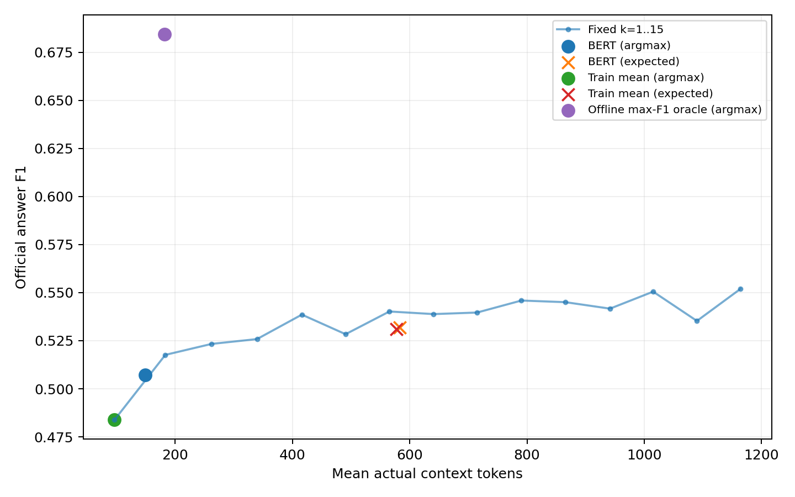
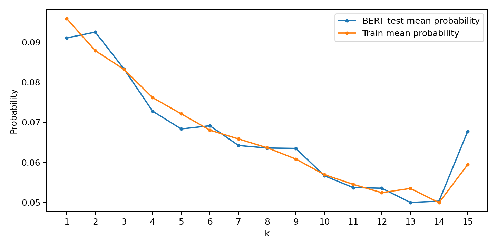

# HotpotQA Train5000: BERT 动态 Top-K 实验结果

完整构造 5000×15 曲线；Original Soft Label：Scheme D，ε=0.1，τ=0.5，λ=0.1，T=0.1。
成本仅为实际检索上下文的 Qwen tokenizer tokens，Evidence 为原有句子级保守 lower bound。两条越界支持句按用户确认记 unknown、保留原始分母。

训练设备：NVIDIA GeForce RTX 4090，UUID `GPU-39c44260-a26c-5152-103c-9e2bff35d4f9`。全参数 BERT，输入仅 question text。
训练 5 epoch；最佳 epoch=2，仅依据 Validation Soft CE 选择。
峰值模型分配显存：2544.5 MiB。

## 标签分布

| 数据 | valid | all_zero_f1 | empty_candidates | 平均熵（nats） |
|---|---:|---:|---:|---:|
| Train5000 | 3543 | 1137 | 320 | 2.1264 |
| 历史 Dev1000 | 752 | 181 | 67 | 2.1065 |

历史 Dev1000 为 bridge/comparison 各500，当前为自然抽样Train，两者分布差异不能视为受控比较。
数据划分及有效标签数量：`{"train": {"all": 3500, "valid": 2516}, "validation": {"all": 500, "valid": 344}, "test": {"all": 1000, "valid": 683}}`。无效标签维持原状态，不参加 Soft CE 训练；所有测试题均参加 Answer F1/成本评价。
异常计数（75000次输出）：`{"empty_answer": 1, "answer_extraction_fallback": 18, "api_usage_missing": 1144, "prompt_cropped": 0, "sentence_unknown": 101}`。

## 相同测试集的结果

| 方法 | Soft CE（有效标签） | KL（有效标签） | argmax F1 | argmax tokens | expected F1 | expected tokens |
|---|---:|---:|---:|---:|---:|---:|
| bert | 2.69390 | 0.53524 | 0.50712 | 148.8 | 0.53181 | 583.2 |
| train_mean_distribution | 2.69167 | 0.53301 | 0.48387 | 96.8 | 0.53094 | 577.2 |
| fixed_k_1 | ∞ | ∞ | 0.48387 | 96.8 | 0.48387 | 96.8 |
| fixed_k_2 | ∞ | ∞ | 0.51763 | 183.3 | 0.51763 | 183.3 |
| fixed_k_3 | ∞ | ∞ | 0.52333 | 262.2 | 0.52333 | 262.2 |
| fixed_k_4 | ∞ | ∞ | 0.52584 | 339.7 | 0.52584 | 339.7 |
| fixed_k_5 | ∞ | ∞ | 0.53856 | 416.2 | 0.53856 | 416.2 |
| fixed_k_6 | ∞ | ∞ | 0.52837 | 490.7 | 0.52837 | 490.7 |
| fixed_k_7 | ∞ | ∞ | 0.54019 | 565.5 | 0.54019 | 565.5 |
| fixed_k_8 | ∞ | ∞ | 0.53884 | 640.7 | 0.53884 | 640.7 |
| fixed_k_9 | ∞ | ∞ | 0.53964 | 715.0 | 0.53964 | 715.0 |
| fixed_k_10 | ∞ | ∞ | 0.54589 | 790.5 | 0.54589 | 790.5 |
| fixed_k_11 | ∞ | ∞ | 0.54503 | 865.7 | 0.54503 | 865.7 |
| fixed_k_12 | ∞ | ∞ | 0.54167 | 941.6 | 0.54167 | 941.6 |
| fixed_k_13 | ∞ | ∞ | 0.55050 | 1015.1 | 0.55050 | 1015.1 |
| fixed_k_14 | ∞ | ∞ | 0.53528 | 1089.8 | 0.53528 | 1089.8 |
| fixed_k_15 | ∞ | ∞ | 0.55197 | 1164.2 | 0.55197 | 1164.2 |
| offline_max_f1_oracle | ∞ | ∞ | 0.68437 | 182.0 | 0.68437 | 182.0 |

Fixed-k 的确定性分布与多数 Soft Label 支持集不兼容，因此精确 CE/KL 为无穷；JSON另列有明确标记的1e-12截断分数。
Validation 选择的 fixed-k 为 12；全部 fixed-k 测试结果仅作描述，不使用Test选参。

## BERT 与 Train Mean

BERT 的测试 Soft CE 未低于 Train Mean；差值 BERT−Mean=0.00223，paired bootstrap 95% CI=[-0.00075, 0.00486]。
确定性策略 F1 差值=0.02325；平均 tokens 差值=52.0。
F1与成本同时不劣于Mean：False。
BERT argmax 选中了 4 种 k，逐类预测概率平均标准差=0.004686。
打乱题目与BERT预测对应关系后平均CE=2.69659，原对应CE=2.69390；置换检验 p=0.03483。
只有预测变化与题目对应后改善损失，才能支持有效query-specific学习；仅概率变化或argmax变化不足以得出结论。
本实验仅单个固定划分和随机种子，bootstrap区间反映测试样本波动，不涵盖训练随机性。

## 固定决策分布后的动态收益

将BERT的argmax-k分布保持不变，只打乱题目与决策对应关系：平均F1=0.50383，tokens=148.3。
BERT原对应F1相对打乱的增量=0.00329，置换检验p=0.28856。这是训练后的描述性诊断，不参与模型或超参数选择。

## 结论

本次BERT没有在主要Soft CE/KL目标上优于训练集Mean Distribution。argmax F1上升同时增加了上下文成本，因此不能据此宣称整体优于Mean。
BERT的测试argmax-k计数：`{"1": 442, "2": 521, "3": 36, "4": 0, "5": 0, "6": 0, "7": 1, "8": 0, "9": 0, "10": 0, "11": 0, "12": 0, "13": 0, "14": 0, "15": 0}`。
训练损失继续下降，但第2轮后Validation Loss上升；按预先规则采用第2轮，不使用测试集重新选模型。
观察到少量query-dependent概率变化；部署决策的实际收益应结合上述固定决策分布的诊断判断，不能仅凭不同问题选出不同k作结论。
